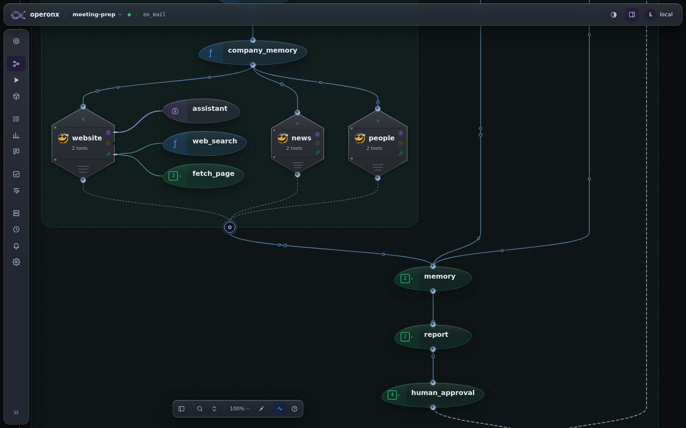
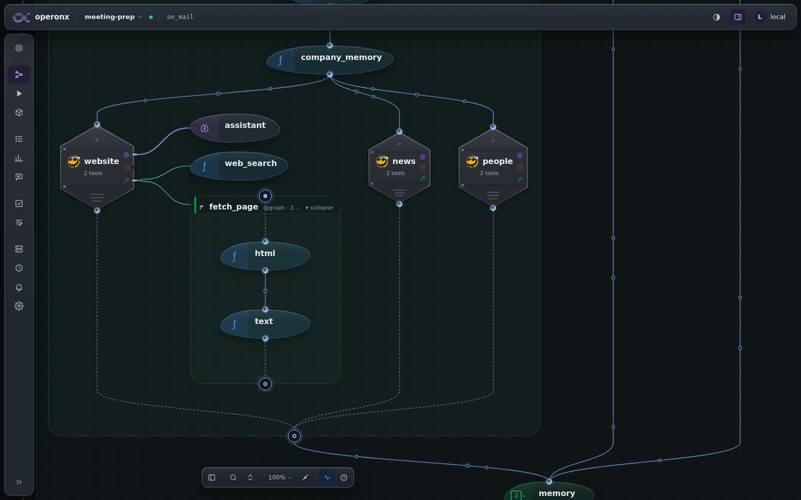
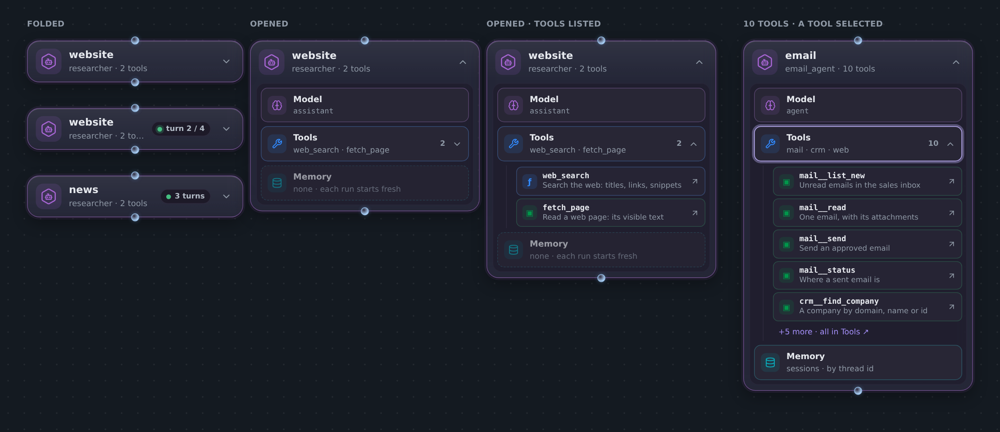
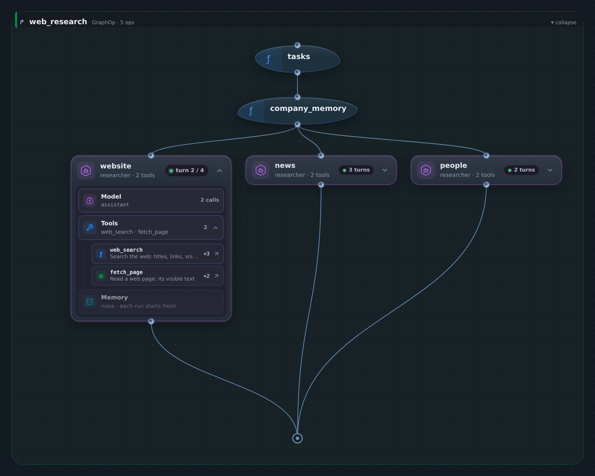
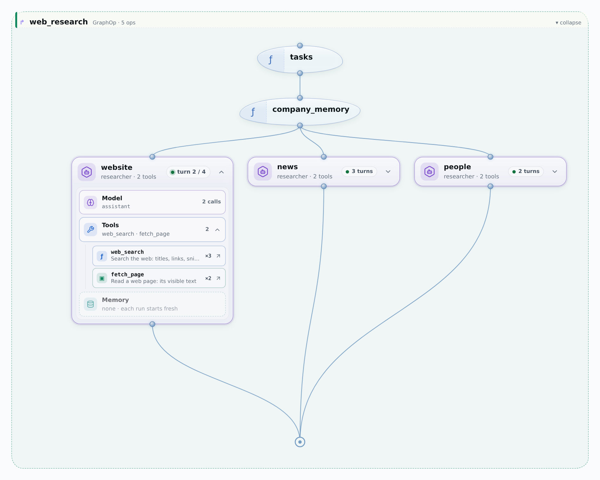
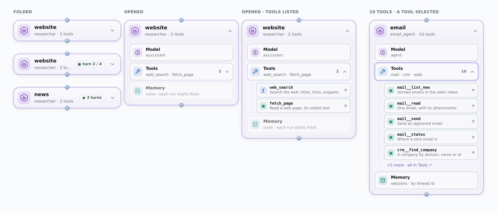
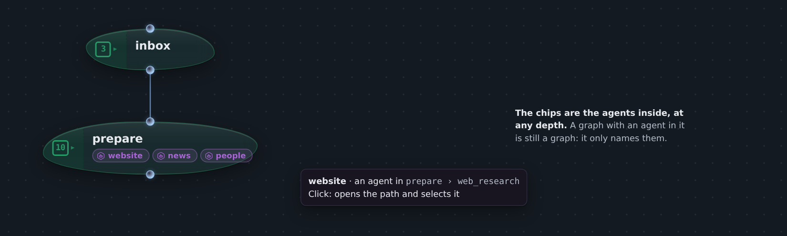
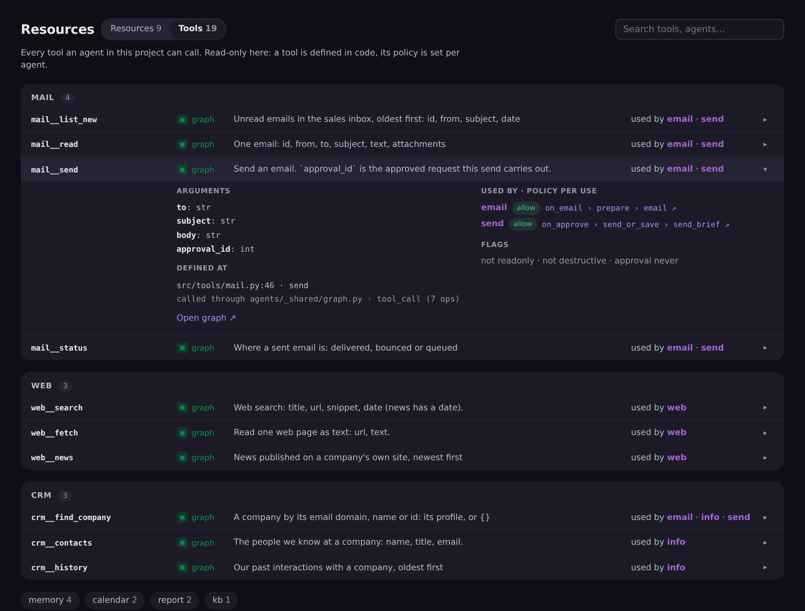
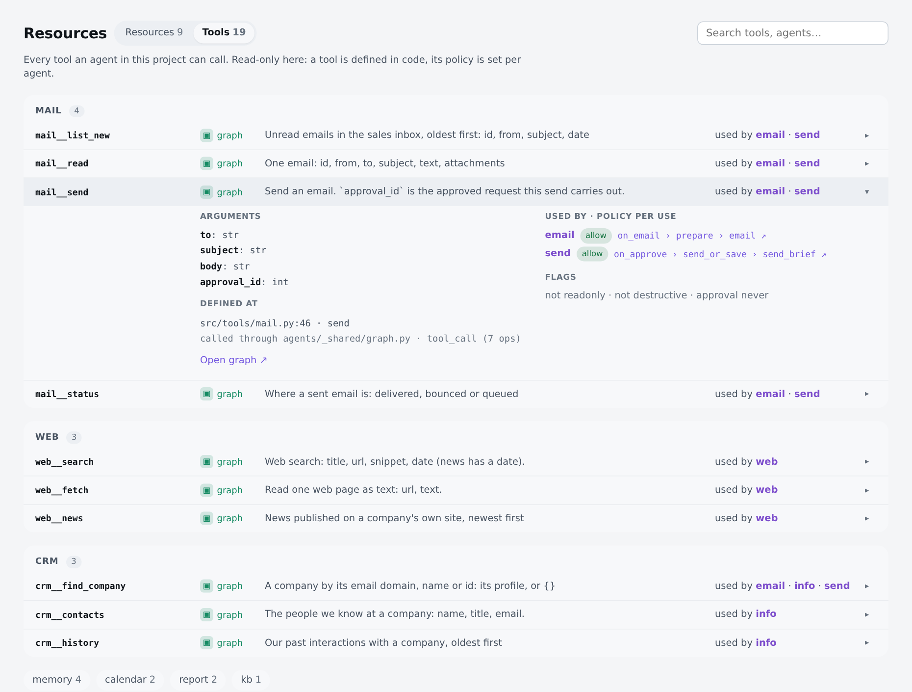

# One card per agent, one list of tools (AGENTOP_REDESIGN_PLAN)

Status: planned (2026-11-12). Nothing built yet.

Owner's brief:
1. Today's AgentOp is ugly.
2. Tools spill onto the canvas as ops, sometimes as whole graphs or other
   agents. That makes the agent hard to read.
3. Agents are buried inside graphs, so you only see them after opening
   every subgraph.

The new card's shape follows the owner's reference: a rounded glass card
with a header (icon, name, count, status, chevron) and rows inside.

The images are mocks drawn with the studio's own CSS, using the real tool
data of meeting-prep-brd. Their source is
[img/agentop/mock.html](img/agentop/mock.html).

## 1 · Today

| Opened agent: model and tools hang off the hex as ops | Opening a tool drops a whole graph onto the canvas |
|---|---|
|  |  |

Problems:
- A tool is drawn as an op, cabled to the hex. It looks like a flow step,
  but the agent decides when to call it.
- A graph tool or agent tool opens in place, inside the parent's container.
- The hex, sockets and cables add shapes the rest of the canvas doesn't use.
- An agent inside `prepare › web_research` can't be seen from the top of
  the flow.

## 2 · Decisions

- **No engine change.** operonx-agents keeps its tool kinds (function, op,
  graph, agent, mcp) and has no runtime registry: each agent owns its
  Toolset (tool.py). The studio only changes how this is drawn.
- **The agent is a card, not a container.** Its tools are rows inside it,
  not ops on the canvas. There are no wires between the rows, because the
  agent loop isn't a pipeline.
- **A graph stays a graph.** A folded graph names the agents inside it, at
  any depth, as chips. We don't give it an "agent look": any graph above an
  agent would qualify.
- **The tool register is a read-only catalogue**, a Tools tab on
  Resources. It is built from what the agents declare. It is not a runtime
  registry: policy stays per agent and is shown per use.
- Rejected:
  - AgentOp absorbing its pre/post ops. `tasks` and `company_memory` feed
    three agents, and that grouping is what GraphOp already does.
  - Restyling flow edges, glow, hinges, socket rims, decorated wires.

## 3 · The new card

- **Header:** a hexagon with a bot inside, the name, "agent · N tools", a
  status pill and a chevron. The pill reads "turn 2 / 4" while running and
  "3 turns" when done.
- **Model row:** the LLM config's name. In a run it also shows "N calls".
- **Tools row:** the count and the namespaces. It opens to one row per
  tool, with a glyph and colour by kind: ƒ function (`--k-func`), ▣ graph
  (`--k-graph`), agent (`--k-llm`), mcp plug (`--k-io`). In a run each row
  shows ×calls. Clicking ↗ opens the tool in its own tab, never in place.
- **Memory row:** the session store. When there is none it is dashed:
  "none · each run starts fresh".
- More than 6 tools show 5, then "+N more · all in Tools ↗".
- Flow ports stay top and bottom centre. Edges are unchanged.

**In its flow** (website opened and running, news and people folded):

Light

## 4 · Agent chips on a folded graph

A folded GraphOp lists the agents anywhere inside it. Clicking a chip opens
the path (`prepare › web_research`) and selects the agent.

## 5 · Tools catalogue (Resources › Tools)

- One row per tool: name, kind, description and the agents that use it.
  Rows are grouped by namespace (`mail__send` → mail).
- An opened row shows the arguments, where the tool is defined, each agent
  that uses it with that agent's policy and a link to its path, and the
  readonly, destructive and approval flags.
- Open by kind:
  - function or op: the code;
  - graph: its graph in a tab;
  - agent: its card;
  - mcp: the server and its tools.
- MCP tools are discovered at connect time, so the catalogue lists the
  tools from the last run, or shows "connect to list" if there is none.
- **Later, not in this plan:** adding a tool to an agent from the
  catalogue.

Light

## 6 · Phases

| # | What | Where |
|---|---|---|
| **A1** | The card. Opening an agent grows the card, not a parts column. Remove the hex, sockets and cables: `agentCard` → new card, `agentFrameEdge`, `socketSvg`, `agentSockets`, `drawAgentParts`, `partCablesFocus`, `agentBlock`, and their CSS (46 lines). Run view: the status pill and ×calls come from the run's steps. | canvas.js, flowlayout.js, studio.css |
| **A2** | Agent chips on folded graphs: the agents at any depth, from the IR. A click expands the path and selects the agent. | canvas.js, extract.py (the list of agents per graph) |
| **A3** | Tools catalogue: `GET /api/p/{pid}/tools`, built from every agent's `parts` (name, kind, description, flags, uses with policy and path) plus each tool's args schema. Adds a Resources / Tools switch. MCP tools come from the last run. | app.py, extract.py, resources.js |
| **A4** | Inspector: a selected tool row shows the "Tool of X" policy section (kept from today). `agentToolsLine` goes, since the card shows the tools. Clean up, then screenshots. | inspector.js |

**Kept (second job):** the IR's `parts` stay. `runpage.js:925` walks them
to address an agent's tool steps in a run, and A3 builds the catalogue from
them. Only the canvas drawing of parts is removed.

## 7 · Gates

- meeting-prep-operonx (`on_mail`):
  - website, news and people show as cards;
  - a card opens and folds;
  - ↗ opens fetch_page in its own tab;
  - `prepare` shows three chips, and a chip opens the path and selects the
    agent.
- meeting-prep-brd: email (10 tools) shows 5 + "+5 more"; Tools lists 19
  tools in 7 namespaces; `mail__send` shows two uses (email and send).
- A run shows "turn n / m" live and ×calls per tool.
- Light and dark screenshots match the mocks.
- tests/js and pytest are green, and nothing in the console.
