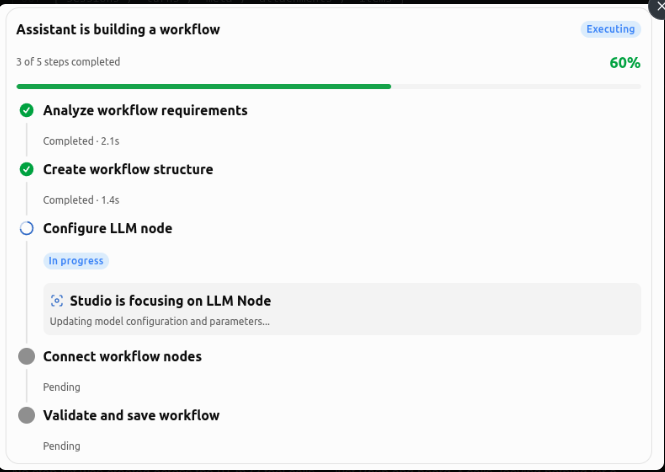

# The assistant works on screen: steps and focus (ASSISTANT_PROGRESS_PLAN)

Status: planned 2026-10-30, not started. Estimate ~4 h for P1–P7.

Owner's brief: "Task-Aware Interactive UI & Visual Execution Progress" — the
assistant is an operator working inside the studio, not a chat widget: the
screen shows what it touches, and a top-down list of steps shows what is
done, what runs now, what is left, and what needs the owner. The two stay
in step.

## Reference

The structure to match: a title with a state chip ("Executing"), "3 of 5
steps completed" with the percentage and a bar, then one block per step on
a vertical line. Done blocks: a check and "Completed · 2.1s". The active
block: a spinner, an "In progress" chip, and a focus box ("Studio is
focusing on LLM Node" / "Updating model configuration and parameters…").
Pending blocks: a grey dot and "Pending". The look is the studio's own
(its tokens, lavender accent, light and dark), not the picture's colours.

## What the owner saw (observed on m33, 2026-10-30)

A board question showed "Thinking… 13 s" and a folded "Used the studio 2×
· 3 steps" row. The hand did go to the board and ring F1, but nothing said
what the assistant was doing, what was done, or what was left. The
assistant never planned: in 91 tool calls over the m33 sessions there was
no step list (Claude Code's `-p` mode has no TodoWrite in 2.1.312), so the
page had nothing to draw a progress from. Inspector fields, board cards and
settings fields cannot be ringed: they carry no target names.

## Design

**D1 · `steps`, a studio tool.** The assistant posts its plan and every
change to it: `{title, steps: [{title, state, detail?, target?, result?,
error?}]}`, the whole list each time (as TodoWrite does). States:
`pending`, `active`, `done`, `failed`, `skipped`, `waiting` (needs the
owner). At most one `active`. `detail` says what the step does in words
("Updating model configuration and parameters"), never a bare label;
`result` is what a done step left ("F1 is in QA"); `error` why one failed.
The server checks the list, answers with one line ("step 3 of 5: …"), and
keeps it on the turn: it stamps each step's start and end the first time
it sees it active and then finished, so a block shows "Completed · 2.1 s".
It changes nothing, so every reach may use it (read-only too). The item
carries the list as data (`plan`), not clipped JSON text.

**D2 · knowledge.** Any task that acts starts with `steps`: the whole
plan, the first step active. Then one call when a step starts, ends,
fails, is skipped, or needs the owner — before the work, not after. A
step that works on a part of the screen names it as `target`. A plan that
changes on the way says so: new steps are added, dropped ones `skipped`.
The reply does not repeat the list.

**D3 · every task has steps (the fallback).** A turn that uses tools but
posts no `steps` still gets a card: the page groups its tool calls into
steps by what they did (read · ran · edited `file` · answered Q-3 · moved
F1), named in words, the running one active. A plain question answered
without tools has no card.

**D4 · the progress card** (the reference above). At the head of the
turn's reply, from the turn's latest `steps` item, held at the top of the
conversation while the turn runs:
- head: the title, a chip (Executing · Completed · Failed · Needs you ·
  Stopped), "3 of 5 steps completed", the percentage, the bar;
- a vertical timeline, one block per step: pending (grey dot, "Pending"),
  active (spinner, lit block, "In progress"), done (check, "Completed ·
  2.1 s" and its result), failed (cross, open by itself with the error),
  skipped (struck through, "Skipped"), waiting (amber, "Needs you" and
  what the owner must do, with a link to it);
- the active block's focus box: "Studio is focusing on <the hand's
  target, in words>" and the step's detail, with the tool call running
  now under it;
- each block opens to its detail, result, and the tool calls made while it
  was active (a tool belongs to the step active when it started);
- the `steps` calls themselves leave the activity list (they are the
  card); the card stays in the conversation after the turn and a reload
  rebuilds it from the items;
- the status line under the conversation says "Step 3 of 5 · Configure
  LLM node" instead of "Thinking…"; with the panel closed a small pill
  (the same words, the bar) keeps the progress on screen and opens the
  panel when clicked;
- a screen reader hears each step change (one polite live region).

**D5 · the screen follows the active step.** A step that becomes active
with a `target` sends the hand there (`Choreo.focus(before, after)`: the
screen to go to — the rail's icon pressed first — then the ring with the
step's words). The hand tells the page what it rings (`oxhandpoint`), so
the focus box names it. When the step ends, the hand rings what it left
(a moved card, a changed row, a saved field, the existing `changed` diff)
before the next step's target, so the resulting state is seen.

**D6 · finer targets: fields, cards, changes as they happen.** New target
names, so the hand reaches what is being configured, not just the page:
- `card:<id>` on the board, `field:<op>/<param>` in the inspector (an op's
  config and prompt fields), `setting:<section>/<name>` on settings pages;
- an edit to an op's file or config rings the op on the canvas, opens its
  inspector, and rings the field it changes; when the edit lands, the
  field shows the new value with a short highlight (old value struck
  beside it for a moment) — the change seen as it happens;
- `board_card` rings the card it reads, `board_act` the card it moves.

**D7 · motion, kept quiet.** One transition per change, ≈200 ms: the dot
fills, the bar grows, the next block lights, the field's highlight fades.
Nothing pulses on its own except the active spinner. Switching pages uses
the hand's existing glide. Reduced motion: states change without
transition. The user's own click still stops the hand for the turn
(hand.js D4); the card keeps updating, and "Follow it again" stays.

## What the owner can always tell

| Question | Where it is answered |
|---|---|
| What is it doing now? | the active block, its detail, and the status line |
| Which part of the studio? | the focus box, and the ring on screen |
| What is done? | checks with times and results; the count and the bar |
| What is left? | the pending blocks |
| Does it need me? | the amber chip on the card and the block, with the link |
| Did something fail? | the red block, opened, with the error |

## Phases

| | What | Est. |
|---|---|---|
| P1 | `steps` tool (mcp.py, read reach in chat.py); the turn keeps the plan and stamps step times; `plan` on the item; the status line's words; tests | 35 min |
| P2 | knowledge.md section (D2); one live turn checks the model plans unasked, before the work | 20 min |
| P3 | the progress card (assistant.js, studio.css + dark): head, timeline, focus box, open blocks, tools under steps, reload, the closed-panel pill | 70 min |
| P4 | the fallback (D3): steps grouped from tool calls when no plan was posted; node tests | 30 min |
| P5 | sync (D5): `Choreo.focus`, `oxhandpoint`, the end-of-step ring; node tests | 30 min |
| P6 | finer targets (D6): `card:`, `field:`, `setting:` names; inspector opens and rings the field; the field's change highlight; choreo for `board_card`/`board_act` and op edits | 45 min |
| P7 | live gate on the scratch studio: a Sonnet turn that plans and edits an op, shot at 1440 and 390 wide, mid-turn and done, light and dark, compared with the reference | 25 min |

## Gates

- node: `Choreo.focus` (a newly active step with a target → go + point;
  the same active step → nothing; no target → nothing; a step that ends →
  its result rung), the fallback grouping, `board_card` → `card:<id>`, an
  op config edit → `op:` then `field:`.
- python: `steps` validates (unknown state, two active, empty), answers
  with the active step, is in the read-only reach; the item carries
  `plan` with start/end stamps.
- live: the turn's card matches the reference's structure at each shot;
  the ring is on the active step's target when that step is active.

## Out of scope

The two layout faults seen on the same screens (the milestone island over
the first message; the reply running under the composer) get their own
fix.
