# Branch junction plan

Owner, 2026-11-13: "Redesign BranchOp — Inline Edge Routing Primitive". The decision card, with a title, a column per condition, books and bracket trees, becomes a small glass bar. Its outputs are ports inside the bar, one per condition, and each port's wire leaves straight from it. Nothing on the canvas spells out a condition. Space comes first.

## Audit (2026-11-13)

- **Card.** canvas.js `opCard` draws a router (`n.routes`) as `.node.branch.cols`. It has:
  - a name line with an icon and chips;
  - `.brlist`, one `.brrow` per route, holding condition books (CondTree), a bracket svg (`drawCondTrees`) and a `.brport` on the bottom edge;
  - hovering a row calls `routeTip` (condition → target) and lights its wire (`state.routePeek`);
  - clicking a row calls `pickRoute`, which selects the router and marks the row in the Inspector's decision table.
- **Layout.** FlowLayout reads `rows[]` from `sizeOf`. A row with `down: true` leaves at `cx` on the card's bottom edge, and each wire is routed from its row (`setPort`, `w.row`).
- **Wires.** A wire that leaves a row is drawn over the card from its dot (`overCard`, masked, with a hole at each `condDots` entry).
- **Width.** The width pass treats a `cols` card as one line, capped at 2000. The layout's guess is 260.
- **Dataflow.** On a double click, `dfPortsBlock` adds plugs. `inlineBranchPlugs` then moves each input plug into the first condition that names it.
- **Inspector.** `routeSection` is the decision table: condition, target, fired count and latest, with a row per route (`data-route`). It is read-only. Conditions are authored in code; the studio has no condition editor or route-editing API.
- **Run.** The route the run took last is `took`, an LED under its stem. Wires into ops that did not run fade (`dorm`).

## Design

- **The rail** (owner, rounds 2–6). `.node.branch.junction` is a thin bar, 23 px high, liquid glass (the ops' `--og-*` clear glass with a lavender tint), with no icon, badge, count or toggle. The router's name is a small rounded sign (`.jnname`) across the bar's top edge, centred, like a signboard. The incoming wire lands in it, and it replaces the input dot. The card is as wide as the wider of its sign and its anchors.
- **Anchors.** There is one solid 6 px dot per route, in route order, along the bar's lower half, 16 px apart: 5 routes give 88 px and 10 give 168 px.
  - The dots are svg circles drawn on each route wire's first point (canvas.js `anchorDot`), so a wire always leaves from the exact centre.
  - CSS dots were pixel-snapped, each one differently, and looked uneven: the owner saw different sizes, heights and off-centre wires.
  - The `.jnport` button underneath is only the pointer target.
  - Each anchor is a socket: a lit core, a pale rim and a soft drop-shadow glow. No `brightness()` is chained before the shadow, since that cut the glow square.
  - The global `button:hover` outranks the slot's `all: unset`, so `.jnport:hover` clears it again (it painted a grey slot behind the hovered anchor).
  - The else anchor is hollow. A lit wire (hover, pick or selection) enlarges its anchor, and the route a run took glows.
- **Edge colour is the identity** (owner, round 2). Route wires and the wire into the router are lavender, and the else wire is the same lavender, dashed, with a hollow anchor (round 4, the owner's choice after amber looked out of place). Dark uses `#A78BFA`. Light uses `#8B6CF0`, because `#A78BFA` is only 2.3:1 on the light backdrop. Ordinary wires keep Arctic Blue. A routing wire is a lit 1 px core (`--rt-wire-lit`) over a soft blurred halo (round 7: the owner found the plain hairlines dull), with no sparks or flow dots.
  - The halo is not copied over the card: blurred under or over the glass it smeared into bands.
  - Hover or selection makes a wire a little brighter and wider.
  - On a run's path, a wire is wider with a restrained glow, and the taken anchor is lit.
  - Off the run's path, a wire fades (`dorm`) but keeps its colour.
- **Geometry.** Each anchor is a layout row with `down: true`, `cx` at the slot's centre and a new `cy` at the anchor's centre. FlowLayout starts the wire at `A.y + cy` when `cy` is set (otherwise at the bottom edge, as before). The over-card mask draws the wire from the anchor out through the rail. The over-card copy takes no pointer, so the anchor under it does.
- **Interaction.** Hovering an anchor shows the route tip and lights the wire. The tip is frosted glass with a lavender rim: the route's socket, its condition, an arrow and the target as a chip. It stands just right of the rail, level with it (left when the right side has no room), not at the pointer. A transparent hit path on each route wire does the same from the wire. Clicking an anchor calls `pickRoute`, which selects the router and opens the Inspector with that row picked.
- **Dataflow (double click).** The plugs block sits above the bar, inside the same glass. Input plugs are wired as on any op. The card grows to fit them while open and returns to a bar when closed.
- **Removed.** The decision-card branch of `opCard`, `drawCondTrees`, `inlineBranchPlugs`, condtree.js, and the `.cols`, book, bracket and inline-chip CSS.
- **Unchanged.**
  - Route order and identity: `e.route` is still the route index, so wires keep their port.
  - Evaluation, serialization, the layout's side-row code, and the Inspector table.

## Out of scope

There is no condition editor (add, edit, remove) in the Inspector today: conditions are code. Building one means writing Python from the UI. That is a separate plan if the owner wants it.

## Gate

- Screenshots of the real flow (2 routes) and of fixtures with 5 and 10 routes, in dark and light, plus hover, pick, run-taken and double-click dataflow states.
- Wires stay on their ports after zoom and after expanding or collapsing a neighbour.
- No card overlaps the bar. The JS tests pass, and test_theme and test_minify pass.

## Outcome (2026-11-13)

Built as one change, after seven rounds with the owner on the look.

- Rails measure 71 × 23 px (2 routes, the real `on_email` flow), 88 × 23 px (5) and 168 × 23 px (10). The 5- and 10-route cards are fixtures that only add routes to the same router.
- Every screenshot loaded with no page errors. The wires leave from the centre of their anchors after zoom (the `-zoom` shots).
- The JS tests pass (188; the condtree tests went with condtree.js). test_theme and test_minify pass (24).
- Not shot: the run-taken state, because the test flow has no run. Its CSS (`took`, `dorm`, `.ran`) is unchanged in kind from the decision card.

All 30 screenshots are in docs/img/junction/ (`n{2,5,10}-{dark,light}[-hover|-pick|-data|-zoom]`). A representative set:

| | dark | light |
|---|---|---|
| 2 routes | 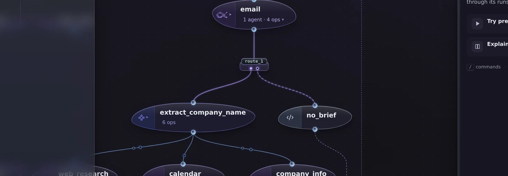 | 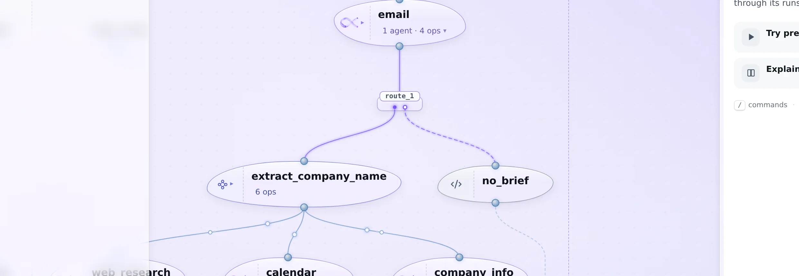 |
| 5 routes, hover | 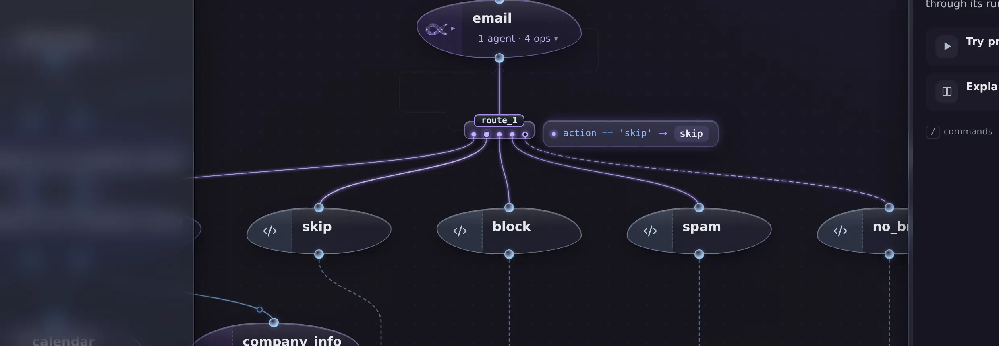 | 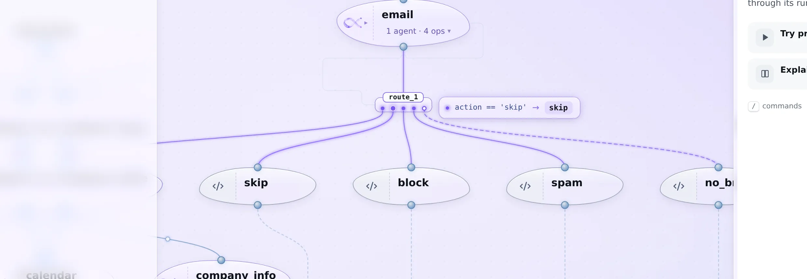 |
| 10 routes | 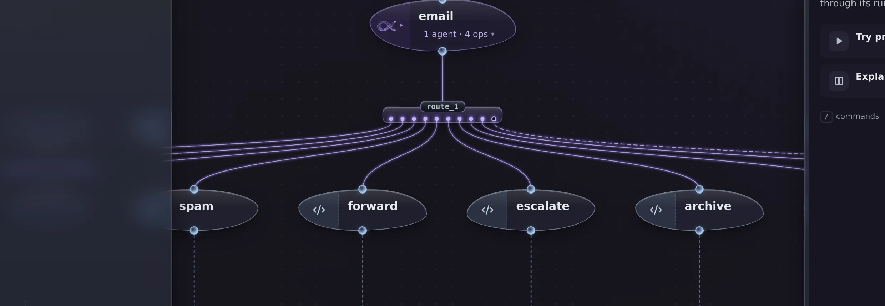 | 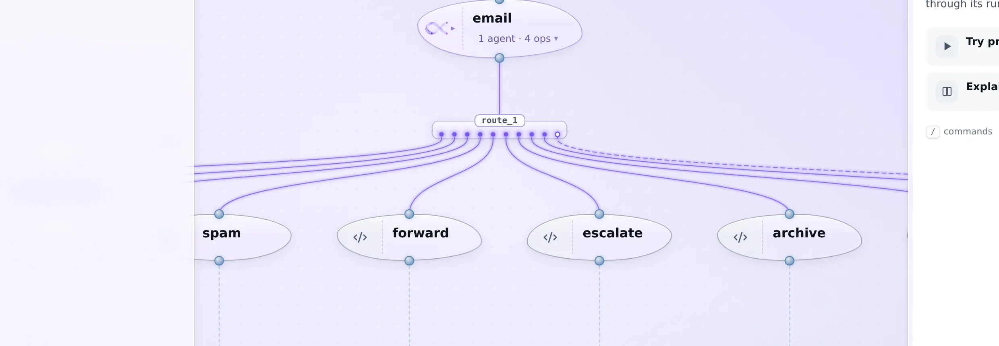 |
| 10 routes, picked | 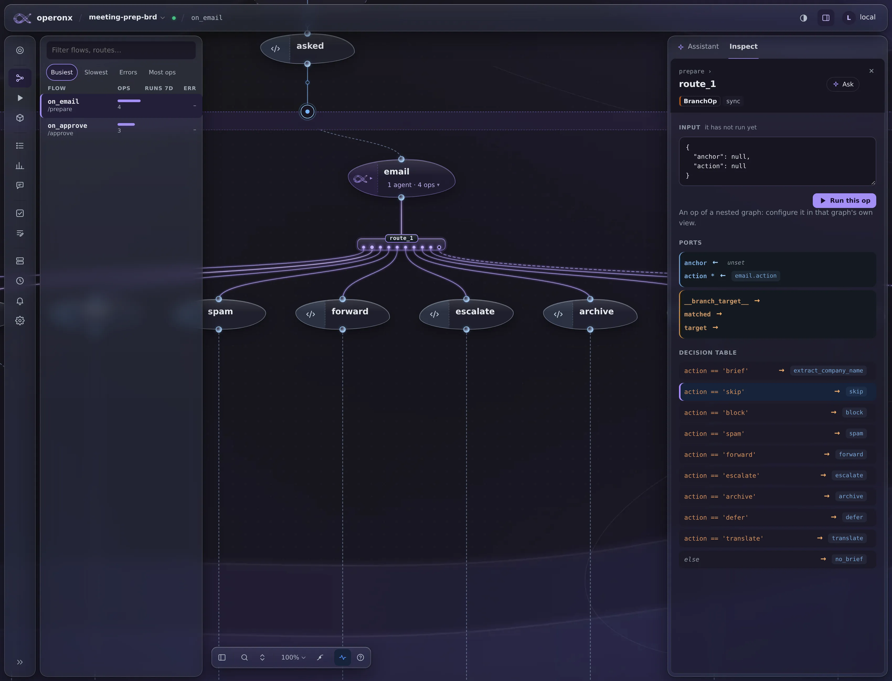 | 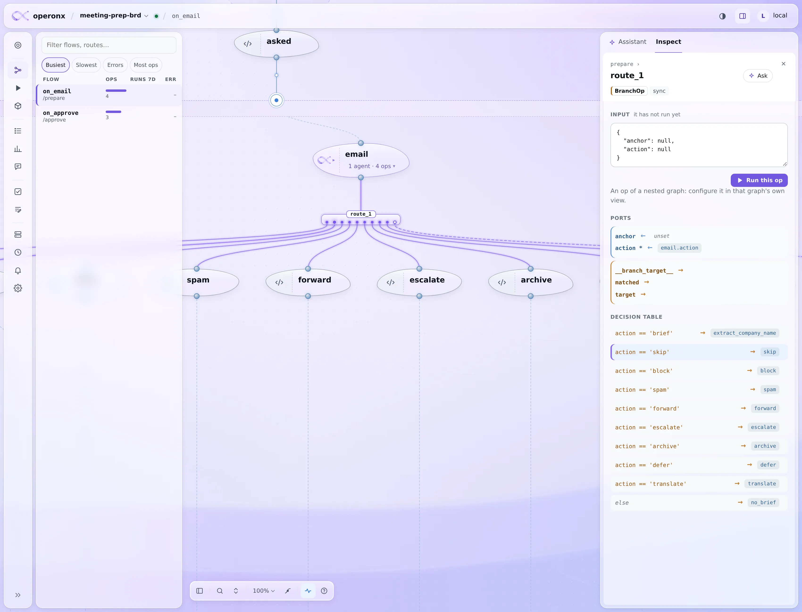 |
| Dataflow (double click) | 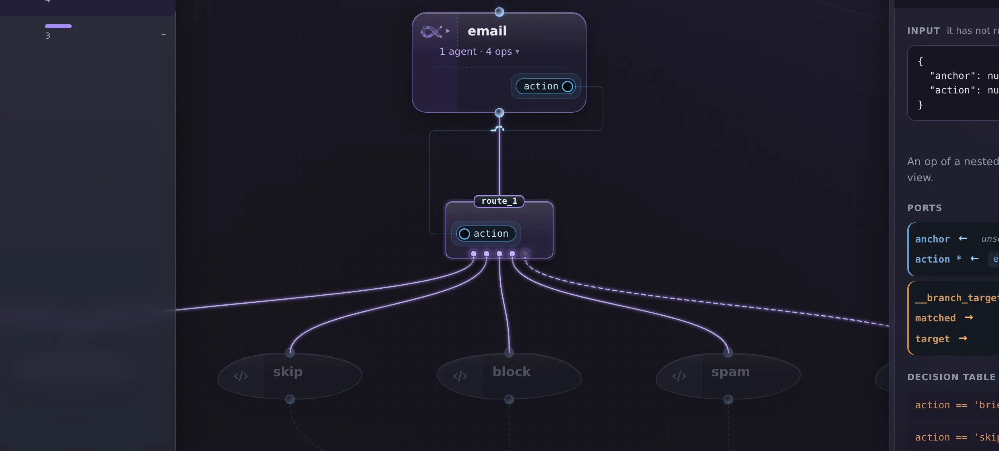 | 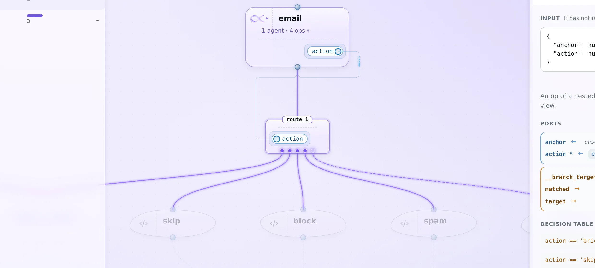 |
| Zoomed in | 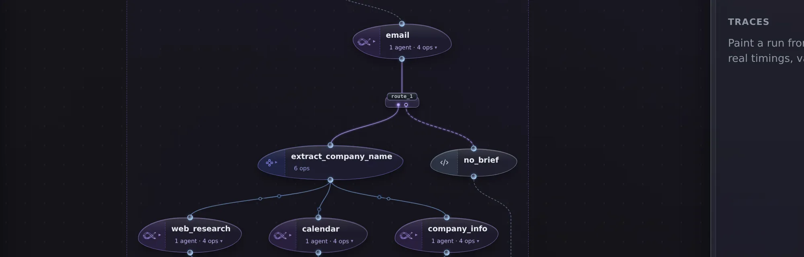 | 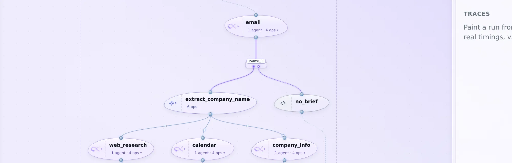 |
