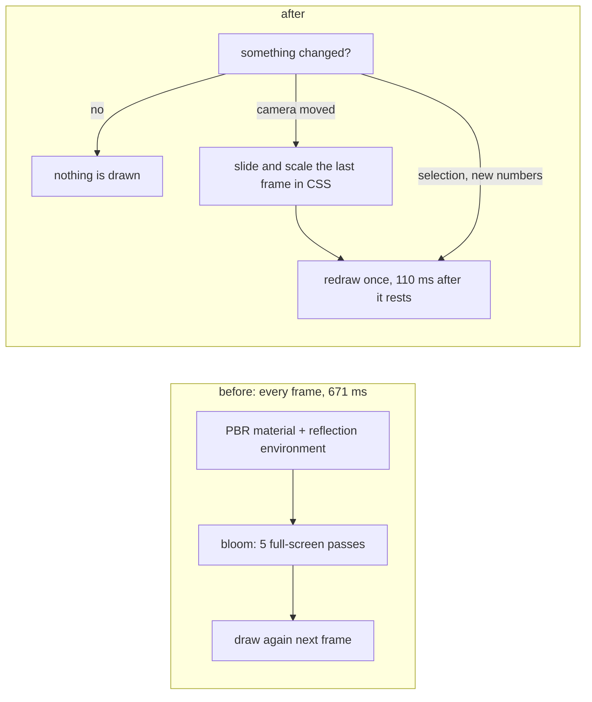

# The Factory picture on a machine with no GPU

The owner's machines have no GPU (2026-11-15), so the browser draws WebGL on the CPU. The picture as
F3–F7 built it drew **1.5 frames a second** there. It now holds **60**, with the same look.

## Result

Headless Chromium, software compositor, WebGL on SwiftShader, 1680×1000, a shared 24-core box.

| | mr-finance (14 flows) | 1,199 flows | 2,999 flows |
|---|---|---|---|
| before: a frame, drawn every frame | 671 ms | | |
| after: at rest | 17 ms | 17 ms | 17 ms |
| after: while dragged | 16 ms | 17 ms | 15 ms |
| after: while zoomed | 17 ms | 18 ms | 17 ms |
| after: one redraw, whole project in view | 40 ms | 50 ms | 85 ms |
| before: the same redraw, new materials only | 155 ms | 500 ms | 700 ms |

Frame times are the median gap between animation frames; 17 ms is the 60 Hz ceiling. The picture was
compared with the accepted screenshots (far and close) and is the same; F4–F7's checks pass unchanged.

Not measured: a real machine of the owner's. The rig is the nearest thing to it on this server.

## What a frame cost, and what was done



| what cost | measured | what replaced it |
|---|---|---|
| drawing every frame, for the lights on the cables | all of it, always | a frame is drawn only on a change; the lights are elements moved along the cables' paths by a CSS animation |
| instanced drawing | 8.6 µs a triangle, against 1 µs for plain geometry: 167 ms of a 408 ms frame for the parts alone | no `InstancedMesh`: every copy is written out into one buffer (`Copies`, `Batch.write`) |
| faces the fixed camera never sees | 58 triangles a part | 28; and 6 (a plain box) when a chamfer is under a pixel |
| antialiasing | 65 ms of 155 | none on a software renderer, and one pixel per pixel |
| per-pixel lighting, the environment, bloom | the rest | a face's shade is a constant (the camera never turns), worked out once and carried by its vertices |
| the studio's blurred glass over a moving picture | 69 ms a frame while dragged, 17 without | on a software renderer the glass over the picture is not blurred, and takes the studio's unblurred tint |
| blur behind the picture's own names and card | 19 frames a second at rest, 60 without | none; their backgrounds are a little more opaque |

Tried and dropped: a Canvas-2D renderer. 6,000 gradient-filled quads take about 180 ms on the same
box, which is slower than the 40 ms the WebGL path now needs for mr-finance. Rust or WebAssembly would
not have helped either: the time was in the browser's rasteriser, not in the studio's JavaScript
(building the picture is 0.3–0.6 s once; a selection is 4–65 ms).

On a machine with a GPU nothing above is switched off except the per-frame loop: antialiasing, the
dense-screen pixel ratio and the studio's blurred glass stay.

## Also

- A **Project picture** button in the canvas bar, beside the flows-panel button, so the picture does not
  depend on the flows rail being open.
- The wheel zooms with the pointer over a name too.

## Code

```text
operonx_studio/static/
  factory3d.js   materials with baked shade; Copies and Batch.write (no instancing); draw() on demand,
                 the last frame slid by CSS; the cable lights as elements; SOFT (a software renderer)
  factory.css    .fx-sparks; no blur over the picture on a software renderer
  factory.js     the canvas-bar button
  project.html   #btn-factory
  vendor/three/  addons/ removed (the post-processing passes): three.module.min.js only
```

## Open

If a browser gives no WebGL at all (not even on the CPU), the picture still shows its "needs WebGL"
note. That case has no renderer yet.
