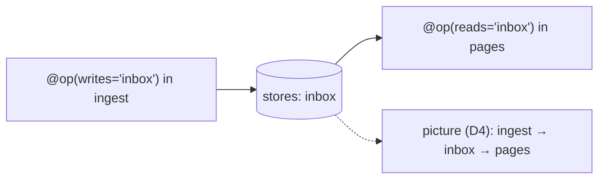

# What the project's IR now says for the picture (PROJECT_DECLARATIONS_PLAN D2)

The plan is in the engine's repository (`Operon/docs/PROJECT_DECLARATIONS_PLAN.md`). The owner's review of
the Factory picture (2026-11-19): a person cannot tell from it what each flow is for, or how flows work
together. Two facts were missing from the IR; the extractor now carries both.

| | before | after |
|---|---|---|
| what a flow is for | not in the IR | `graph.description`: the first paragraph of the `@graph` function's docstring |
| which store an op touches | not recorded anywhere | `node.reads`, `node.writes`: the names from `@op(reads=, writes=)` (operonx ≥ 1.39) |
| the project's stores | | `ir.stores`: `[{name, description, readers: [{graph, op}], writers: [...]}]`, described from `[stores.<name>] description` in `operonx.toml` |



A store an op names and `operonx.toml` does not describe is listed under its name alone. A store described
and used by no op is listed with no readers or writers. A project that declares none has `stores: []`.

Nothing is drawn from these yet: the picture's part is D4.

## Code

```text
operonx_studio_toolkit/extract.py   _node: reads, writes · extract_graph: description · extract_stores · extract_project: stores
operonx_studio/app.py               the served IR passes description, reads, writes and stores through
tests/project/test_extract.py       2 tests
```
