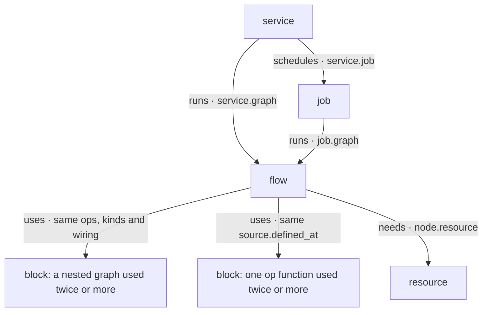

# The factory model (SPATIAL_FACTORY_PLAN F2)

2026-11-15. Plan: [SPATIAL_FACTORY_PLAN.md](SPATIAL_FACTORY_PLAN.md).

**Result.** `static/factorymodel.js` turns the IR the studio already serves into a project's
architecture: doors, flows, blocks, resources, and the links between them. It is pure data → data and
is not loaded by any page yet; F3 draws from it.

**Code.** `operonx_studio/static/factorymodel.js` (new), `tests/js/factorymodel.test.mjs` (new, 14
tests; the suite is 212). No `.py` changed.

## What it derives, and from what

| rule | detail |
|---|---|
| a nested graph is one block | when two nested graphs hold the same op functions (`source.defined_at`), kinds and wiring. Their names may differ: `held_feed`, `held_search` → `held_*` |
| an op is one block | when two ops are defined at the same file and line. The same name alone is not enough |
| not a block | an op from an installed package (the framework's own `src`, `out`); anything inside a kept block, which the block already shows |
| shared | a block used by more than one flow. Used twice inside one flow is a block, not a shared one |
| unresolved | a door whose graph is not among the project's graphs; it keeps the name it asked for |
| domain | the module a service names for the flow, else the folder the flow is wired in |
| resource | by its key, its name, or an instance name through `resources.details` |

Queries: `into(id)`, `outOf(id)`, `upstream(id)`, `downstream(id)`, `domainOf(id)`, and
`pairs(model, groupOf)`, which adds every link between two boxes into one counted line.

## Checked on real projects

Each project's IR as the studio serves it. mr-finance was read from a copy of the repository.

| project | flows | services | jobs | blocks (shared) | domains | unresolved doors |
|---|---|---|---|---|---|---|
| mr-finance | 14 | 90 | 24 | 8 (4) | 13 | 13 jobs, all asking for `market_flow` |
| runline-lab | 13 | 0 | 13 | 14 (14) | 1 | 0 |
| callbot | 2 | 3 | 2 | 0 | 2 | 2 jobs (`check_case`, `backfill_log`) |
| meeting-prep-brd | 2 | 2 | 1 | 2 (2) | 1 | 1 job (`golden_case`) |
| generated, 1,199 flows | 1,199 | 180 | 320 | 10 (10) | 14 | 0 |

mr-finance, layer to layer:

| from → to | lines | what they are |
|---|---|---|
| doors → flows | 78 | 67 services and 11 jobs each run a flow |
| doors → doors | 22 | each schedule service runs a job |
| flows → blocks | 14 lines, 30 uses | `held_*` (9 ops) is used 11 times by 4 flows: pages, news, scenarios, allocation |
| flows → resources | 3 | `llm:assistant`, `llm:onprem`, `http:stt`, one flow each |

40 of mr-finance's doors lead, through a flow, to the one `held_*` block. That is the connection the
earlier pictures could not show.

Time to build the model: 12 ms for mr-finance, 122 ms for the 1,199-flow project.

## Limits

- Block identity is structural. Two nested graphs that are the same graph in the code but were given
  one different op would be two blocks; one named graph identity needs B1.
- A project whose IR carries no `source.defined_at` gets no op blocks, and nested graphs are matched
  by op names.
