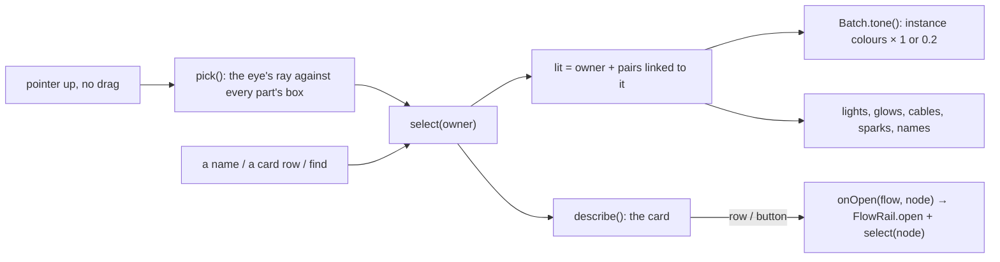

# Factory navigation (SPATIAL_FACTORY_PLAN F4)

**Result.** On the project picture a click answers "what does this connect to", and any flow is two
actions away: select it, open it.

| action | what happens |
|---|---|
| click a cluster, a core item or a name | it and what it links to stay lit; everything else drops to a fifth of its tone, its lights and cables go dark; a card opens |
| the card, on a flow | its doors (services and jobs), the shared blocks it uses and the resources it needs, with counts; **Open in the editor** |
| the card, on a domain (projects past 30 flows) | its flows, failing and busiest first; a row opens that flow |
| the card, on a shared block | every use: the flow and the name it has there; a row opens the flow with that op selected |
| the card, on a resource | the flows that need it; a row opens the flow |
| a row naming a block or resource | selects it |
| double click a flow | opens it |
| `/`, then a name | finds a flow, service, job, shared block or resource; selects its cluster or core item and centres it |
| Esc, or a click on nothing | clears |

Example, on mr-finance: click `pages_flow` → the card shows 9 services, 4 shared blocks (`held_*` ×6)
and its cables stay lit → click `held_*` → 11 uses in 4 flows, those four clusters lit → click
`pages_flow as held_overview` → the editor opens `pages_flow` with `held_overview` selected.

## How



- Everything drawn carries an **owner**: the cluster or core item it was built for. Picking, quieting
  and the card all read that one field; nothing is looked up by position or name.
- Picking does not use three.js raycasting (the parts' shape is computed in the vertex shader, which a
  raycast cannot see): it tests the camera ray against the same boxes the camera fit uses.
- Quieting rewrites instance colours only; no geometry, material or draw call is added by a selection.
- The links are `FactoryModel.pairs` (cluster → core item), the same ones the cables are drawn from.

## Code

```text
operonx_studio/static/
  factory3d.js   owner tagging; pick(), select(), describe(), reveal(); the find box; Esc and /
  factory.js     onOpen(flow, node): open the flow, then select the op that uses the block
  factory.css    the card, the find box, quiet and picked names
```

No `.py` file changed.

## Not in F4

- In a project past 30 flows a single flow cannot be selected on the picture, only its domain; its
  flows are in the card and in find.
- A service or a job is found by name but selects the flow (or the unresolved group) it leads to.
- Keyboard reach of the parts themselves (Tab through clusters) is F7.
