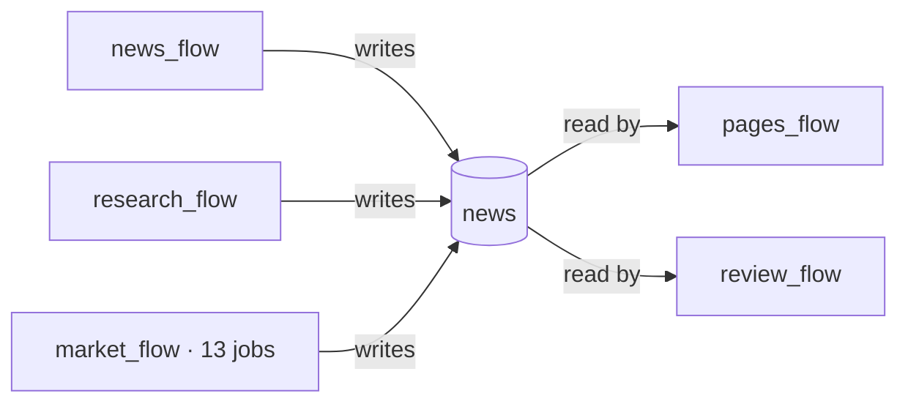

# The Factory tab: stores, data lines and the info panel

Operon `docs/PROJECT_DECLARATIONS_PLAN.md` D4. The picture answered "what is in this project"; it did not
answer "how do the flows work together" or "what is the thing in the middle". Three changes.

| | Before | After |
|---|---|---|
| Where it is | a button in the Flow canvas bar | **Factory**, the first tab of the Flow section; a project opens on it (it remembers if you left it on the editor) |
| The middle | "Core" | "Shared — what the flows have in common": shared blocks, resources, and now **stores** |
| How flows cooperate | not shown | a store is a part in the middle; each flow that reads or writes one has an amber line to it, and the light on the line runs the way the data goes |
| The card | name, counts, lists | what it is (its own description), who it gets data from, who it passes data to, what it reads and writes, how work comes in, what it is built from |

That is the `news` store of mr-finance as its card lists it: written by, read by, with the ops that do it.

## The card, by kind

- **Flow**: purpose (first paragraph of the `@graph` docstring) → *Gets data from* / *Passes data to* (the
  flows and jobs on the other side of its stores, with the store names) → *Reads* / *Writes* → *Comes in
  through* (services and jobs, each with its description) → shared blocks → resources.
- **Store**: its `[stores.<name>] description` → *Written by* / *Read by*, each row with the ops.
- **Shared block**: the op's description → the flows that use it.
- **Resource**: what a resource is → the flows that need it.

## Code

- `operonx_studio_toolkit/extract.py`: `_job_nodes` — a job whose graph is in no service is walked too, so a
  job that seeds a store is its writer; jobs that run one graph are one entry, named after the graph.
- `static/factorymodel.js`: `stores` (`t:<name>`), `writes`/`reads` links, descriptions on flows, doors and blocks.
- `static/factory3d.js`: the store part, the `data` strand, the card (`describe`).
- `static/factory.js`, `project.html`, `factory.css`: the Factory tab; the one warm colour (`--fx-sig-store`).

## Not done

- A line cannot be clicked: what moves along it is said in the card of either end.
- A store used only by jobs is not drawn (it is in the IR).
