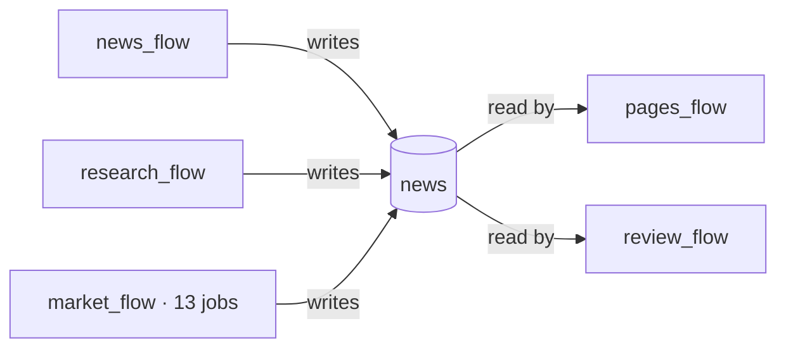

# The Factory tab: stores, data lines and the info panel

Operon `docs/PROJECT_DECLARATIONS_PLAN.md` D4. The picture answered "what is in this project"; it did not
answer "how do the flows work together" or "what is the thing in the middle". Three changes.

| | Before | After |
|---|---|---|
| Where it is | a button in the Flow canvas bar | **Factory**, the first tab of the Flow section; a project opens on it (it remembers if you left it on the editor) |
| The middle | "Core" | "Shared — what the flows have in common": shared blocks, resources, and now **stores** |
| How flows cooperate | not shown | a store is a part in the middle; each flow that reads or writes one has an amber line to it, and the light on the line runs the way the data goes |
| The card | name, counts, lists | what it is (its own description), who it gets data from, who it passes data to, what it reads and writes, how work comes in, what it is built from |

That is the `news` store of mr-finance as its card lists it: written by, read by, with the ops that do it.

## The card, by kind

- **Flow**: purpose (first paragraph of the `@graph` docstring) → *Gets data from* / *Passes data to* (the
  flows and jobs on the other side of its stores, with the store names) → *Reads* / *Writes* → *Comes in
  through* (services and jobs, each with its description) → shared blocks → resources.
- **Store**: its `[stores.<name>] description` → *Written by* / *Read by*, each row with the ops.
- **Shared block**: the op's description → the flows that use it.
- **Resource**: what a resource is → the flows that need it.

## Code

- `operonx_studio_toolkit/extract.py`: `_job_nodes` — a job whose graph is in no service is walked too, so a
  job that seeds a store is its writer; jobs that run one graph are one entry, named after the graph.
- `static/factorymodel.js`: `stores` (`t:<name>`), `writes`/`reads` links, descriptions on flows, doors and blocks.
- `static/factory3d.js`: the store part, the `data` strand, the card (`describe`).
- `static/factory.js`, `project.html`, `factory.css`: the Factory tab; the one warm colour (`--fx-sig-store`).

## Where the card is, and lines

- The card is the side panel's **Inspect** tab (`#fx-inspect`, beside the op inspector), not a box over the
  picture: a selection opens the panel the way a click on an op does, Esc lets it go, and the assistant is the
  tab next to it. What was picked slides out from under the panel.
- A **line can be clicked** (`pickLine`): its card says what kind of connection it is and lists what is at its
  far end — for a data line, the stores written and read, with the ops that do it.
- A store that only jobs use stands in the middle too, without a line; its card lists the jobs.

## Clear glass (Flow section)

The owner's reference: glass you can see through, drawn by its edge. On the Flow section (the picture and the
editor) the studio's panes change from frosted to clear — `factory.css`, last block:

| | frosted (before) | clear (now) |
|---|---|---|
| tint | nearly opaque | 20–34% dark; 50% where nothing is blurred (no GPU), 66% for the side panel's running text |
| blur | 6 / 10 / 24 px | 2 / 5 / 8 px |
| edge | one rim line | bright upper rim, hairline all round, a fainter line below, a slanting sheen |

A name on the picture that falls under the side panel steps back, so it does not read through the text.
Not done: the bending of what is behind the glass (refraction). In a browser that is an SVG displacement filter
on the backdrop — Chromium only, and redone on the CPU for every frame on a machine with no GPU.

**A little blur, at rest only.** With no blur at all the picture under a pane competes with its text. On a machine with no
GPU a blurred pane costs nothing while what is behind it stands still, so: `fx-rest` (factory3d.js, 320 ms after the last
move) turns on `blur(1.5px)` for the rail, the flows list and the side panel; any move turns it off; the sparks are clipped
out from under the panes, so nothing behind them changes at rest. Measured on the software renderer: 60 frames a second at
rest with and without it. Names under the flows list step back like those under the side panel.

**Every page.** The clear-glass tokens moved from `factory.css` (Flow section only) to the last block of
`studio-dark.css`, on `body`: the bar, the rail, the side panel, the page panes, the home page's cards. Menus keep more
tint (40%) because they open over running text. `factory.css` keeps only what belongs to the picture (the unblurred tint,
the blur at rest, the names). On the other pages the change is mostly the lit edge: their backdrop
(`canvas-bg-dark.webp`) is nearly flat, and clear glass shows only what is behind it.

**The backdrop.** Clear glass shows only what is behind it, and `canvas-bg-dark.webp` was made quiet on purpose (a graph
runs over it). So the pages get their own: `backdrop-dark.webp` — the operonx glyph large and lit in the lower right,
the lavender glows about doubled, the centre still calm (`docs/img/canvas/backdrop.html?m=dark&g=lit`, 2560×1440, 45 KB).
The flow canvas keeps the quiet one; the Factory picture has its own ground.

**What was still solid.** The ask bar (its own rule outranked the glass list), the home page's composer, starter
buttons and project buttons (they lie straight on the backdrop, in no pane), the flows find box, and the chosen row
(`--accent-soft` was an opaque `#231e38`; on glass it is lavender at 17%). All in the last block of `studio-dark.css`.

**The backdrop, second version (the owner's): the cosmos.** `backdrop-dark.webp` is now deep space with one figure in it:
a DNA double helix as the backbone; an arch springing from it and returning to it; five junctions evenly spaced on the
arch, operonx-glyph constellations seated at them; three ribs falling from the arch onto three lit points of the backbone
(the middle one runs on through it to a node below); a faint inner arc and a faint keel. Lines pass behind what they
join: the network is drawn on its own sheet, cut away along the strands and over each constellation's footprint, and
laid down first. Drawn by `docs/img/canvas/cosmos.html` (canvas 2D, seeded; open it and save the canvas as WebP,
2560×1440, 264 KB). On the home page the arch's crown and middle rib run behind the centre column.

## Backdrop polish (after the owner's look at the live pages)

- **The three spheres are gone.** Under glass they were dim discs nobody could name. `cosmos.html` no longer draws them.
- **A page of text is darker.** `--glass-page` went from a .30 to a .50 tint, then to .68 (#229): at .50 the backdrop's bright nodes still sat behind the words in the lower right of a page (the Prompts samples). Bars and panels keep the clear glass.
- **Home has a shade down the middle.** The arch and the backbone cross exactly where the column of text is. Moving the figure right was tried and was worse (a constellation landed behind the title), so the figure stays and `body.page` gets a soft dark band behind the column, clear at the sides.
- **The Factory keeps its own ground.** A sheet of fog over the cosmos was tried (#223) and taken out again: with little blur the backdrop's fine lines fought the cables, with more it was a smear. The picture is busy enough to want a plain ground.

## No GPU: the glass is drawn beforehand

The owner found every page slow to come up. Server and network were not it (a project opens in 1.7 s on the box, static files under 1 s through the tunnel). Drawing was: on a software renderer a live blur (`backdrop-filter`) is recomputed every frame.

| page | live blur | blur off | baked (now) |
|---|---|---|---|
| home | 19 fps | 61 | 60 |
| Services | 10 | 61 | 60 |
| Flow canvas | 29 | 56 | 56 |
| Factory | 50 | 60 | 53 |

The fixed backdrop and the shadows cost nothing. So where there is no GPU — `data-gpu="soft"` on `<html>`, asked of WebGL once by the head script and kept in `localStorage["ox:gpu"]` — nothing is blurred live. Pages of text, the bar and the rail lie on `backdrop-dark-soft.webp`, a 12 KB copy of the backdrop blurred once (`fixed`, so it lines up with the backdrop behind): the same look, only loaded. Menus are nearly solid. With a GPU nothing changes. To re-ask after a hardware change: remove `ox:gpu` from localStorage.
