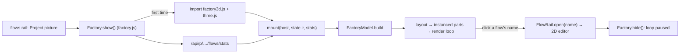

# The Factory picture (SPATIAL_FACTORY_PLAN F3)

**Result.** A project opens as one picture: a core of what its flows share and need, a cluster of
parts for every flow, cables in bundles between them. It is the first row of the flows rail on the
Flow screen. The scene was checked in the lab on mr-finance (14 flows, 90 services, 24 jobs) and on a generated
project of 1,199 flows in 14 domains, at far, medium and close zoom; wired into the studio it was
checked on mr-finance (open the picture, open a flow from it, come back).

## What is drawn

Everything comes from `FactoryModel.build(ir, stats)`; nothing is invented for the picture.

| on the picture | is | built as |
|---|---|---|
| the core, silver blocks | shared blocks | solid silver titanium in three machined sections |
| the core, glass boxes | resources a flow names (by kind past 12) | a titanium frame, smoked glass, a lit core |
| a cluster | a flow (a domain past 30 flows) | a plate with one part per op (per flow) |
| a part with a glass top | an op | a titanium module, a recessed glass panel in a thin frame |
| a tower on a base | a nested graph | a dark base with a narrower framed tower, lit where they meet |
| a three-tier part | an agent | Space Black tiers, a lavender seam and window |
| a low eight-sided part | a branch | a junction with two ways out, the taken one lit |
| small parts on a plate's outer edge | services and jobs | a compact dark module; a plain one with a light |
| cables | flow → shared block (lavender), flow → resource (blue) | 1–3 strands per kind, never one per link |
| a red light on a part | a flow with failed runs in the last 7 days | |
| a dark plate, name in italics | a graph a door asks for that the project does not list | |

Bundles never cross: each side of the core owns one corner, and the bundle with farthest to go turns
nearest the core.

## How it loads



- No other page pays for it: `project.html` gains two small classic scripts (`factorymodel.js`,
  `factory.js`) and one stylesheet; three.js is fetched on the first open.
- The scene is kept while a flow is open and resumes on return; it is rebuilt when the IR is reloaded.
- A hidden picture draws nothing; `prefers-reduced-motion` stops the lights on the cables;
  `prefers-reduced-transparency` makes the glass enclosures and the name slips opaque.
- Cost at scale: every box-like part of one material is one instanced draw call (titanium, glass
  panels, smoked glass), plus junctions, lights (two levels of detail), their glows, contact shadows,
  engraved names (close zoom only) and the cables. Lights and engravings are not drawn until a part is
  large enough on screen to show them.

## Code

```text
operonx_studio/static/
  factory.js          new   Factory.show / hide / on; imports the module on first use
  factory3d.js        new   the scene: layout, machined geometry, materials, camera, names
  factory.css         new   #factory styles and the --fx-* tokens (served as written, see below)
  vendor/three/       new   three.js r160 build + the four post-processing passes it needs (MIT)
  flowrail.js         edit  first row "Project picture"; opening a flow leaves the picture
  project.html        edit  #factory host, the stylesheet, two scripts
docs/SPATIAL_FACTORY_PLAN.md   §1 note, §3 decision, F3, progress, B5
```

Why `factory.css` and not `studio.css`: `theme.py` derives a dark twin of every colour written in
`studio.css`. The Factory's tokens are already the dark values (the studio is dark-first), so they
live in a file that is served as written. Nothing outside `#factory` reads them.

No `.py` file changed.

## Not in F3

- Selecting a part to light its upstream and downstream; opening a flow from a domain cluster; search
  (F4).
- Runs on the picture beyond the error light (F5); a green "succeeded" light is in the tokens, unused.
- Recessed sockets on every part: ports exist where a bundle leaves a cluster and reaches the core.
- A Light set of tokens (deferred with the rest of Light).
- The top bar's crumb still names the last flow while the picture is open.
- Checked in headless Chromium with software GL only; frame rate on real GPUs was not measured.
