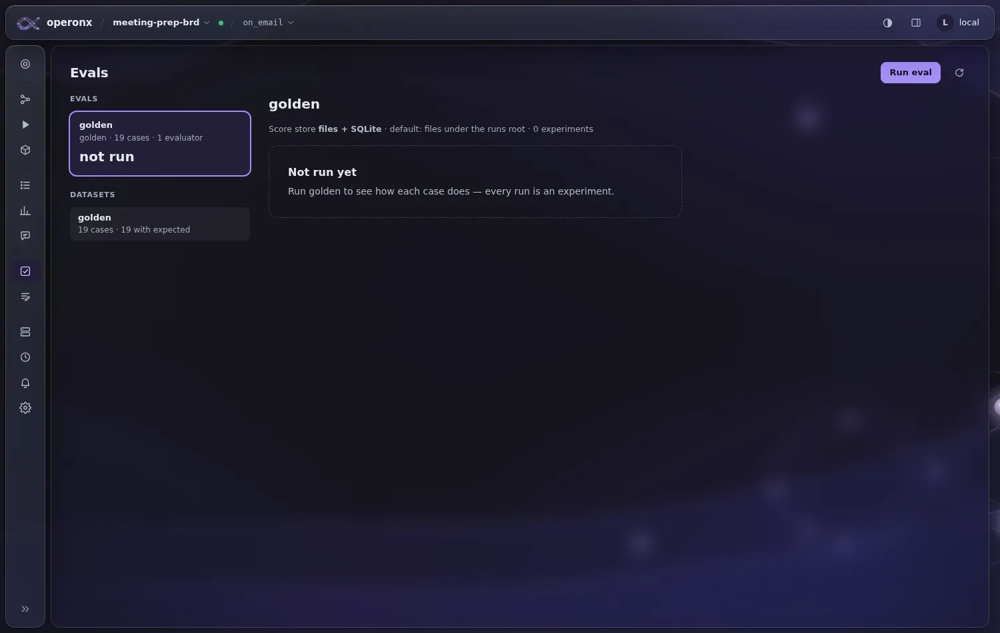
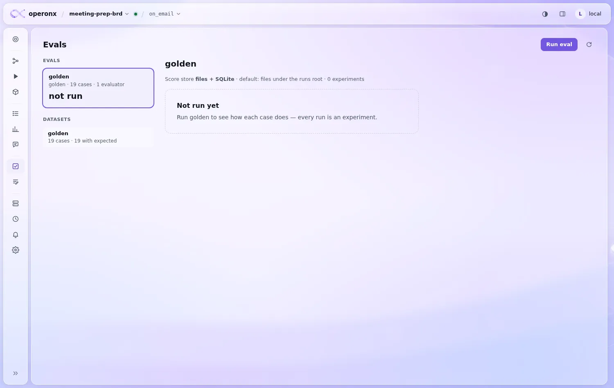
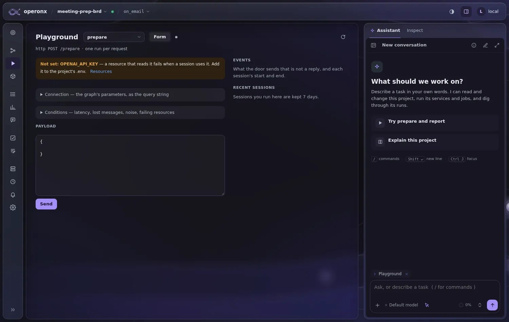
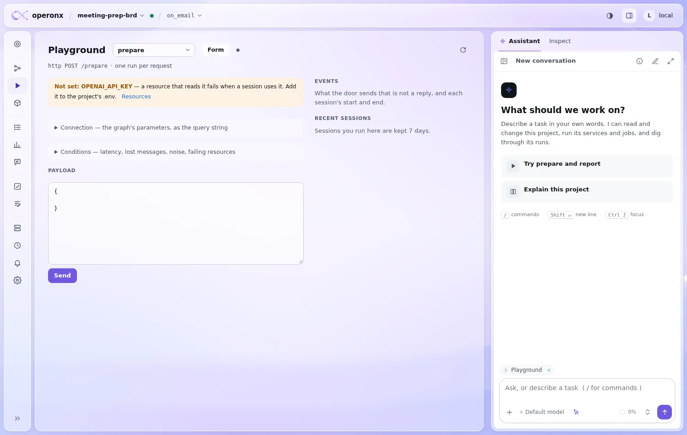
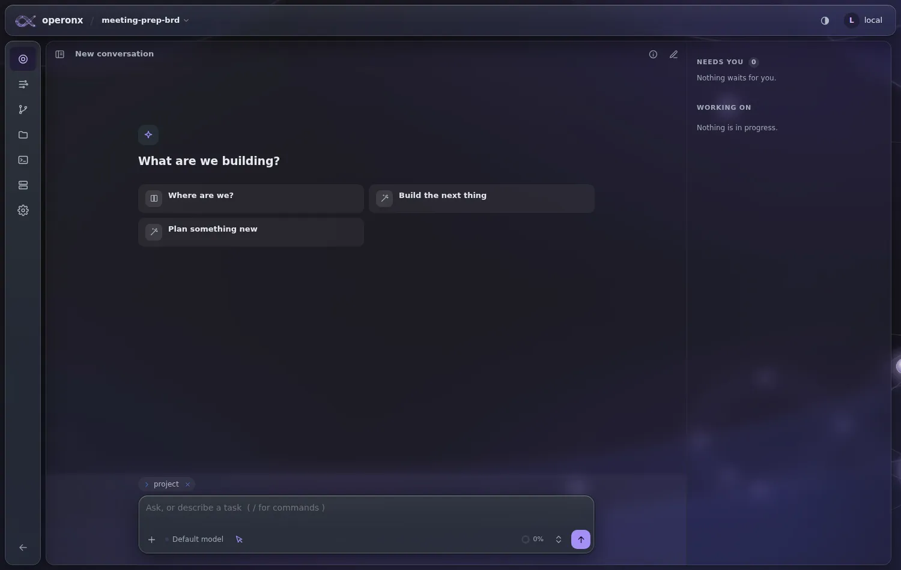
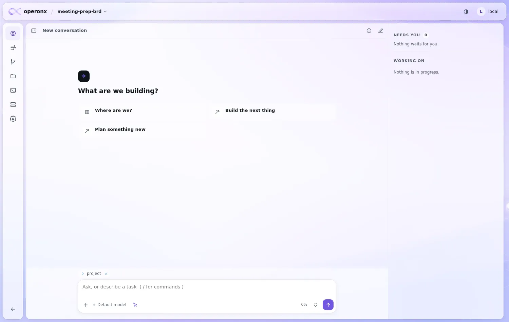
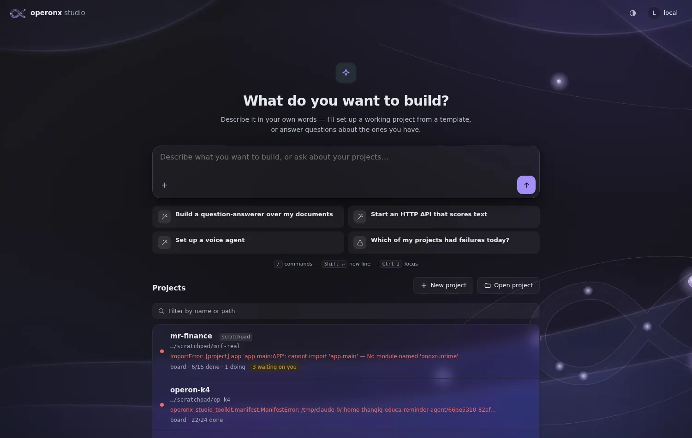
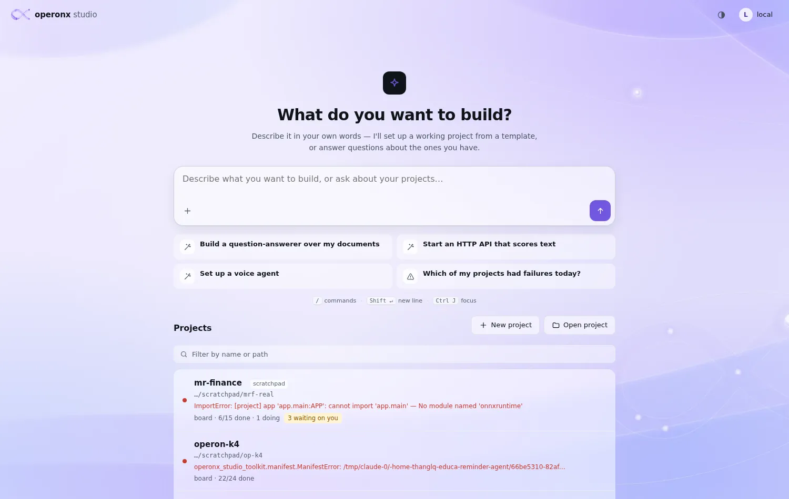
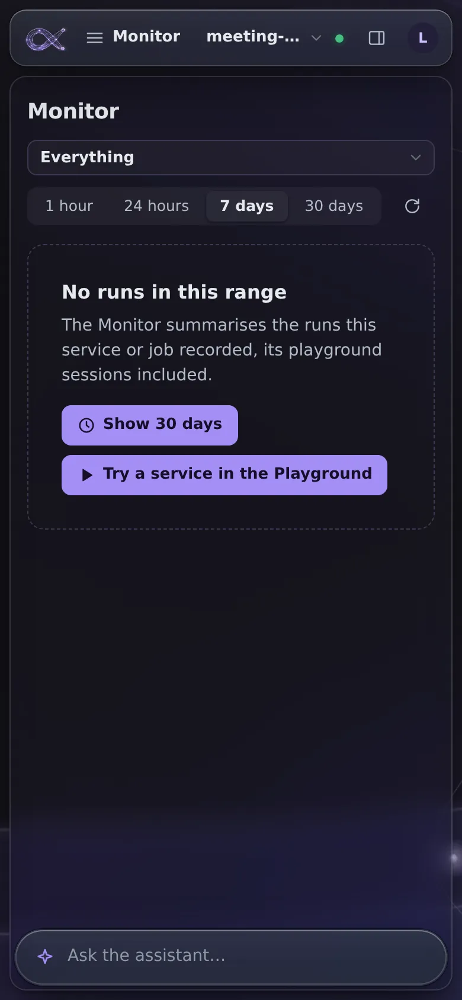
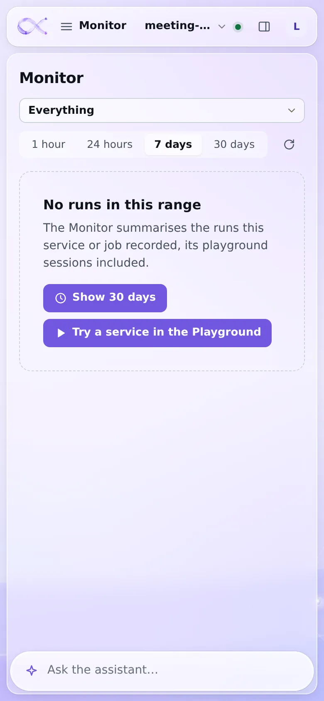

# Glass everywhere plan

Owner, 2026-11-13: "every other page must have the backdrop too, so the components sit on it as liquid glass, like the Flow screen. All pages: it is the common design."

Today only the Flow screen has it (CANVAS_REDESIGN_PLAN C1). The other screens use a docked frame: solid top bar, rail and side panel, and solid pages.

## Audit (2026-11-13)

- **Screens.** The project page has 13 tabs besides Flow: playground, resources, knowledge, traces, monitor, review, evals, prompts, services, jobs, alerts, settings and project. Project mode adds 7 pages: now, board, changes, files, terminal, environments and settings. There are 3 separate pages: home (`/`), team and login. All of them load `body.page`.
- **The frame** is `body.floatframe`. shell.js sets it only on Flow. The only JS that reads it is canvas.js `stageInset`, which runs on Flow only, so the class is safe to set on every tab.
- **Why a token override alone is not enough.** `--card`, `--card-hover`, `--well`, `--panel` and `--panel-2` are set at `:root` as `var(--surface-2)` and similar. Custom properties resolve where they are declared, so overriding `--surface-2` on a page does not change `--card`. A prototype that overrode only the surfaces left 33 kinds of element opaque, for example `.stattile`, `.vizcard`, `th`, `.ax-start`, `.svccard` and `.prail`. The derived tokens must be declared again on the glass scope.

## G1: the project page (every tab, both modes)

- shell.js: `floatframe` is on for every tab. The one exception is a run's canvas, which stays in its pane under a solid head as before.
- The body wears the backdrop (`canvas-bg-{light,dark}.webp`, `cover`, fixed) on every screen except Flow, where `#stage` already wears it.
- The page (`.pane`, `#traces`, `#jobs`, `#resources`) is a glass card in the open area, with the frame's clear tint, a 12px blur, the glass edge and the frame radius.
- Inside it, the surfaces and the derived tokens are translucent, so cards, tables, tiles and wells are glass on glass. Accent fills (primary buttons, selection) stay solid.
- Reduce Transparency (`data-glass="solid"`) keeps the solid surfaces. Phone width keeps the floatframe phone rules.

## G2: home, team, login

- `body.page` wears the backdrop. The project list, the composer, the starter cards and the login card are glass, with the same token approach.

## Gate

- Screenshots of every screen above, in dark and light. They go in docs/img/glass/; a representative set is linked here.
- The audit script finds no surface-coloured panel left opaque. Accent fills and selection are exempt.
- Body text stays at least 4.5:1 against the glass at its 1st/99th-percentile background.
- Reduce Transparency is unchanged. pytest test_theme and test_minify pass, and the JS tests pass.

## Outcome (2026-11-13)

Built as one change, G1 and G2 together.

- shell.js sets `floatframe` whenever a run's canvas is not open. On a phone, a page off Flow starts below the floating bar.
- studio.css and studio-dark.css have a "Glass everywhere" section:
  - the backdrop sits on `body.floatframe` and on `body.page`;
  - the page card uses `--glass-page`;
  - the surface tokens and the derived tokens are declared again on the page and on `body.page`;
  - `--bg` is transparent inside the card, since the card is the page.
- `#prail` joins the frame's frosted glass.
- Audit: in both themes, the opaque elements left in `.main` are primary buttons, selection (`.sel`, `.active`, `.on`) and the warning tints (`.playenv`, `.svcenv.bad`). These are the exempt kinds.
- Contrast, measured at the 1st/99th-percentile background with accent fills hidden:
  - body text (`--text`, `--text-2`) is at least 5.0:1 on monitor, traces, evals, project, home and login in both themes;
  - faint labels (`--text-3`) are at least 4.1:1.
- Reduce Transparency: no backdrop and solid surfaces, checked on evals and home in both themes.
- The JS tests (194) pass. test_theme and test_minify (24) pass.

All 50 screenshots are in docs/img/glass/. A representative set:

| | dark | light |
|---|---|---|
| Evals |  |  |
| Playground |  |  |
| Project mode |  |  |
| Home |  |  |
| Phone |  |  |
