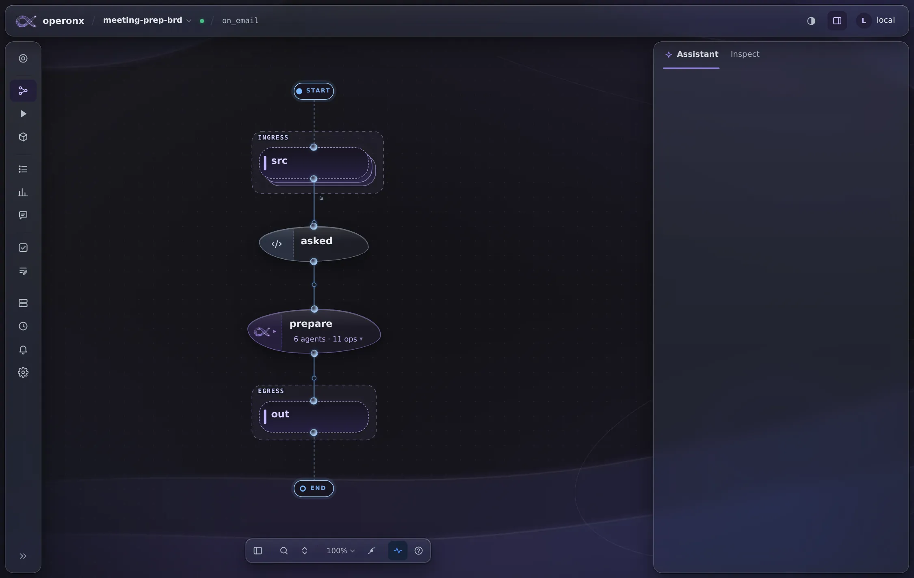
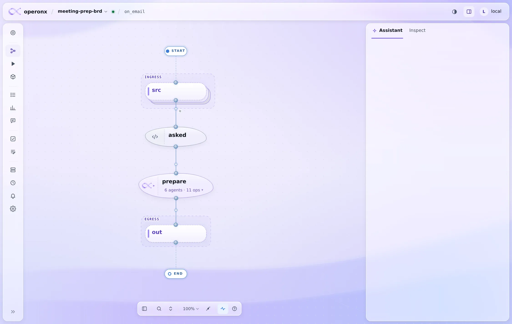
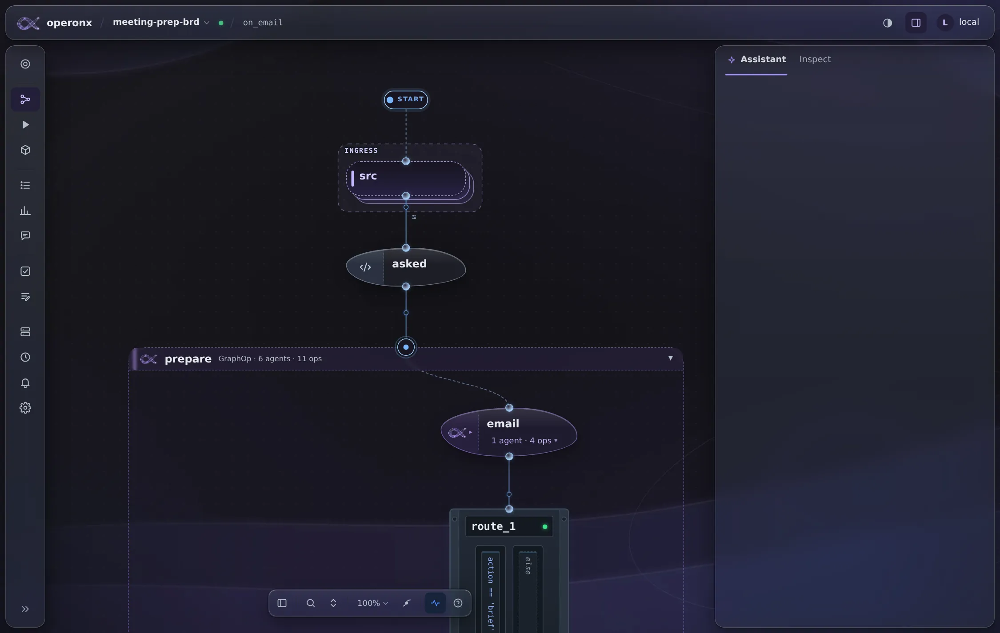
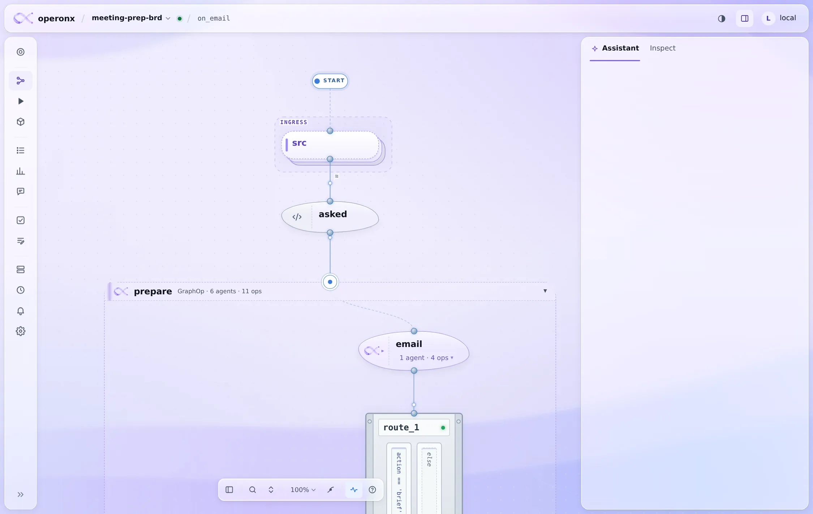
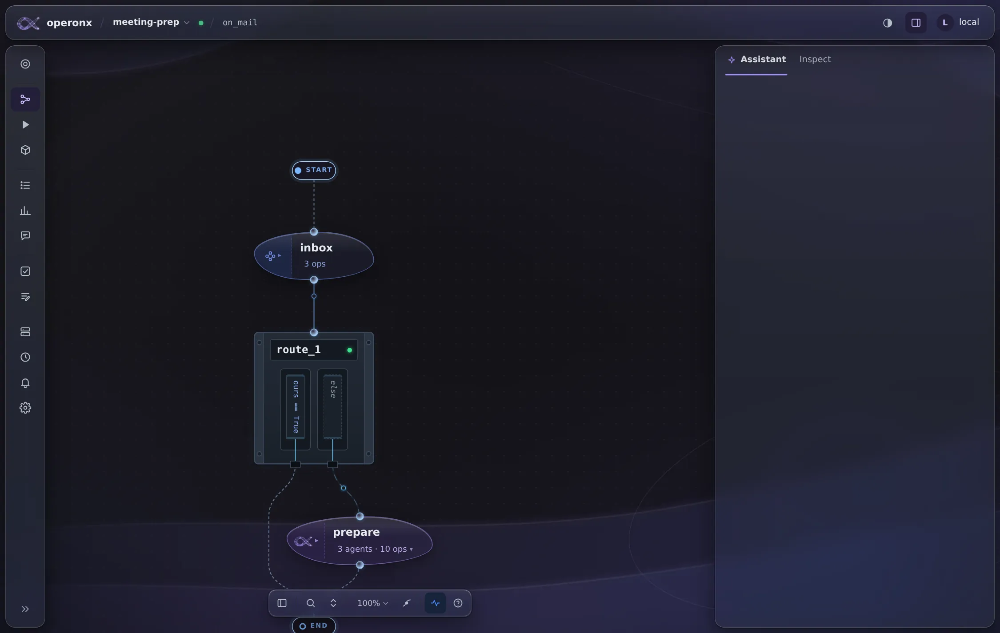
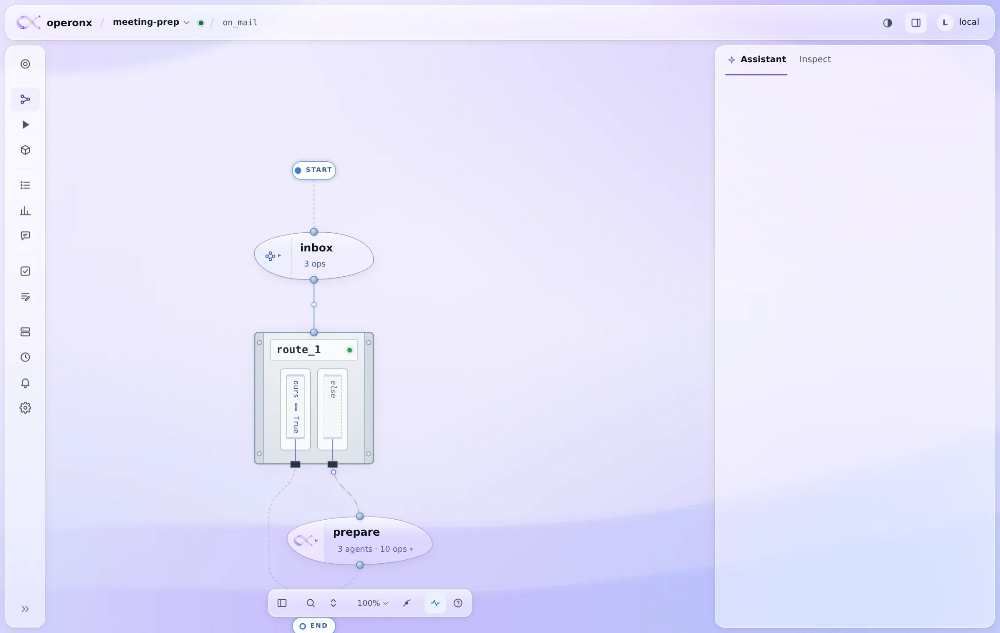
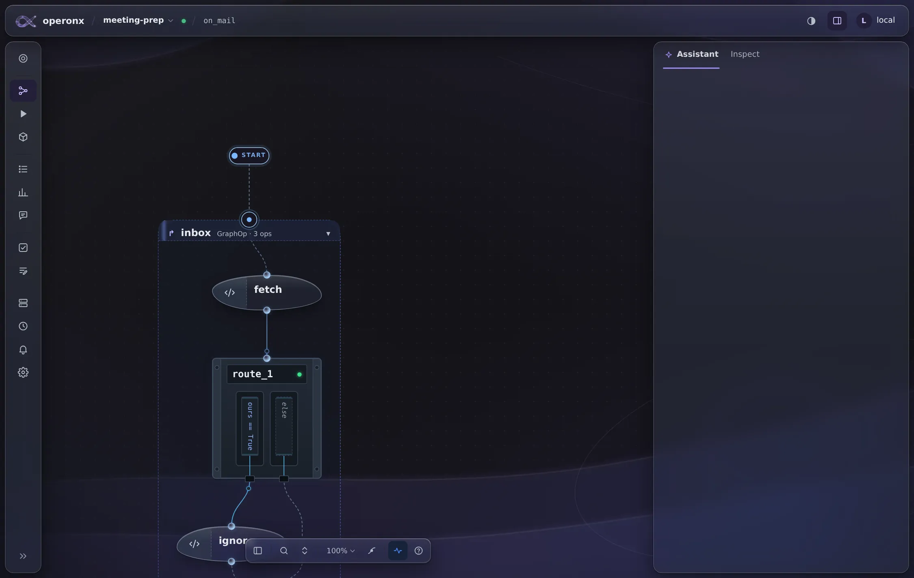
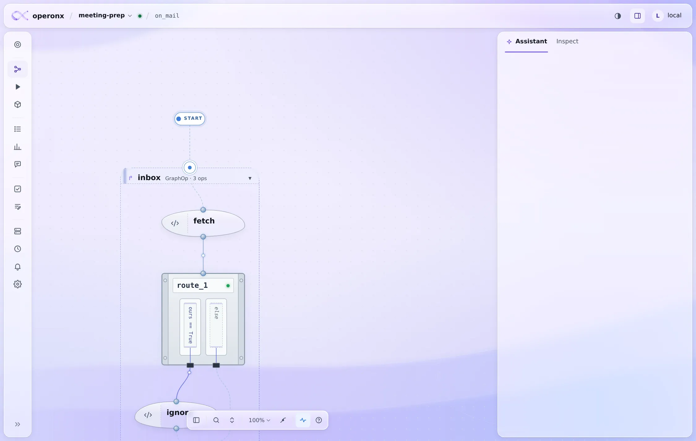

# Graph hierarchy plan

Owner, 2026-11-13: the canvas should say what kind of op a card is before you read it. An agent, a plain GraphOp and a FuncOp all looked alike: green graphs, blue functions and a busy backdrop behind them. The backdrop has to step back, so the graph is the loudest thing on screen.

## Design

- **Quiet backdrop.** `canvas-bg-{light,dark}.webp` are regenerated from `docs/img/canvas/backdrop.html?g=quiet`. That variant has no orbs or sparks, the glyph at a third of `faint`, and glows and bright edges about halved. The glass curves at the edges stay.
- **Agent GraphOps: lavender with the ∞ glyph.** The kind is `--k-agraph` (dark `#c5a6ff`, light `#7a56d8`), with its own fill and line tokens.
- **GraphOps: periwinkle with a graph icon.** The kind is `--k-graph` (dark `#7894ea`, light `#3557b8`, was green). The icon is the drawn `graphop` icon, and the op count ("3 ops") sits in the body.
- **FuncOps: Titanium Slate with `</>`.** The kind is `--k-func` (dark `#c2cddd`, light `#4f5d75`, was blue). The icon is the drawn `code2` icon. `kindIconEl` puts the same icon on the canvas, in the inspector and in the run tree.
- **Width.** A card is no wider than its name needs.
- Each kind has `--k-*-fill` and `--k-*-line`, so a card's tint and rim follow its kind (`--kind-fill`, `--kind-line`).

## Outcome (2026-11-13)

Built as one change. Shown on meeting-prep-brd (`on_email`, 6 agents) and meeting-prep (`on_mail`), in both themes, with no page errors. pytest test_theme and test_minify pass (24), and the JS tests pass (194).

| | dark | light |
|---|---|---|
| on_email, folded |  |  |
| on_email, every graph opened |  |  |
| on_mail, folded |  |  |
| on_mail, opened |  |  |

The BranchOp in these screenshots is still the decision card. docs/BRANCH_JUNCTION_PLAN.md replaces it with the routing rail and makes GraphOps more purple (dark `#8589ee`, light `#4651c0`).
