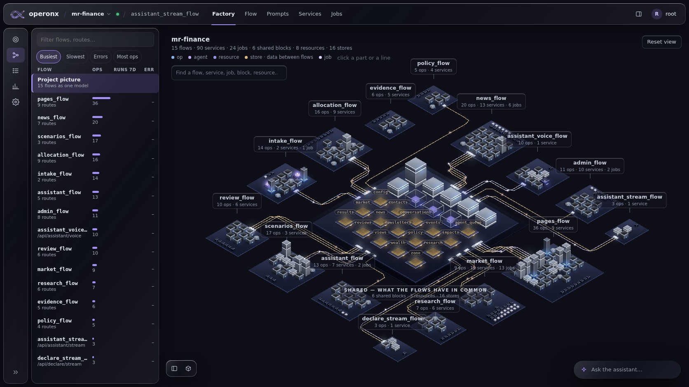
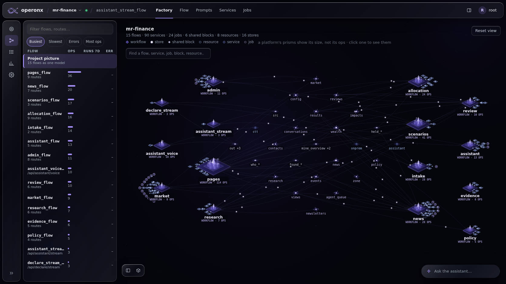
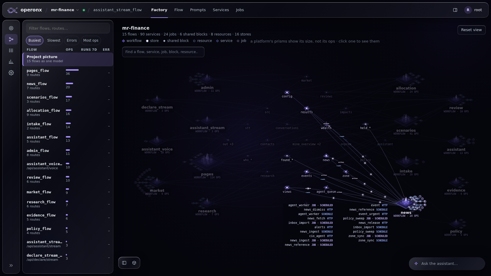
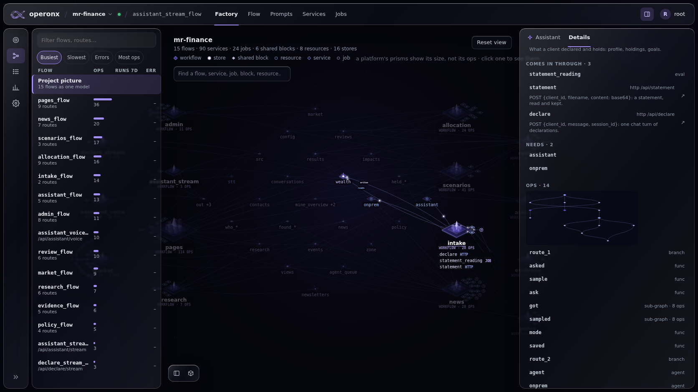
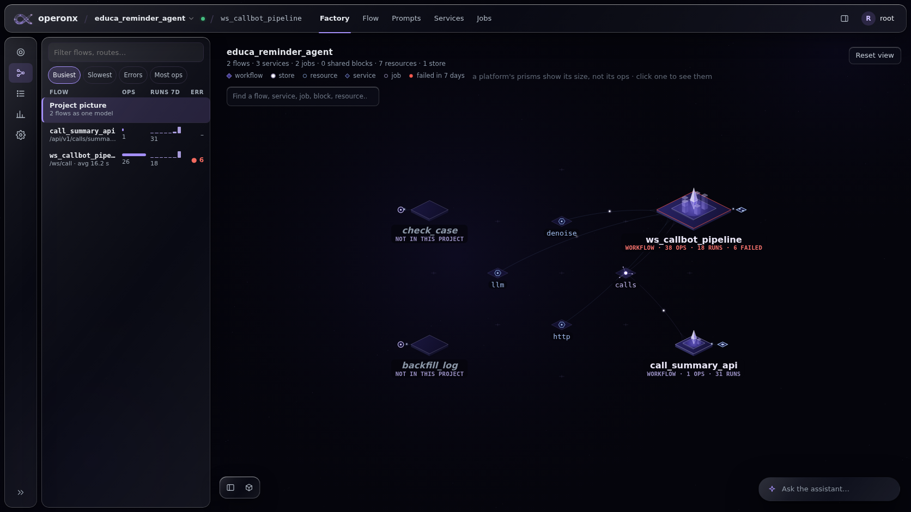
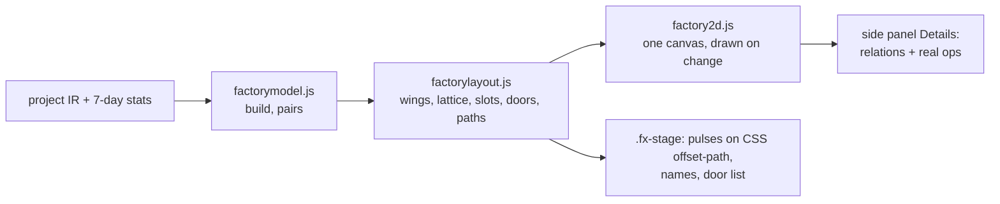

# Neural Factory — what was built

The Factory picture is now the approved mock 14, drawn from the project's real model on one 2D
canvas. Plan: [NEURAL_FACTORY_PLAN.md](NEURAL_FACTORY_PLAN.md).

| Before (three.js) | After (2D, mr-finance, real data) |
|---|---|
|  |  |

Hover a workflow — its filaments and their far ends stay lit, the rest dims, and its services and
jobs are listed by name where the list covers no neighbour and no lit filament:



Click a workflow — the side panel's Details lists what it gets and passes, and its real ops (a small
map of the graph, then every op by name). The picture itself never draws ops one by one:



Another project (the callbot: 2 flows, 7 resources, 1 store, two jobs whose flows are not in the
project):



## What is drawn

| Thing | Shape | Rule |
|---|---|---|
| workflow | glass platform, recessed plate, crystal core, 1–7 prisms | prisms = log₂(ops): size, never a count |
| store / shared block / resource | junction / rhombus / hexagon on the centre lattice | one per item; past 12 resources, grouped |
| service | small flat diamond on the platform's outer side | every one drawn, or counted in `+n more` past 36 |
| job | small circle, with hands when scheduled | same |
| relationship | one 0.6 px filament at rest ~17%, one pulse in the data's direction | one per (workflow, item, kind) |
| a flow a door asks for that is not in the project | empty dark platform, italic name | `NOT IN THIS PROJECT` |

## How it works



- **Layout is searched and pure** (`factorylayout.js`, 14 tests): workflows in two wings, shared
  items on a diamond lattice between them, slots chosen for fewest crossings with a seeded search.
  Same input, same picture. It takes any counts: tested from 1 flow / 0 shared to 64 clusters.
- **Nothing runs per frame.** The canvas is redrawn when something changes; while panning it is
  slid by a CSS transform and redrawn when the last draw was cheap. Pulses are CSS animations.
- **Past 30 flows a platform is a domain**, as before; past 320 pulses only the lit ones run.

## Measured (software renderer, no GPU, 1672×941)

| Project | Drawn | One draw | Dragging |
|---|---|---|---|
| mr-finance | 15 workflows, 25 shared, 113 doors, 83 filaments, 181 pulses | 5–16 ms | 34 fps |
| callbot | 4 platforms, 4 shared, 5 filaments | 1.4 ms | — |
| qc-snatcher | 7 platforms, 10 shared, 15 filaments | 3 ms | — |

## Code

```
operonx_studio/static/
  factorylayout.js   new      pure layout: wings, lattice, slot search, doors, panel placement, curves
  factory2d.js       new      the picture: canvas drawing, pulses, names, hover, selection, card
  factory.js         changed  loads factory2d.js; Factory.view() hands out the mounted picture
  factory.css        changed  stage, pulses, names, door list
  project.html       changed  one script tag
  factory3d.js       removed  (682 lines)
  vendor/three/      removed  (660 KB)
tests/js/factorylayout.test.mjs   new, 14 tests
```

## Different from the mock

- The door list is two columns past 12 rows, so a long list (news: 20, market: 24) fits beside its
  workflow instead of across the lit filaments.
- Inspect is the side panel, not an overlay in the middle of the picture.
- Names, markers and filaments keep a readable size on screen when a large project is fitted small.

## Not done

- Not measured on the 1,199- and 2,999-flow projects in this pass (the layout is tested to 64
  clusters; the domain level is the same code path as before).
- A single-flow project still opens on its Flow, as before, so it never shows this picture first.
