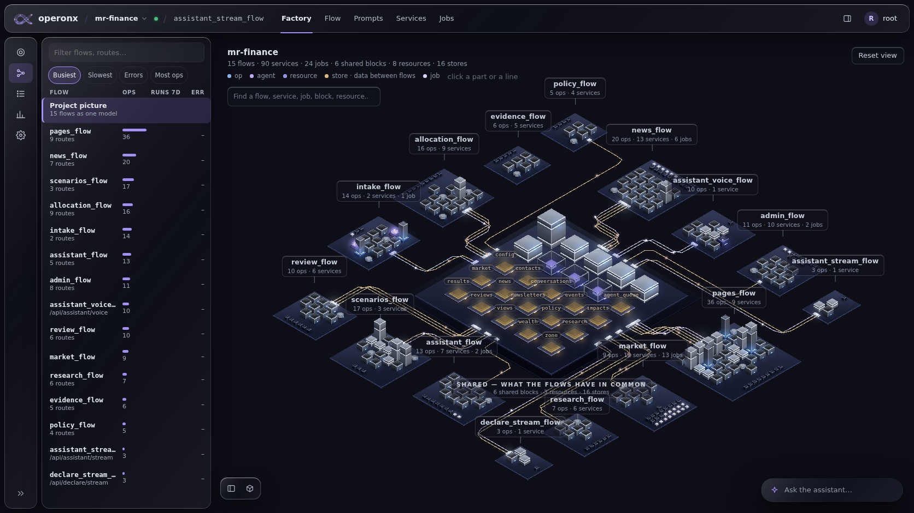
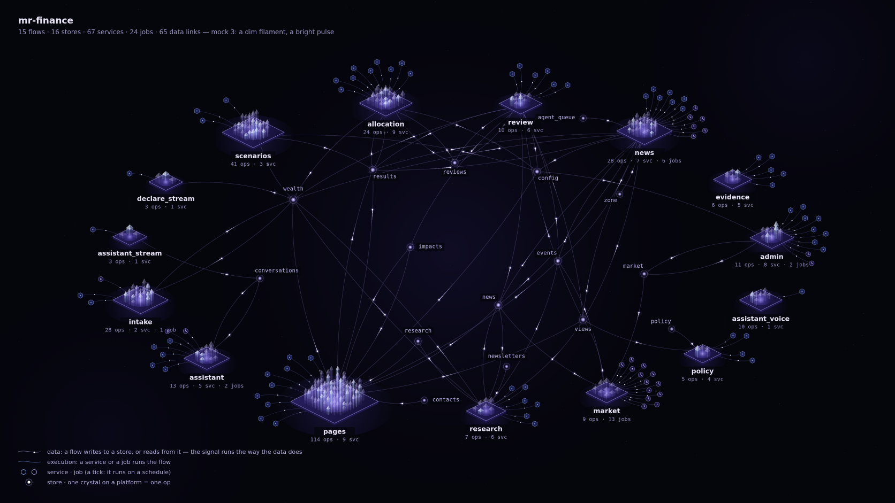
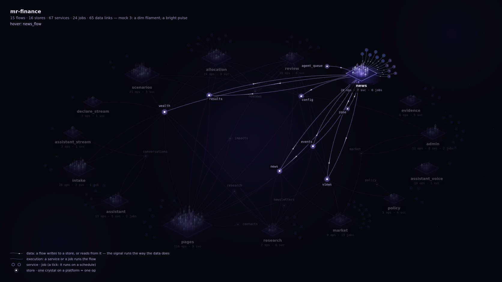
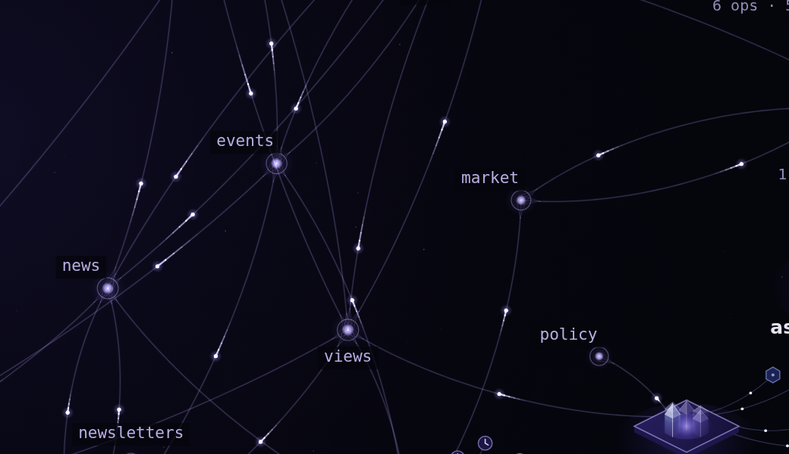

# Neural Factory plan

The Factory picture redrawn as a neural architecture: flows are crystalline cells, stores are luminous
junctions, and each relationship is one fine filament that carries its own signal. The owner's brief,
2026-11-21. A visual and interaction redesign: the model (`factorymodel.js`), what a click opens, and
every other screen stay as they are.

**Status: proposed. Nothing is built. Waiting for the owner's go.**

| Today | Mock of the target (mr-finance, real data) |
|---|---|
|  |  |

Hovering a flow in the mock: 

The mock is a standalone canvas page, not studio code. Its crystal heights come from a hash of the
flow's name, because it was given op counts only; the real picture sizes each crystal from its op.

## The one rule

**One relationship = one filament = one energy pathway.** Only the last few pixels at each end part
into 3–4 short roots. A flow that both writes and reads a store has two relationships, so two
filaments, bowed to either side. How many ops are behind a relationship shows as how many signals
travel the filament (1–3), never as more strands.

## A dim filament, a bright pulse

The owner's refinement of the second mock (2026-11-21): the filaments read as bright laser cables.
**The network's structure is seen first; a filament is noticed when it is looked at; moving energy is
what says something is happening.** Mock 3 above is drawn to these numbers.

| Layer | What | Numbers |
|---|---|---|
| A — the filament | one thin, continuous strand, there when nothing moves | 0.5–0.8 px, muted lavender, 15–30% opacity (the mock: 0.65 px at 24%); no halo, only a luminosity held within 1 px of it; drawn without additive blending, so a crossing is no brighter than a strand |
| B — the energy | one small pulse with a short tail, on the filament's own path, going the way the data goes | a 1.25 px white core, a 4 px halo; it lights itself, not the strand; each relationship has its own phase |

- Hovered or selected: its relationships rise to about 60%, the rest drop to a third of their resting
  level and carry no pulse. Junctions glow when looked at, not all at once.
- Fewer crossings: the ring's order is searched on the count of crossing filaments first, their
  length second.

## What exists today (read from the code)

| | Today (`factory3d.js`, 670 lines; `factory.css`) |
|---|---|
| renderer | three.js, fixed isometric camera; a frame is drawn only on a change, and while the camera moves the last frame is slid in CSS (`docs/FACTORY_CPU.md`: 60 fps on a machine with no GPU) |
| flow | a cluster of machined titanium parts, one per op |
| links | every link runs from a cluster to a **core** in the middle; up to 3 strands per kind, as tube geometry (`strandsFor`) — a bundle |
| stores, shared blocks, resources | parts standing in the core |
| services, jobs | small parts on a cluster's outer edge |
| moving lights | DOM elements on a CSS `offset-path` over the frame (`fx-sparks`) |
| layout | pinwheel round the core, so bundles never cross |
| interaction | click selects (the rest goes quiet, a card lists it); double click opens the flow; `/` finds; no hover |
| scale | past 30 flows a cluster is a domain; measured to 2,999 flows |

## Decisions

1. **Filaments are an SVG layer over the 3D frame, not 3D geometry.** A 0.6–1 px antialiased curve
   with tapered roots is what SVG draws well and what software WebGL (no antialiasing, by the CPU
   rules) draws badly. The layer is projected with the same fixed camera the sparks layer already
   uses, and slid with the frame while the camera moves. Glow is a second, wider, faint stroke —
   never a blur filter. **N0 measures this before anything else is built.**
2. **Energy is the existing sparks mechanism**, pointed at the filament's own path: an element with a
   short tail on CSS `offset-path`. No per-frame JavaScript. Direction is the data's: a write runs
   flow → store, a read store → flow; execution runs service/job → flow.
3. **No core, no brain.** The centre holds what the flows really share: stores, shared blocks and
   resources, each a compact junction of its own kind. Nothing is drawn that the model does not hold.
4. **Layout is searched, not simulated.** Flows stand on a ring whose order is chosen so flows that
   share junctions are neighbours; junctions settle inside the ring between their flows; services and
   jobs sit on the outside of their flow. Outside → ring → centre reads as entry point → workflow →
   shared data. Same input, same picture.
5. **A crystal is an op.** One crystal per op of the flow; a nested graph is one taller crystal sized
   by its ops; an agent keeps a distinct form. Geometry stays merged into one buffer (no instancing).
6. **Two colours of filament, one family.** Data is muted lavender; execution is periwinkle; both dim at rest. Both are
   the studio's lavender pattern; no other hue.
7. **Hover is added; click stays.** Hover a flow or junction: it, its filaments and their other ends
   stay lit, the rest drops to about 15%. Hover a filament: its direction and what is behind it (the
   ops that read or write). Click, double click, the card, `/`, pan and zoom work as today.
8. **"Business logic / control" is the domains.** The model has no control entity. Flows of one
   domain stand together on the ring under a faint domain name. Past 30 flows a cell is a domain, as
   today, and a filament is domain ↔ junction.

## Parts

Each part ends with screenshots (far, close, hover) on the no-GPU rig and a write-up in `docs/`.
Branch `ui/neural-factory`; frontend only (`git diff --stat origin/main -- '*.py'` stays empty).

| Part | What | Gate |
|---|---|---|
| **N0** spike | The SVG filament layer and its sparks over today's picture, mr-finance and the 2,999-flow project | at rest and while dragged ≥ 55 fps on the software rig; one redraw ≤ 100 ms. If it fails: filaments on a 2D canvas drawn on change, measured the same way |
| **N1** layout | Ring order search, junction placement, door placement — pure functions beside `factorymodel.js`, tested with `node --test` | no two cells or labels overlap on mr-finance, callbot, the 1,199- and 2,999-flow projects; same input → same output |
| **N2** filaments | One filament per relationship, roots at both ends, signals; the tube bundles and the core are removed | the count of filaments equals the count of links in the model (asserted in a test) |
| **N3** cells and junctions | Crystals, platform, core light, halo; the three junction kinds; names clear of filaments | the owner's look review on screenshots — restrained glow, glass kept, no bright solids |
| **N4** entry points | Services and jobs as their own elements with one execution filament each; a scheduled job is marked | every service and job of the model is drawn once |
| **N5** interaction | Hover dimming, filament tooltip, labels that stay legible as the zoom changes | click, double click, card, `/`, pan, zoom checked against today's behaviour |
| **N6** scale and write-up | The domain level past 30 flows; signal budget; reduced-motion | 60 fps at rest at 2,999 flows; `docs/NEURAL_FACTORY.md` |

## Budgets

- At rest and while moving: 60 fps on the software rig (today's number). One full redraw ≤ 100 ms.
- Signals: at most 150 moving elements on screen; past that, only the hovered or selected entity's
  filaments carry signals. `prefers-reduced-motion`: none move.
- No live blur, no post-processing, no antialiased WebGL (the standing no-GPU rules).

## Risks

- **A hub flow knots the centre.** mr-finance's `pages` reads 11 stores. Ordering and bowed curves
  reduce crossings but cannot remove them; hover dimming is what makes one flow readable. If the
  resting picture is still too busy, filaments rest at about 40% and light on hover.
- **90 services round 15 flows** are many small elements. They are drawn without names; a name
  appears on hover and in the card.
- **The look took eight rounds last time.** N3 is shown as screenshots early, before N4–N6.

## Not in this plan

Light theme; engine or model changes; any other screen; real-time run data beyond what the picture
shows today.
