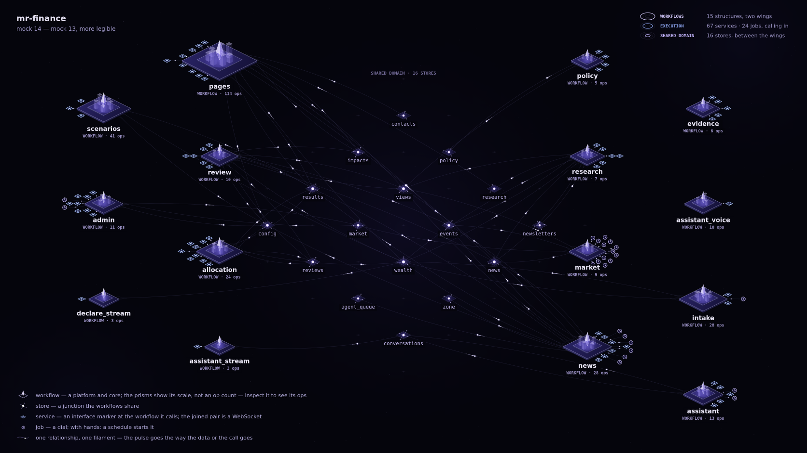
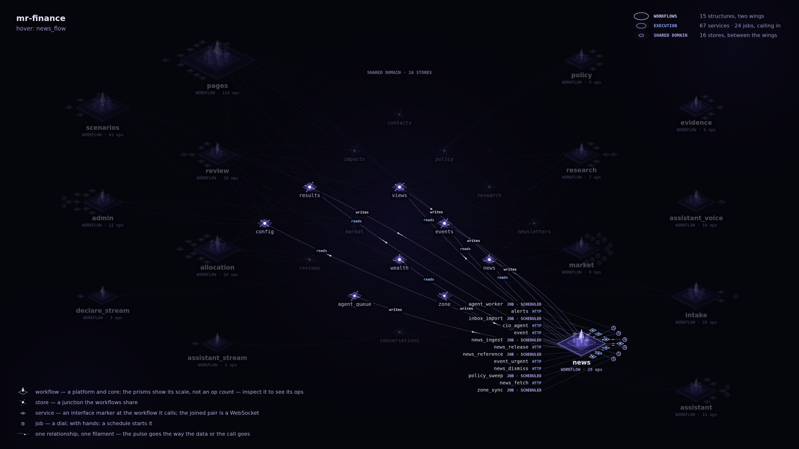
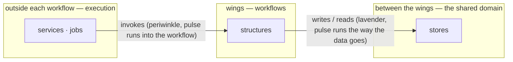
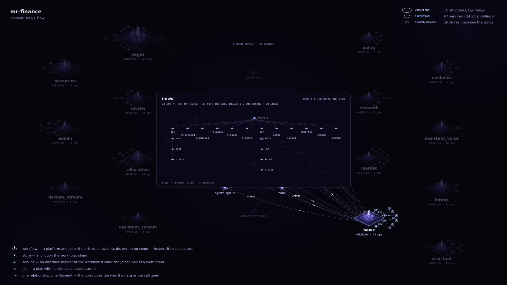
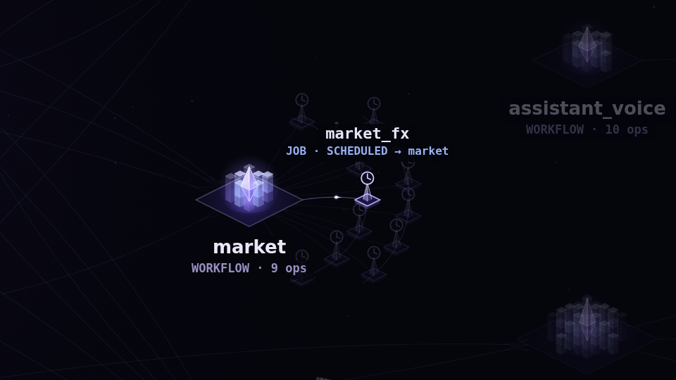
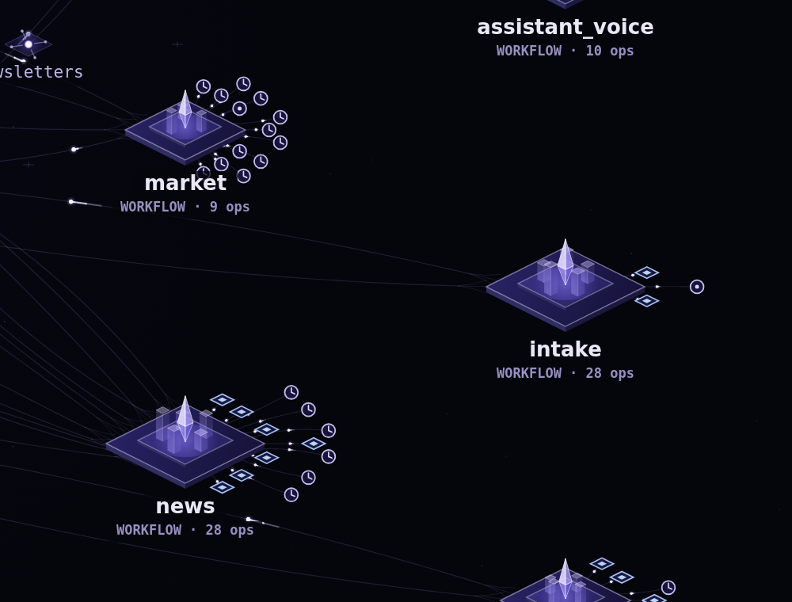

# Neural Factory plan

The Factory picture redrawn as a neural architecture: flows are crystalline structures on platforms, stores are luminous
junctions, and each relationship is one fine filament that carries its own signal. The owner's brief,
2026-11-21. A visual and interaction redesign: the model (`factorymodel.js`), what a click opens, and
every other screen stay as they are.

**Status: built (2026-11-22).** The owner approved mock 14 as the visual baseline and chose a 2D
renderer; what was built, with screenshots on real data and the measurements, is
[NEURAL_FACTORY.md](NEURAL_FACTORY.md). The Decisions and Parts below are the plan as proposed;
where the build differs, the write-up says so.

| Today | Mock of the target (mr-finance, real data) |
|---|---|
|  |  |

Hovering a workflow in the mock: 

The mock is a standalone canvas page, not studio code. Its crystal heights come from a hash of the
flow's name, because it was given op counts only; the real picture sizes each crystal from its op.

## The one rule

**One relationship = one filament = one energy pathway.** Only the last few pixels at each end part
into 3–4 short roots. A flow that both writes and reads a store has two relationships, so two
filaments, bowed to either side. How many ops are behind a relationship shows as how many signals
travel the filament (1–3), never as more strands.

## A dim filament, a bright pulse

The owner's refinement of the second mock (2026-11-21): the filaments read as bright laser cables.
Mock 6 drew them too strongly again; mock 7 is to the numbers below, and the order of the eye is: workflows, then junctions, then gateways and beacons, then silk.
**The network's structure is seen first; a filament is noticed when it is looked at; moving energy is
what says something is happening.** Mock 3 above is drawn to these numbers.

| Layer | What | Numbers |
|---|---|---|
| A — the filament | one thin, continuous strand, there when nothing moves | 0.5–0.7 px, a faint violet-blue, 12–22% opacity (mock 7: 0.6 px at 17%; a call's filament 0.55 px at 16%); one stroke, nothing round it; drawn without additive blending, so a crossing is no brighter than a strand |
| B — the energy | one small pulse with a short tail, on the filament's own path, going the way the data goes | a 1.3 px white core, a 3.2 px halo (mock 7); it lights itself, not the strand; each relationship has its own phase; the tail is two short steps (mock 8) |

- Hovered or selected: its relationships rise to about 50%, the rest drop to under half their resting
  level and carry no pulse — dimmed, never hidden. Junctions glow when looked at, not all at once.
- Fewer crossings: the ring's order is searched on the count of crossing filaments first, their
  length second.

## A shape for each kind, three levels

The owner's third brief (2026-11-21): the entities looked alike and the hierarchy could not be read.
His fifth, on mock 4: its radial, spiky cells were **too biological and alien — not to be continued**.
Mock 5 returned to the Factory's own crystalline platforms. His sixth (2026-11-22): the platforms
read as small cities, the entry points as decoration round a workflow, the stores as a tangle, and
the whole was forced onto a ring. Mock 6 (the images above) is drawn to that.

| Kind | Shape | Why it cannot be mistaken |
|---|---|---|
| workflow | a glass-and-titanium platform (the owner's thirteenth brief: mocks 8–12 had grown mechanical — a motherboard, a small factory): a clean slab, one inset glass plate, a faceted core, and round it a few translucent prisms — two for 3 ops, seven for 114 (log₂ of the ops). **Not one shape per op any more**: the op count is the label's and the platform's size | the only large structure, the only one with a core |
| store | a synaptic junction on a small pad of the platforms' own shape: a nucleus, three or four short terminals. The sixteen stand on one diamond lattice between the wings, each named under its pad; a faint registration mark stands where the lattice's cells meet — marks, not lines | compact, star-like, no structure on it |
| service | a small interface marker at the workflow's boundary: a flat rhombus with a lit centre (a WebSocket's is a joined pair). No hardware, no strut | flat, cool blue, 15 px |
| job | smaller and simpler than a service: a small dial; one a schedule starts has hands, one started by hand a dot | round, violet, 8 px |

Scale: store < service, job < workflow. **Not drawn, by the owner's rule:** radial needles, spikes,
petals, membranes, a ring round every entity, a ring or ellipse round the centre, glow that says
nothing. The connection system (the two sections above) is settled and is not redesigned.

**The three levels are places, not labels.**

- **Not a ring.** Workflows stand in two wings; the stores are a lattice between them, each named
  under its junction; a workflow's entry points are an arc (two past six) on its outer side, services
  above, jobs below. Read from the outside in: a call comes in → the workflow → its data, in the
  middle. Which slot a workflow or a store takes is searched: fewest crossings, no filament over
  another workflow, then length.
- **Entry points stand at the workflow's boundary** (mock 13). They follow the platform's outer
  outline in ranks, services nearest, jobs behind, each with one thin periwinkle filament and its
  pulse. Mock 12's solid struts and hardware docks are withdrawn: the owner found them mechanical
  and cluttered. In mr-finance every service and job runs exactly one workflow (91 of 91); the model
  allows more, and then the entry point stands between the workflows it runs.
- **Nothing is drawn round the centre**, and no control entity is drawn: the model has none.
- **A busy workflow's filaments leave apart.** Each relationship leaves the platform at its own point
  along the two edges that face the stores, in the order of the stores it goes to (mock 11: `pages`
  and `news`). The strand, its count and its ends are unchanged.
- **Overview shows scale; inspection shows the ops** (mock 14). A platform's prisms say how large a
  workflow is (log₂ of its ops), never how many ops it has — the legend says so. Selecting a
  workflow, or zooming past a threshold, opens a glass panel with its real graph: every top-level op
  by name, branches and sub-graphs marked, the edges between them, from the project's IR
  (`state.ir.graphs[i].nodes/edges`, which the Flow page already draws). Double click still opens
  the flow. 
- **Markers and panels keep clear.** Service and job markers are 12% larger than mock 13 with a
  firmer outline, no more glow. Jobs take a wider arc at even spacing (`market`'s 13: two ranks of
  7 and 6). A hover panel tries ten places round its workflow and takes the one that covers the
  least of other workflows, their markers and labels, lit stores, the legend and the canvas edge.
- **Hover.** A workflow: its stores and relationships, each tagged `reads` or `writes`; its entry
  points listed. A store: the workflows that read or write it, tagged the same. A service or job: it,
  its one filament and its workflow — no data relationship lights. Everything else dims and loses
  its pulse; nothing is hidden. 
- **Names.** A workflow: its name, then `WORKFLOW · n ops`. A store: its name. Services and jobs are
  each drawn, unnamed at rest (91 names would bury the picture); hovering a workflow lists every one
  of its services and jobs by name and kind (`HTTP`, `WEBSOCKET`, `JOB · SCHEDULED`).

**What the model does not hold, so the picture does not show:**

| Asked for | In the model today |
|---|---|
| business relationships from the control layer to services, jobs or workflows | none. Only: a service or job runs a flow; a schedule starts a job; a flow reads or writes a store, uses a block, needs a resource |
| a job's schedule as text | the picture's model says only that a schedule starts it; N1 checks whether the IR carries the expression and shows it on hover if it does |
| a service that runs no flow (mr-finance's one `asgi` mount) | it exists in the model with no link; it is drawn in the band, unattached |

**What thirteen mocks settled** (so the build does not reopen it): two wings and a store lattice, not
a ring; one dim filament and one bright pulse per relationship; hover dims, never hides; a workflow
is the only structure with a core. **What swung back and forth:** how much detail a workflow and its
entry points carry — one shape per op and hardware-like docks were asked for (briefs 5–12) and then
rejected as clutter (brief 13). The build starts from mock 13's restraint; detail is added only on
zoom, if at all.

## What exists today (read from the code)

| | Today (`factory3d.js`, 670 lines; `factory.css`) |
|---|---|
| renderer | three.js, fixed isometric camera; a frame is drawn only on a change, and while the camera moves the last frame is slid in CSS (`docs/FACTORY_CPU.md`: 60 fps on a machine with no GPU) |
| flow | a cluster of machined titanium parts, one per op |
| links | every link runs from a cluster to a **core** in the middle; up to 3 strands per kind, as tube geometry (`strandsFor`) — a bundle |
| stores, shared blocks, resources | parts standing in the core |
| services, jobs | small parts on a cluster's outer edge |
| moving lights | DOM elements on a CSS `offset-path` over the frame (`fx-sparks`) |
| layout | pinwheel round the core, so bundles never cross |
| interaction | click selects (the rest goes quiet, a card lists it); double click opens the flow; `/` finds; no hover |
| scale | past 30 flows a cluster is a domain; measured to 2,999 flows |

## Decisions

> Decision 1 was replaced: the owner chose one 2D canvas for the whole picture (no three.js), with
> the pulses and names as DOM over it. Decisions 2–8 were built as written.

1. **Filaments are an SVG layer over the 3D frame, not 3D geometry.** A 0.6–1 px antialiased curve
   with tapered roots is what SVG draws well and what software WebGL (no antialiasing, by the CPU
   rules) draws badly. The layer is projected with the same fixed camera the sparks layer already
   uses, and slid with the frame while the camera moves. Glow is a second, wider, faint stroke —
   never a blur filter. **N0 measures this before anything else is built.**
2. **Energy is the existing sparks mechanism**, pointed at the filament's own path: an element with a
   short tail on CSS `offset-path`. No per-frame JavaScript. Direction is the data's: a write runs
   flow → store, a read store → flow; execution runs service/job → flow.
3. **No core, no brain.** The centre holds what the flows really share: stores, shared blocks and
   resources, each a compact junction of its own kind. Nothing is drawn that the model does not hold.
4. **Layout is searched, not simulated.** Workflows stand on the outer ring, in an order chosen so
   the fewest filaments cross; junctions settle in the centre between their workflows; a workflow's
   services and jobs stand in the band between it and the centre. Same input, same picture.
5. **A platform is a workflow; its ops are not drawn one by one at this level** (mock 13). Today's per-op clusters are replaced by a platform, a core and a few prisms; a nested
   graph is one larger crystal sized by its ops; an agent keeps a distinct form. Geometry stays merged into one buffer (no instancing).
6. **Two colours of filament, one family.** Data is muted lavender; execution is periwinkle; both dim at rest. Both are
   the studio's lavender pattern; no other hue.
7. **Hover is added; click stays.** Hover a flow or junction: it, its filaments and their other ends
   stay lit, the rest drops to about 15%. Hover a filament: its direction and what is behind it (the
   ops that read or write). Click, double click, the card, `/`, pan and zoom work as today.
8. **"Business logic / control" is the domains.** The model has no control entity. Flows of one
   domain stand together on the ring under a faint domain name. Past 30 flows a cell is a domain, as
   today, and a filament is domain ↔ junction.

## Parts

> Built as one part on the 2D canvas, so N0's spike and N2's "remove the tube bundles" had nothing
> left to do. Gates as measured are in the write-up.

Each part ends with screenshots (far, close, hover) on the no-GPU rig and a write-up in `docs/`.
Branch `ui/neural-factory`; frontend only (`git diff --stat origin/main -- '*.py'` stays empty).

| Part | What | Gate |
|---|---|---|
| **N0** spike | The SVG filament layer and its sparks over today's picture, mr-finance and the 2,999-flow project | at rest and while dragged ≥ 55 fps on the software rig; one redraw ≤ 100 ms. If it fails: filaments on a 2D canvas drawn on change, measured the same way |
| **N1** layout | Ring order search, junction placement, door placement — pure functions beside `factorymodel.js`, tested with `node --test` | no two cells or labels overlap on mr-finance, callbot, the 1,199- and 2,999-flow projects; same input → same output |
| **N2** filaments | One filament per relationship, roots at both ends, signals; the tube bundles and the core are removed | the count of filaments equals the count of links in the model (asserted in a test) |
| **N3** structures and junctions | Today's clusters restyled: translucent blocks, thin platform, core light; the three junction kinds; names clear of filaments | the owner's look review on screenshots — restrained glow, glass kept, no bright solids |
| **N4** entry points | Services as gateways and jobs as beacons with one execution filament each; a scheduled job is marked | every service and job of the model is drawn once |
| **N5** interaction | Hover dimming, filament tooltip, labels that stay legible as the zoom changes | click, double click, card, `/`, pan, zoom checked against today's behaviour |
| **N6** scale and write-up | The domain level past 30 flows; signal budget; reduced-motion | 60 fps at rest at 2,999 flows; `docs/NEURAL_FACTORY.md` |

## Budgets

- At rest and while moving: 60 fps on the software rig (today's number). One full redraw ≤ 100 ms.
- Signals: at most 150 moving elements on screen; past that, only the hovered or selected entity's
  filaments carry signals. `prefers-reduced-motion`: none move.
- No live blur, no post-processing, no antialiased WebGL (the standing no-GPU rules).

## Risks

- **A hub flow knots the centre.** mr-finance's `pages` reads 11 stores. Ordering and bowed curves
  reduce crossings but cannot remove them; hover dimming is what makes one flow readable. If the
  resting picture is still too busy, filaments rest at about 40% and light on hover.
- **90 services round 15 flows** are many small elements. They are drawn without names; a name
  appears on hover and in the card.
- **The look took eight rounds last time.** N3 is shown as screenshots early, before N4–N6.

## Not in this plan

Light theme; engine or model changes; any other screen; real-time run data beyond what the picture
shows today.
