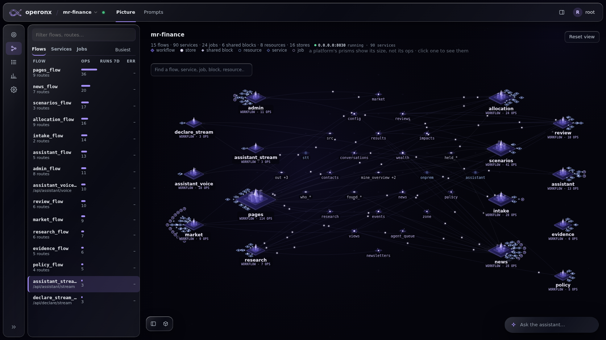
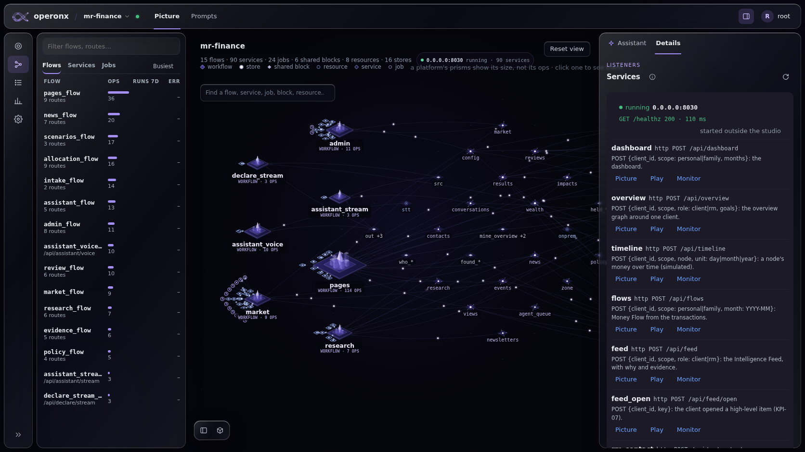
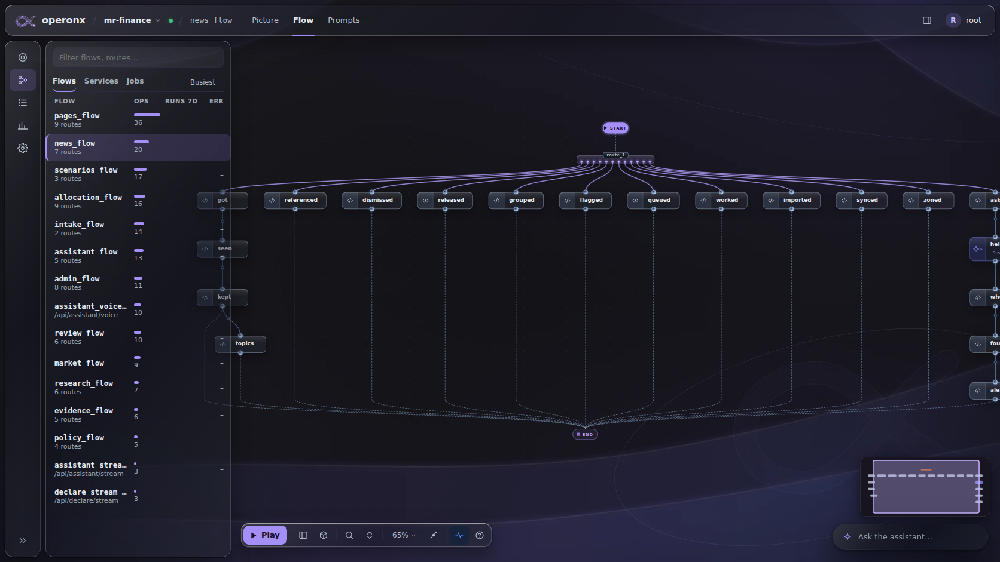
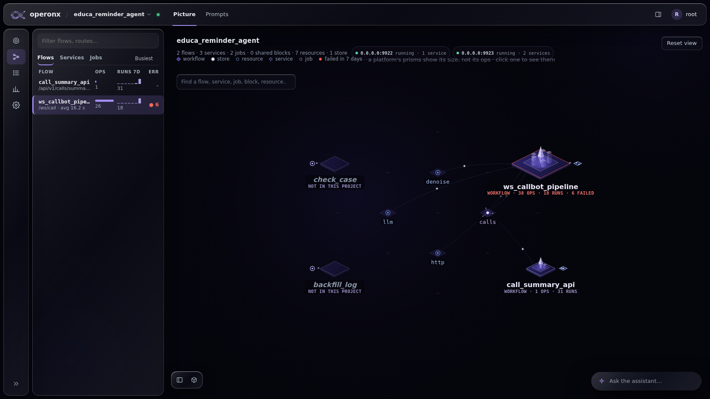
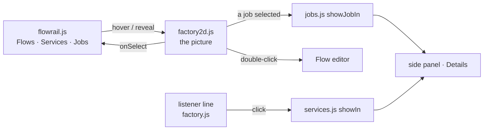

# One picture — what was built

Factory, Flow, Services and Jobs are one place now. Plan: [ONE_PICTURE_PLAN.md](ONE_PICTURE_PLAN.md).

```
before   Factory | Flow | Prompts | Services | Jobs
after    Picture | Prompts            (Flow appears while a flow is open)
```



## The five parts

| Part | Built |
|---|---|
| **O1** job in the card | Click a job on the picture, in a workflow's card or in the rail: the card shows the job — schedule, runs, a run's items or steps, **Run**, **Resume** — drawn by the Jobs screen's own code (`showJobIn`). |
| **O2** listeners | Each listener stands on the picture's counts line (`0.0.0.0:8030 running · 90 services`). A click opens them in the card: up/down, Start/Stop, log, environment check, queues and Requeue (`ServicesView.showIn`). |
| **O3** rail as index | One row over the list: **Flows · Services · Jobs** as text tabs, the flows' sort as a small select. Over the picture, the pointer on a row lights its shape, a click selects it, a second click opens it; a selection on the picture marks its row. The "Project picture" row is gone. |
| **O4** flow as a level | The Flow tab shows only while a flow is open; on the picture the flow's name leaves the crumbs. Double-click a platform, or "Open in the editor", goes in; the Picture tab comes back. |
| **O5** tabs removed | Services and Jobs are no longer tabs. |

A job, opened from the rail's Jobs list:


The listeners, in the card:



Inside a flow — `Picture · Flow · Prompts`, the rail is the flow switcher it was:



The callbot (two listeners, two flows):



## How it is wired



Nothing was rewritten: `jobs.js` and `services.js` draw into a box they are handed instead of only
their own page. No Python changed.

## Different from the plan

- **The Services and Jobs screens still exist as full pages** — their tabs are gone, the pages are
  not. Each card has "Open as a full page", and old addresses and the assistant's `open_jobs` land
  there. The plan had them redirect to the picture; a run's item table is too wide for the panel to be
  the only place it can be read.
- **Past 30 flows the rail still lists flows, not domains.** Finding one flow among thousands is what
  the rail's filter is for; a click reveals its domain on the picture.
- **No Esc and no `Picture / flow` crumb**: the Picture tab is the way back.
- **A single-flow project** still opens on its flow; its Picture tab is there.

## Not exercised

- Run, Resume, Start, Stop and Requeue were not pressed from the card: the test project is a copy of
  mr-finance with no job runs, and its listener is the live server. They are the same handlers the
  full pages use.
- A job with a long run (many items) in the 400 px panel was not seen for the same reason.

## Checked

mr-finance and the callbot on the software renderer; `node --test tests/js/` 228 pass; the Python
tests touching pages, tabs, jobs and services 64 pass.
