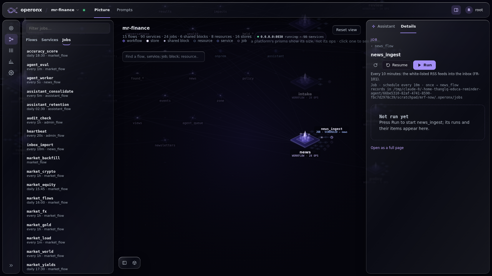
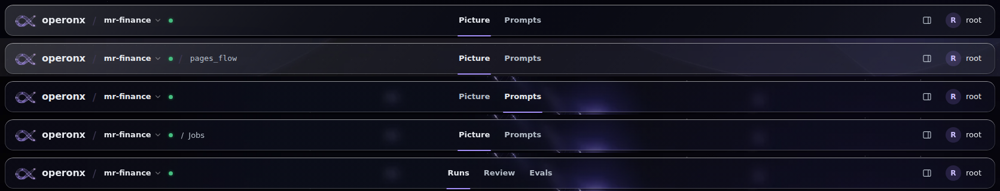
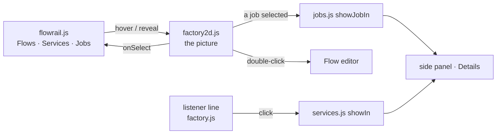
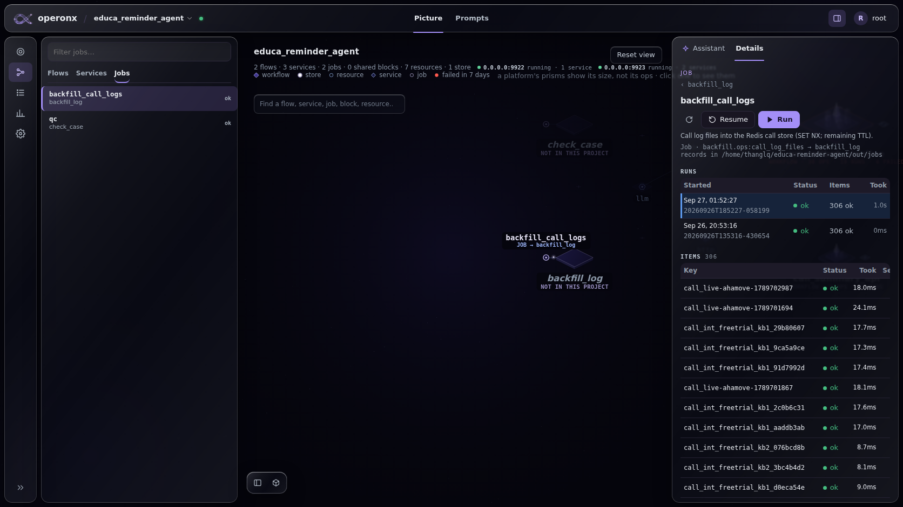

# One picture — what was built

Factory, Flow, Services and Jobs are one place now. Plan: [ONE_PICTURE_PLAN.md](ONE_PICTURE_PLAN.md).

```
before   Factory | Flow | Prompts | Services | Jobs
after    Picture | Prompts
```


## The five parts

| Part | Built |
|---|---|
| **O1** job in the card | Click a job on the picture, in a workflow's card or in the rail: the card shows the job — schedule, runs, a run's items or steps, **Run**, **Resume** — drawn by the Jobs screen's own code (`showJobIn`). |
| **O2** listeners | Each listener stands on the picture's counts line (`0.0.0.0:8030 running · 90 services`). A click opens them in the card: up/down, Start/Stop, log, environment check, queues and Requeue (`ServicesView.showIn`). |
| **O3** rail as index | One row over the list: **Flows · Services · Jobs** as text tabs, the flows' sort as a small select. Over the picture, the pointer on a row lights its shape, a click selects it, a second click opens it; a selection on the picture marks its row. The "Project picture" row is gone. |
| **O4** flow as a level | There is no Flow tab. Double-click a platform, or "Open in the editor", goes in; the crumbs name the flow; the Picture tab, still the open one, leads back. |
| **O5** tabs removed | Services and Jobs are no longer tabs. |

A job, opened from the rail's Jobs list:



The listeners, in the card:


Inside a flow — the crumbs name it, Picture stays the open tab, the rail is the flow switcher it was:


The callbot (two listeners, two flows):


## A top bar that does not move (added the same day)

The first cut showed the Flow tab only inside a flow. Measured, that made the strip two tabs on the
picture and three in a flow, and slid it sideways — Picture stood at x = 311, 419 or 437 — because it
followed a flow name that came and went. Now:

| | Before | After |
|---|---|---|
| tabs of the section | `Picture · Prompts` or `Picture · Flow · Prompts` | always `Picture · Prompts` |
| where the strip stands | after the crumbs, wherever they end | the middle of the bar: x = 757 on every screen |
| open tab in a flow, on the Jobs page, on the Services page | Flow, or none | Picture — they are levels under it; a click on Picture leads back |
| crumbs | a flow's name on every screen but the picture | only the level: the flow in the editor, `Jobs`, `Services` |
| the section's last screen | could reopen the Jobs or Services page | the picture, a flow or Prompts |
| a tab's width | heavier when open, nudging its neighbours 7 px | the same open or closed |



Still different between screens, on purpose: the flows rail is there on the picture and in a flow, and
not on Prompts or the Jobs and Services pages, which are full-width tables.

## How it is wired



Nothing was rewritten: `jobs.js` and `services.js` draw into a box they are handed instead of only
their own page. No Python changed.

## Different from the plan

- **The Services and Jobs screens still exist as full pages** — their tabs are gone, the pages are
  not. Each card has "Open as a full page", and old addresses and the assistant's `open_jobs` land
  there. The plan had them redirect to the picture; a run's item table is too wide for the panel to be
  the only place it can be read.
- **Past 30 flows the rail still lists flows, not domains.** Finding one flow among thousands is what
  the rail's filter is for; a click reveals its domain on the picture.
- **Esc** in a flow, with nothing selected, goes back to the picture; so does the Picture tab.
- **A single-flow project** still opens on its flow; its Picture tab is there.

A job with real runs, on the callbot (306 items; the item table scrolls sideways in the 420 px panel):



## Play that does not wait for the run store

"Starting Play…" stayed for minutes on mr-finance. Measured: the bridge itself starts in 2.8 s and the
doors answer in 0.13 s once it is up — but the doors call also listed recent runs, which first
refreshes the run store, and mr-finance's store holds 776,071 run directories (17 GB; `agent_worker`,
every 5 s, wrote 528,615 of them). That refresh is a walk of minutes, and it was running continuously
in the studio (two threads at 64% CPU, `FilesRunStore.refresh → os.walk`). Now the doors give the run
store half a second and go without recent sessions if it is not back; the screen asks for them after.
The store's size itself is not fixed here — see the open points.

## Not exercised

- Run, Resume, Start, Stop and Requeue were not pressed from the card: they would start real work on
  the owner's projects and live servers. They are the same handlers the full pages use.
- Several listeners are one line (`2 listeners · 2 running`), so the counts line keeps its length.

## Checked

mr-finance and the callbot on the software renderer; `node --test tests/js/` 228 pass; the Python
tests touching pages, tabs, jobs and services 64 pass.
