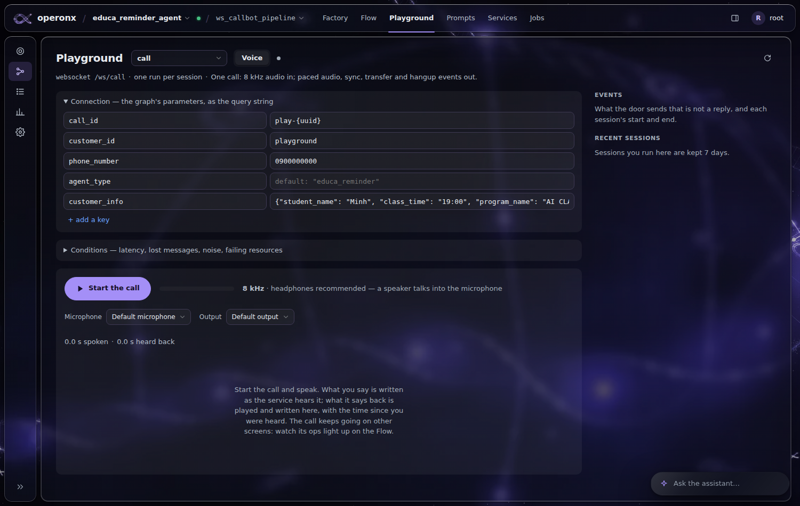
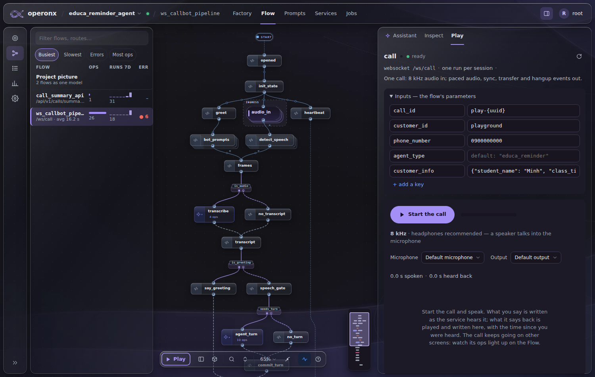
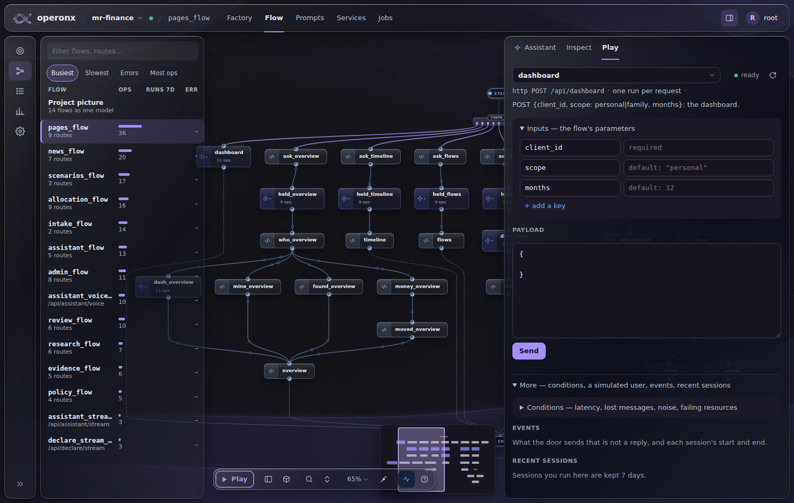
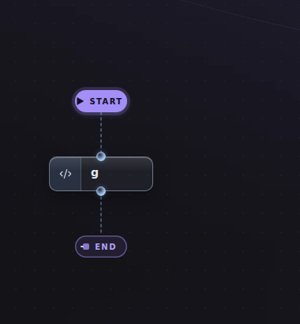
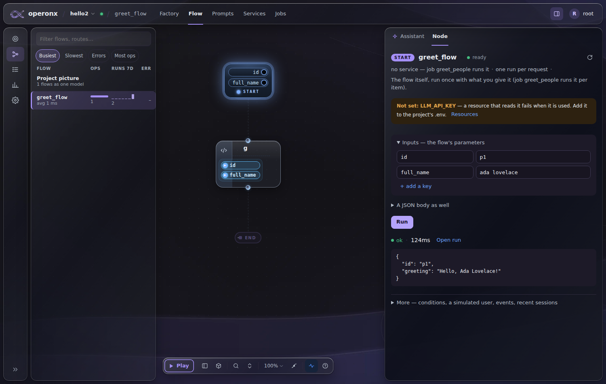
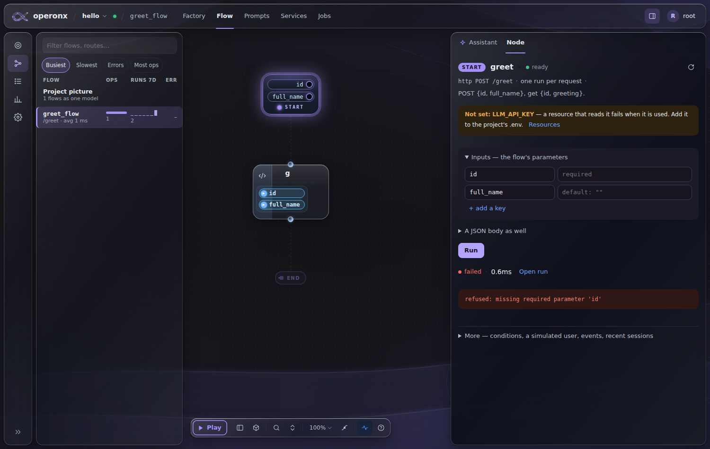
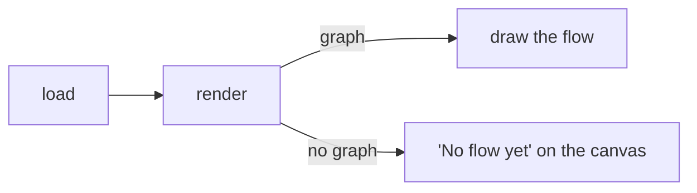
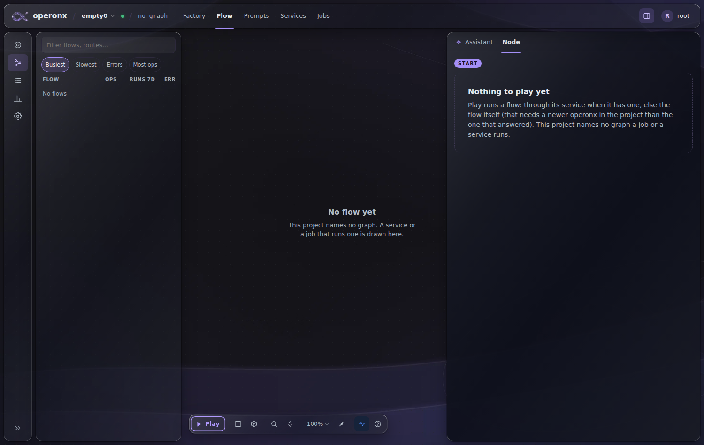
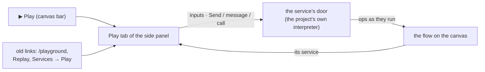

# Play — on the Flow

The Playground was a page of its own: pick a service, pick a kind (Chat, Form,
Voice, Simulated user), and run it away from the graph it runs. It is gone. A
flow is played where it is drawn.

## Result

| Before | After |
|---|---|
| A **Playground** tab beside Flow | A **▶ Play** button on the canvas bar; it opens the **Play** tab of the side panel |
| Pick the service from every service of the project | The service is the one of the flow on the canvas; a picker only when that flow has several doors (its routes), listing only those |
| Pick a kind: Chat / Form / Voice / Simulated user | One panel that follows what the door takes in: one request → the flow's parameters as fields and **Run** (a JSON body, when wanted, is folded under them); a session of text → a message box (the next message is the next turn of the same session); audio → **Start the call** |
| Conditions, events and recent sessions always on screen | Under **More**, closed: conditions, a simulated user, events, recent sessions |
| The run happens on another page | The canvas is beside it: its ops light up as it runs |

Before:

After — a voice service, and a request–reply one run from its fields:

## START is where a flow is played

The Play tab lasted a day. Play is what the side panel's **Node** tab (it was
"Inspect") shows for **START** — the node where the flow's input comes in:

| Picked on the canvas | The Node tab shows |
|---|---|
| START (or the ▶ Play button, which picks it) | Play: the flow's inputs, Run / message / call, the reply |
| an op | that op's detail, as before |

START and END were blue contacts with a halo; they are the brand's lavender
now — START a filled play button, END a quiet outline with a stop square.

**Every flow can be played.** A flow no service serves (a job's, or one the
manifest only names) is run directly: the engine's bridge gives it a door of
its own (`flow:<graph>`), and the fields start from the job's first item. This
needs the project's operonx to have that door; an older one plays only flows
behind a service.

## Two leftovers, closed

**START's opened terminal is lavender.** Clicking START opens its input plugs on the canvas. That capsule was still the blue of a data wire while the pill it opens from is lavender. START and END terminals now take the accent colour.

**A project with no graph loads.** Before: every page of such a project said "Could not load this project — Cannot read properties of undefined (reading 'nodes')", because the canvas walked the nodes of a graph that was not there. After: the canvas says so in one line and the other pages open.

## How it flows

## Code

- `static/project.html` — the Playground tab and pane are removed; `#btn-play` on the canvas bar, a `Play` side tab, `#playground` inside the side panel.
- `static/shell.js` — `switchTab("playground")` opens the Flow with the Play tab (so every old link and address still lands); the panel is drawn when it comes on screen; Play shows only on the Flow.
- `static/play.js` — no page head; the service follows the canvas (`follow`, `openOn`, `graphOf`); the kind is taken from the door; `More` holds the rest. The toys themselves (chat, form, call, simulated user) and the server side are unchanged.
- `static/studio.css`, `static/factory.css` — one column, a wider panel while playing, near-solid over the canvas.
