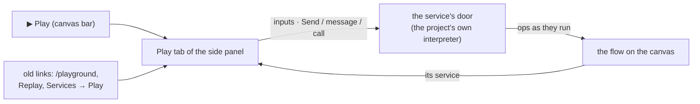

# Play — on the Flow

The Playground was a page of its own: pick a service, pick a kind (Chat, Form,
Voice, Simulated user), and run it away from the graph it runs. It is gone. A
flow is played where it is drawn.

## Result

| Before | After |
|---|---|
| A **Playground** tab beside Flow | A **▶ Play** button on the canvas bar; it opens the **Play** tab of the side panel |
| Pick the service from every service of the project | The service is the one of the flow on the canvas; a picker only when that flow has several doors (its routes), listing only those |
| Pick a kind: Chat / Form / Voice / Simulated user | One panel that follows what the door takes in: a payload → the inputs and **Send**; a session of text → a message box (the next message is the next turn of the same session); audio → **Start the call** |
| Conditions, events and recent sessions always on screen | Under **More**, closed: conditions, a simulated user, events, recent sessions |
| The run happens on another page | The canvas is beside it: its ops light up as it runs |

Before:

After — a voice service, and a request–reply one with More open:

## How it flows

## Code

- `static/project.html` — the Playground tab and pane are removed; `#btn-play` on the canvas bar, a `Play` side tab, `#playground` inside the side panel.
- `static/shell.js` — `switchTab("playground")` opens the Flow with the Play tab (so every old link and address still lands); the panel is drawn when it comes on screen; Play shows only on the Flow.
- `static/play.js` — no page head; the service follows the canvas (`follow`, `openOn`, `graphOf`); the kind is taken from the door; `More` holds the rest. The toys themselves (chat, form, call, simulated user) and the server side are unchanged.
- `static/studio.css`, `static/factory.css` — one column, a wider panel while playing, near-solid over the canvas.
