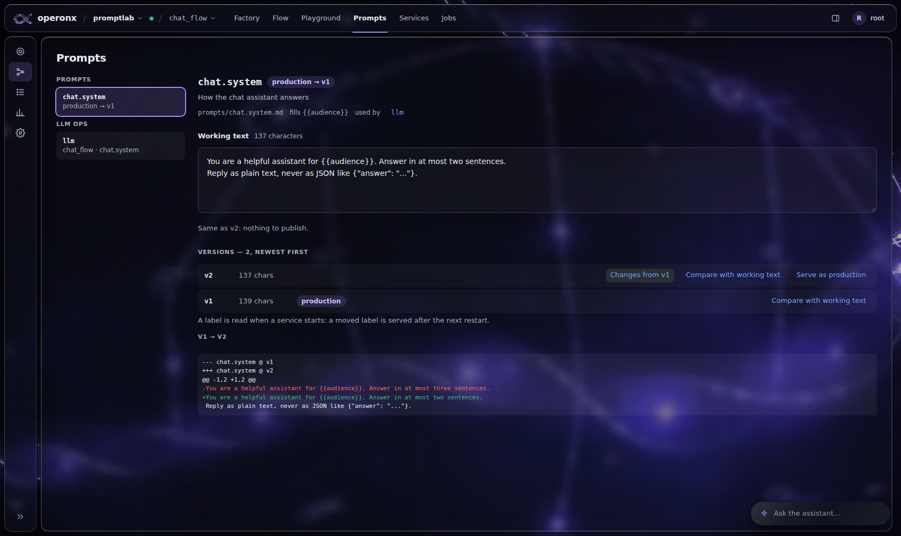
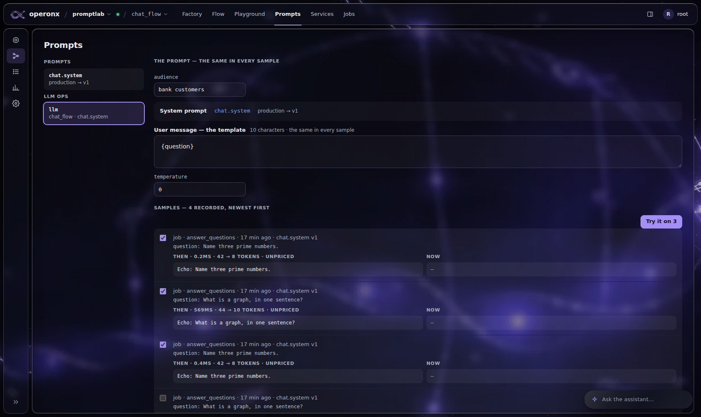
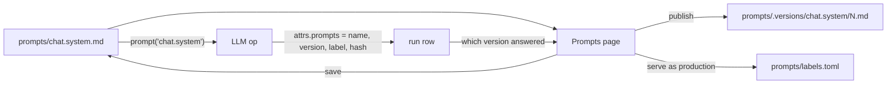
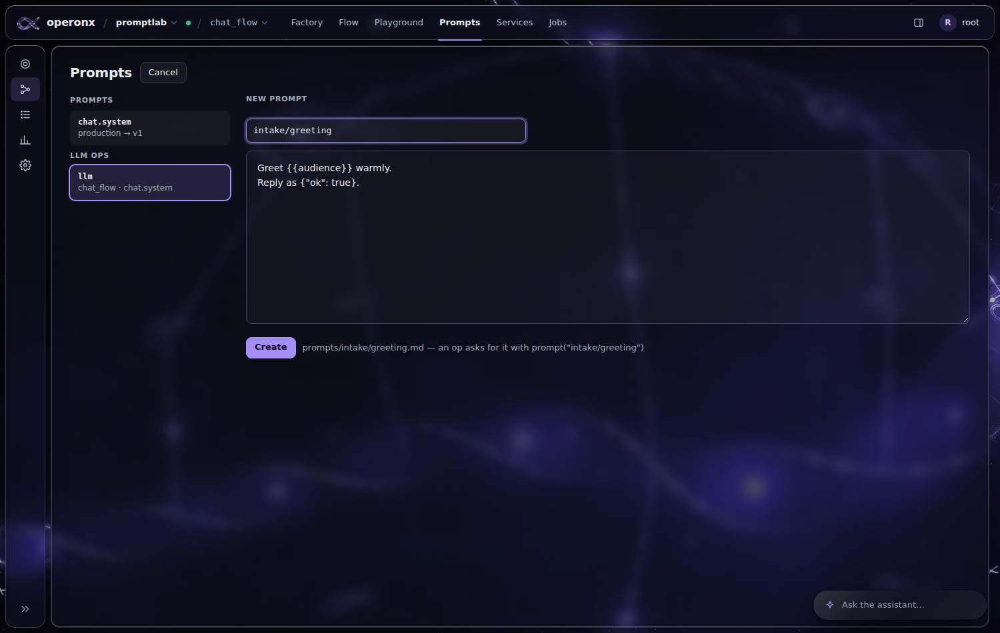
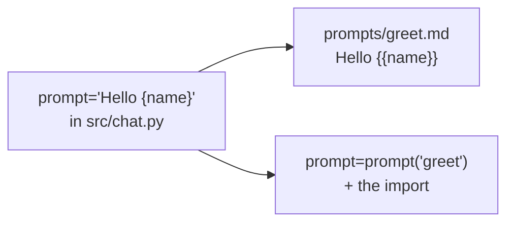
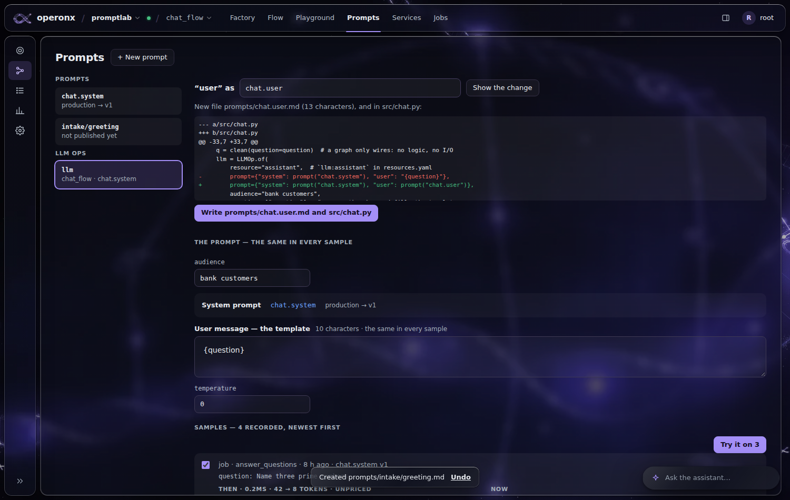
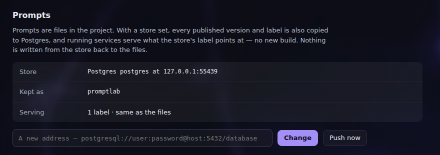

# The Prompts page — named prompts

Part P3 of the engine's `docs/PROMPTS_PLAN.md` (operonx ≥ 1.40.0).

## Result

A project keeps each prompt as a file, `prompts/<name>.md`, and code asks for
it by name: `prompt("chat.system")`. The page now shows those files, not only
what a run happened to record.

| Before | After |
|---|---|
| The list held LLM ops only; a prompt was whatever the last run sent | A **Prompts** section lists every `prompts/*.md` with the version `production` points at |
| No way to see what changed between two wordings | Versions, newest first, and a diff between any two (or against the working text) |
| A prompt was edited in the source file | Save the working text, **Publish as vN**, **Serve as production** — from the page |
| A sample said when it ran | A sample also says which version answered: `chat.system v1` |

An op whose part was asked for by name shows a link to the prompt instead of a
copy of its text:

## How it flows

A label is read when a service starts, so a moved label is served after the
next restart; the page says so under the versions.

## Creating one, and naming one that is in the code

**+ New prompt** writes `prompts/<name>.md` from the page and opens it with its
(empty) versions. Nothing asks for it until code says `prompt("name")`.

An op whose `prompt=` is text in the code has **Make this a named prompt** (one
per part of a `prompt={...}`). It shows the change first, then writes two files:

It is refused, and nothing is left behind, when the text would not come back
the same from a file (`{x!r}`, `{0}`, a literal `{{…}}`), or when the project
no longer builds with the change — a project on operonx < 1.40 has no
`operonx.prompts`.

## The prompt store (Settings → Prompts)

A service runs from an image built some time ago: a version published since is
not in it. With a store set, a publish or a moved label is also copied to
Postgres, and running services serve what the store's label points at
(`operonx.prompt_store`). One way — nothing is written from the store to the files.

Settings takes the address once: the value goes to the project's `.env`
(`PROMPT_STORE_DSN`, never sent back to the page), `[prompts] store =
"${PROMPT_STORE_DSN}"` is added to `operonx.toml`. An address that cannot be
reached is not saved. A service needs the same variable in its environment.

## Code

- `operonx_studio_toolkit/extract.py` — a node carries the `prompts` its op declared.
- `operonx_studio/app.py` — `GET /api/p/{pid}/prompts`, `…/prompts/text`,
  `…/prompts/diff`; `POST …/prompts/write` (refuses a stale base with 409),
  `…/prompts/publish`, `…/prompts/label`. A sample carries its run's `prompts`.
- `operonx_studio/access.py` — the three reads are open to readers, the three writes to editors.
- `operonx_studio/static/prompts.js` — the Prompts section, the named-prompt view, the link from an op.
- `tests/studio/test_prompts.py` — a prompt's life (write, publish, label, diff) and a sample naming its prompt.
- `operonx_studio/promptadopt.py` — `to_named` (the template as a file's text), `rewrite_call` (the source asking by name), `find_source`.
- `operonx_studio/app.py` — `POST …/prompts/new`, `POST …/prompts/adopt` (a preview without `apply`); both through safewrite.
- `tests/studio/test_prompt_adopt.py` — both endpoints and the two pure steps.
- `operonx_studio/app.py` — `POST …/settings/prompt-store` (set), `…/settings/prompt-store/push`; `prompt_store` in `GET …/settings`; publish and label push when a store is set. `tests/studio/test_prompt_adopt.py` covers them (one against a real Postgres, `OPERONX_TEST_PG_DSN`).
