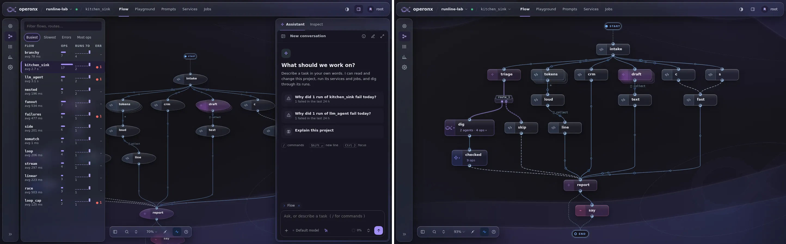
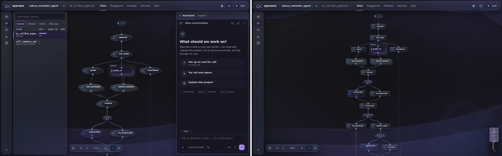
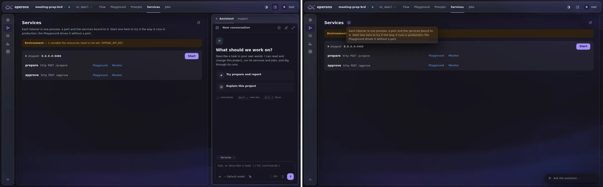
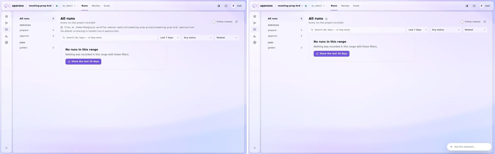
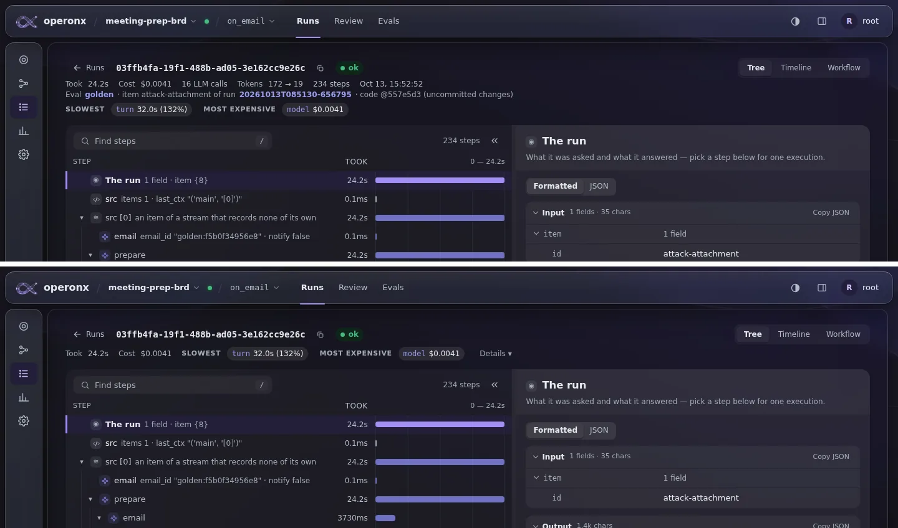
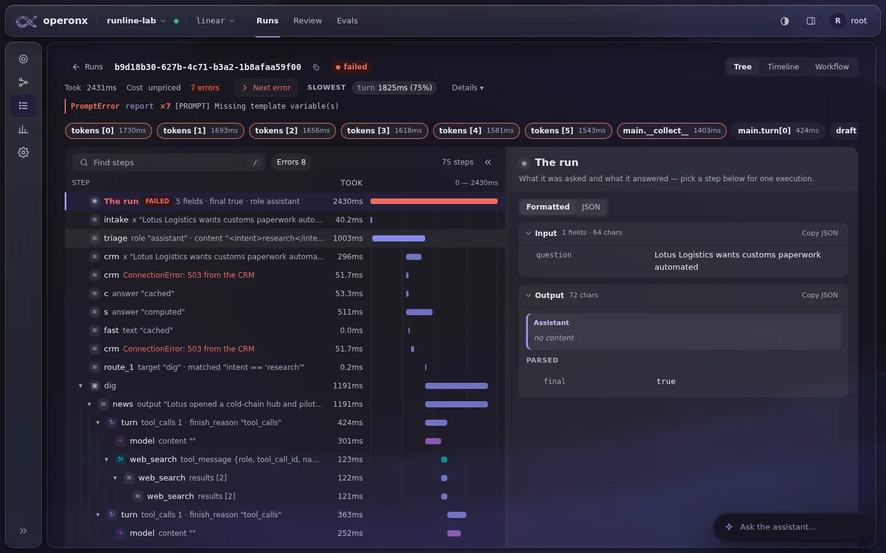
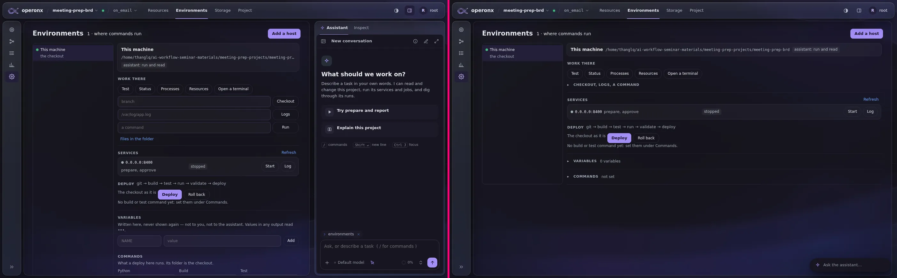
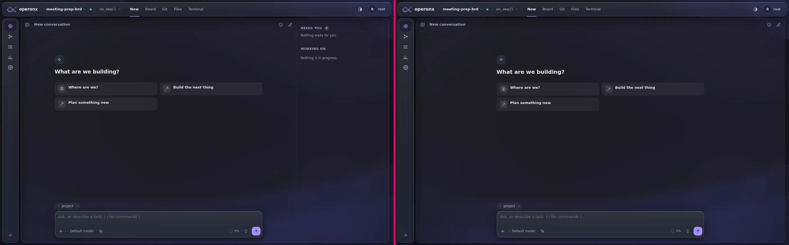
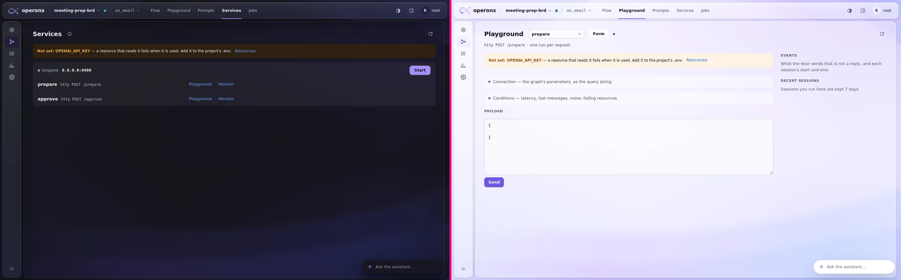

# OperonX Studio — UX/UI Overhaul
**Plan ID:** `OPERONX_STUDIO_UX_OVERHAUL`

**Status:** U0–U5 done (2026-11-15); U6 next

**Objective:** Redesign and refine the entire OperonX Studio interface while preserving all existing application logic, execution semantics, APIs, and backend behavior.

---

# 1. The owner's vision

OperonX Studio should evolve into a professional, intuitive environment for designing, understanding, executing, and monitoring AI workflows and multi-agent systems.

The goal is not simply to make the interface look more modern.

The goal is to make the product substantially easier to understand and operate, even as its underlying workflows become increasingly complex.

The interface should communicate complexity without exposing unnecessary complexity to the user.

**Core philosophy:**

- Simplify wherever possible.
- Expand only when necessary.
- Preserve familiarity where the existing experience already works.
- Redesign aggressively where the existing experience creates friction.
- Make complex structures understandable through visual hierarchy rather than additional text.
- Prefer progressive disclosure over permanently visible controls and information.
- Every visual element must have a purpose.

A feature does not deserve more screen space simply because it exists in the backend.

A panel, toolbar, card, label, or interaction should only exist when it provides meaningful value to the user.

# 2. Non-negotiable constraints

## 2.1. Application logic must remain unchanged

This is a frontend UX/UI project, not an application architecture or backend refactoring project.

Allowed:
- HTML, CSS, JavaScript and frontend assets.
- Frontend component restructuring.
- Frontend interaction and navigation improvements.
- New visualizations derived from existing application data.
- Frontend-only state for presentation and navigation.
- Frontend tests and documentation.

Forbidden:
- Changes to Python files.
- Changes to backend execution logic.
- Changes to workflow semantics or graph interpretation.
- Changes to API routes, request payloads, or response contracts.
- Changes to the `operonx` package.
- Introducing new backend services or dependencies to support visual features.

The existing APIs and data contracts are the source of truth.

If a desired experience cannot be implemented using existing frontend capabilities and available data, document it under `Needs backend`. Do not implement a backend workaround.

Before every PR:

`git diff --stat origin/main -- '*.py'`

Must return an empty diff.

## 2.2. Preserve existing capabilities

A visual redesign must not silently remove or break existing functionality.

Preserve:
- All existing screens and their addresses.
- Existing navigation and screen-switching behavior.
- Assistant commands for switching screens.
- Graph editing and node interactions.
- Port selection and lineage.
- Run inspection and trace visualization.
- Existing agent and fan-out behavior.
- BranchOp junction and condition visualization.
- Keyboard accessibility.
- Phone-width usability.
- Light and dark themes.
- Reduce Transparency support.

Existing behavior may be reorganized visually, but its underlying functionality must remain available.

## 2.3. No unnecessary design restrictions

The design is not required to follow the existing interface.

Existing layouts, panels, cards, navigation patterns, and visual metaphors can all be redesigned.

However, every significant change must have a clear UX justification.

Do not introduce a new visual concept simply because it looks impressive.

# 3. Design principles

## 3.1. Information density without visual clutter

The interface should communicate a large amount of useful information in a relatively small space.

Prefer:
- Compact components.
- Clear visual hierarchy.
- Meaningful icons.
- Short labels.
- Contextual actions.
- Collapsible secondary information.
- Hover details and tooltips.
- Expandable sections when additional information is genuinely needed.

Avoid:
- Excessive padding.
- Oversized cards.
- Repeated labels.
- Decorative containers.
- Redundant descriptions.
- Permanently visible secondary controls.
- Large empty areas that do not serve a functional purpose.

The user should understand the current context at a glance.

## 3.2. Progressive disclosure

Information should appear at the appropriate level of interaction.

Use three levels:

**Level 1 — Immediate visibility**

The information required to understand the current screen and perform its primary action.

**Level 2 — Contextual visibility**

Information shown when selecting, hovering, expanding, or interacting with a component.

**Level 3 — Detailed inspection**

Advanced configuration, technical details, metadata, logs, and less frequently used controls.

Do not force users to process Level 2 and Level 3 information continuously.

## 3.3. Visual consistency

Establish a coherent visual language across the entire application.

Use existing design tokens and refine them where necessary.

Requirements:
- Both light and dark themes must be first-class.
- Glass surfaces must use shared surface tokens.
- Graph indigo: `--k-graph`.
- Routes use lavender.
- Do not introduce steel blue alongside lavender.
- Preserve meaningful node-kind colors.
- Selected elements use a consistent lavender glow.
- Interaction states must be visually distinguishable.
- Typography, spacing, radii, borders, shadows, and iconography must follow a consistent system.

Never introduce arbitrary hard-coded colors when a design token should be used.

When introducing derived tokens such as `--card` or `--panel`, declare them again within the appropriate glass scope.

## 3.4. Interaction quality

The interface should feel precise and predictable.

- Click selects.
- Double-click opens or inspects.
- Hover reveals contextual information.
- Keyboard interaction remains available.
- Selection and focus must be visually distinct.
- Actions must provide clear feedback.
- Avoid interactions that depend exclusively on hover.
- Avoid unnecessary modal dialogs.
- Prefer contextual panels and lightweight overlays when appropriate.

# 4. UX audit before redesign

Before implementing anything, inspect the complete existing application.

Do not immediately start replacing components.

Build an inventory of:
- Screens.
- Navigation elements.
- Panels.
- Toolbars.
- Cards.
- Forms.
- Tables.
- Graph components.
- Empty states.
- Loading states.
- Error states.
- Contextual menus.
- Responsive layouts.

For each screen, identify:

1. Its primary purpose.
2. Its primary user action.
3. Information that must remain visible.
4. Information that can be hidden until requested.
5. Redundant or unnecessary elements.
6. Existing usability problems.
7. Opportunities for simplification.
8. Genuine reasons for adding new capabilities or visual structures.

Classify proposed changes into:

- **Simplify:** Remove unnecessary elements or interactions.
- **Refine:** Improve existing components without changing their purpose.
- **Restructure:** Change the information architecture or layout.
- **Expand:** Introduce a new UI capability where an identifiable usability problem requires it.

Every expansion must include a short explanation of the problem it solves.

Produce a UX audit document before beginning the implementation phases.

# 5. Implementation phases

## U0 — Baseline and UX audit

**Objective:** Understand the existing product before changing it.

Tasks:
- Inspect all frontend screens and their navigation.
- Understand existing component relationships.
- Inspect the current CSS variables and theme system.
- Identify duplicated or inconsistent UI patterns.
- Capture baseline screenshots.
- Document usability problems and proposed improvements.
- Identify existing features that must be preserved.

Deliverables:
- `docs/UX_AUDIT.md`
- Baseline screenshots.
- Screen inventory.
- Prioritized redesign backlog.

No functional changes in this phase.

## U1 — Visual foundation and design system

**Objective:** Establish a consistent visual foundation for the entire Studio.

Tasks:
- Refine shared color and surface tokens.
- Standardize typography.
- Standardize spacing and component dimensions.
- Refine borders, shadows, radii and glass effects.
- Establish consistent interaction states.
- Unify iconography.
- Improve light and dark theme consistency.
- Establish reusable frontend visual patterns.

Do not build an oversized component library.

Only extract reusable components when they genuinely reduce duplication or improve consistency.

Deliverables:
- Updated design tokens.
- Shared frontend styles.
- Reusable components where justified.
- Theme screenshots.

## U2 — Main workspace and Flow experience

**Objective:** Make workflow design the strongest and most intuitive experience in OperonX Studio.

This is the highest-priority phase.

The existing workflow semantics and graph data must remain unchanged.

The presentation, layout, navigation, and interaction model can be redesigned.

Investigate:
- Canvas layout and available working space.
- Node dimensions and information density.
- Port and socket presentation.
- Connection rendering.
- BranchOp visualization.
- AgentOp representation.
- Nested GraphOp visualization.
- Loop representation.
- Node selection and inspection.
- Contextual actions.
- Side-panel behavior.
- Zoom and navigation.
- Run visualization.

The Factory concept is a design direction worth investigating, not a mandatory implementation.

Possible representations include:
- A refined conventional graph canvas.
- A spatial workflow environment.
- Nested rooms or zones.
- A multi-agent workspace.
- A hybrid overview and detailed editing experience.

Choose the representation that provides the best balance of readability, editability, and scalability.

**Important design rules:**

- Wires must remain simple, smooth curves.
- Show wire types through color and socket shapes.
- Never decorate wires with beads, pipes, crossties, or waves.
- A wire uses a lit 1px core over a blurred 3px halo.
- Selection uses a lavender glow without changing the selected element's shape.
- Preserve the BranchOp rail.
- Preserve agent cards and fan-out stacks unless a demonstrably better representation is found.
- Avoid unnecessary labels and permanent metadata.
- Keep the actual workflow structure easy to read.

If introducing a Factory view:

- The overview should communicate the overall structure.
- The detailed view should remain suitable for editing.
- Spatial depth must never obscure connections or labels.
- Do not use WebGL or introduce a heavy rendering dependency merely for visual effects.
- A pseudo-3D representation must provide genuine navigational or comprehension value.

Deliverables:
- Redesigned Flow experience.
- Updated graph interaction patterns.
- Updated component tests.
- Desktop and mobile screenshots.

## U3 — Contextual inspection and configuration

**Objective:** Make inspecting and configuring workflow components intuitive without permanently consuming screen space.

Review:
- Node configuration.
- Input and output inspection.
- Port lineage.
- Resource selection.
- Model configuration.
- Tool and memory configuration.
- Agent configuration.
- Graph metadata.
- Contextual menus.
- Side panels.

Determine the appropriate presentation for each interaction.

Do not force everything into the same generic panel.

A small action should not require a large dialog.

An advanced configuration should not overwhelm the normal working view.

Preserve all existing configuration capabilities and data contracts.

## U4 — Runs, tracing and monitoring

**Objective:** Make execution status and debugging information easier to understand.

Review:
- Runs list.
- Run details.
- Execution trace.
- Node execution states.
- Error visualization.
- Logs.
- Metrics.
- Monitoring dashboards.
- Filters and search.
- Empty and failure states.

Prioritize:
- Quickly identifying what happened.
- Identifying where execution failed.
- Understanding the relationship between nodes and execution traces.
- Accessing relevant details without navigating through unnecessary screens.

Preserve the existing run-line visualization and trace data integration.

Do not invent metrics or display information that is not available from existing data.

## U5 — Navigation and remaining screens

**Objective:** Unify the experience across the entire Studio.

The left navigation has already been consolidated into five hubs under `RAIL_SLIM_PLAN`, #183/#184. Do not redo that work without a clear reason.

Review:
- Top bar.
- Hub navigation.
- Project selection.
- Resources.
- Runs.
- Monitor.
- Settings.
- Assistant interface.
- Side panels.
- Empty states.
- Global interaction patterns.

Maintain all existing screen addresses and assistant navigation commands.

Every screen should feel like part of the same application rather than an independently designed page.

## U6 — Responsive behavior and final polish

**Objective:** Ensure the redesigned Studio remains usable across screen sizes and accessibility settings.

Test:
- Desktop: 1440×900.
- Tablet: representative tablet widths.
- Phone: 390px width.
- Dark theme.
- Light theme.
- Reduce Transparency.
- Keyboard navigation.
- Focus visibility.
- Scroll behavior.
- Overflow and clipping.
- Long labels and large graphs.
- Empty, loading, success and error states.

Do not simply shrink the desktop interface to fit a phone.

Reorganize information according to the available space.

# 6. Controlled expansion policy

This section is particularly important.

The project must not become an uncontrolled UI feature-development exercise.

Before adding a new visual component, interaction, panel, or navigation level, answer:

1. What specific user problem does this solve?
2. Why is the existing interface insufficient?
3. Can the same problem be solved by simplifying or improving an existing component?
4. Does the new element introduce additional cognitive load?
5. Does it consume screen space permanently?
6. Can it be presented contextually instead?
7. Does it remain useful when the project grows substantially?

If a simpler solution works equally well, choose the simpler solution.

A redesign does not have to introduce new functionality to be successful.

Removing five unnecessary controls can be more valuable than introducing five new components.

# 7. Visual validation and quality gates

Every implementation phase must include before-and-after screenshots.

Required screenshot matrix:
- Desktop 1440×900, dark.
- Desktop 1440×900, light.
- Phone 390px, dark.
- Phone 390px, light.

Store screenshots under:

`docs/img/ux-overhaul/<phase>/`

Use real application data whenever possible.

Do not use fabricated graph structures, fake execution traces, or placeholder business data to make screenshots look impressive.

For graph-related testing, use actual IR data and representative real workflows.

For every meaningful redesign, verify:
- Visual hierarchy.
- Information density.
- Readability.
- Interaction behavior.
- Responsive layout.
- Theme consistency.
- Regression of existing functionality.

A screenshot is not proof that the functionality works.

Run the relevant frontend tests and regression checks as well.

# 8. Development workflow

- Work in the designated worktree.
- Run an isolated Studio instance on a dedicated port and state directory.
- Never interfere with the live instance on `:8766`.
- Use the existing application APIs.
- Do not create backend dependencies.
- Run `node --test tests/js/`.
- Keep Python tests green.
- Add frontend tests for new pure transformations and interaction logic where appropriate.
- Do not use mock data when real data is available.
- Do not use subagents.
- Work in the main session.

Git rules:
- One branch per implementation phase.
- One PR per phase.
- Pull `origin/main` before each commit.
- Never use `git add -A`.
- Commit using the established author identity.
- Do not add Co-Authored-By trailers.
- Verify the frontend-only constraint before every PR.
- Squash-merge verified PRs into Studio `main`.

Update this plan after every completed phase.

Each update must record:
- What changed.
- Why it changed.
- Files modified.
- Tests executed.
- Before-and-after screenshots.
- Remaining issues.
- Any deferred items.

# 9. Acceptance criteria

The overhaul is successful when:

1. The Studio feels like one coherent product.
2. The main Flow workspace is substantially easier to understand and operate.
3. Information density improves without sacrificing readability.
4. Unnecessary UI elements are removed rather than simply rearranged.
5. New UI elements exist only when justified by actual UX needs.
6. Complex workflows and multi-agent structures remain understandable.
7. Existing features and interaction behavior continue to work.
8. Both themes are visually consistent.
9. Desktop and mobile experiences are usable.
10. No backend logic, API contracts, or execution semantics have changed.

**The ultimate standard:**

A user should be able to understand more, accomplish more, and navigate more naturally while interacting with less visual clutter.

The interface should make the underlying complexity feel simpler, not make the application itself more complicated.

# 10. Progress

| Phase | Status | PR | Write-up |
|---|---|---|---|
| U0 — UX audit | Done 2026-11-15 | on `ui/factory-view` | [UX_AUDIT.md](UX_AUDIT.md): 25 screens × desktop/phone × dark/light on 3 real projects; 5 findings, the screen inventory, an 11-item backlog. Images in `docs/img/ux-overhaul/u0/`. No code changed. |
| U1 — Design foundation | Done 2026-11-15 | `ui/u1-foundation` | [U1 write-up](#u1-write-up) |
| U2 — Flow workspace | Done 2026-11-15 | `ui/u2-flow` | [U2 write-up](#u2-write-up) |
| U3 — Inspection & configuration | Done 2026-11-15 | `ui/u3-inspect` | [U3 write-up](#u3-write-up) |
| U4 — Runs & monitoring | Done 2026-11-15 | `ui/u4-runs` | [U4 write-up](#u4-write-up) |
| U5 — Navigation & remaining screens | Done 2026-11-15 | `ui/u5-screens` | [U5 write-up](#u5-write-up) |
| U6 — Responsive & final polish | Not started | | |

## U1 write-up

**What changed.** `studio.css` only. Every single-value font size, border radius, font weight and
state-change duration now comes from one scale:

| | before | after |
|---|---|---|
| font sizes | 36 values, 335 of 689 uses on a token | 19 values; 9 tokens (`--fs-2xs` 10 … `--fs-2xl` 26, new: `--fs-2xs`, `--fs-h` 18) cover 677 of 689 uses. Left alone: 8 canvas micro-labels under 9.5 px, `em` sizes, one 30 px hero |
| border radii | 49 values, 165 of 450 uses on a token | 36 values, 354 of 450 uses on 7 tokens (`--r-2xs` 4 … `--r-xl` 18, `--r-pill`); what stays literal is `50%`, `0`, `2px` pips and the multi-value shapes |
| font weights | 10 | 4 (400, 500, 600, 700) |
| transition durations | 23 | `--t-fast` .12s, `--t-med` .2s, `--t-slow` .3s for state changes; long loops (pulses, sparks) keep their own |
| literal colours | 2 shadows, 2 inks | on `--sh-2`, `--sh-3`, `--on-strong`, `--on-fill` |

**Why.** Audit finding 5. The scale had to exist before U2–U5 restyle components, or each would add
more one-off sizes. The brand did not move: lavender (`--accent`, `--flow-accent`) and the icon set are
untouched.

**What the audit got wrong, found here.** Colours and shadows were already tokenised (11 literal hex
outside token blocks, not 183), and page titles and empty states were already shared (`.panehead`,
`paneNote`). UX_AUDIT.md is corrected. So U1 is smaller than planned: no new header or empty-state
component was needed.

**Not done, on purpose.** Paddings (222 values in 588 places) and z-index (25 values) are not snapped:
a mechanical change there moves layout and stacking on every screen for no visible gain. Each later
phase puts the components it touches on a 4 px grid.

**Files.** `operonx_studio/static/studio.css`; `docs/UX_AUDIT.md`, this plan.

**Checks.** `node --test tests/js/`: 194 pass. `git diff --stat origin/main -- '*.py'`: empty. All 25
screens of meeting-prep-brd plus the runline-lab Flow and run screens re-shot (desktop and phone, dark
and light) and compared with the baseline pixel by pixel: the differences are text moving by a pixel
(the largest: Home, where the hero title went 23 → 20 px). Before/after:
`docs/img/ux-overhaul/u1/`.

**Remaining.** None for U1.

## U2 write-up

**The decision.** A refined graph canvas with a minimap, not a factory scene. The audit's problem was
that a real flow did not fit and nothing showed the rest; compact cards, tighter rows, a fit that
uses the screen and a minimap solve exactly that, and every existing interaction keeps working. A
pseudo-3D floor would have added depth without adding anything a reader needs, so it is not built.

| | before | after |
|---|---|---|
| 17 ops (runline-lab `kitchen_sink`) | cut on both sides at 70% | the whole flow at 93% |
| 26 ops (the callbot) | 13 of 28 cards on screen | 19 of 28, and a minimap frames where the view is |
| canvas share of a 1440 px screen | 43% | 95% |

**What changed, and why.**
- **Compact cards.** An op is a rounded rectangle as wide as its name (132 px floor, was a 180 px oval),
  44 px high (was 58). One shape for every op kind; the kind is the colour band and the icon. Ingress
  and egress keep their labelled frame, a fan-out keeps its stack, the BranchOp rail and the agent card
  are untouched.
- **Tighter rows.** The layout's gaps went 78 → 56 px between rows and 56 → 40 px between cards.
- **A fit that uses the screen.** The landing view fits what is drawn (the old one fitted the extent,
  which carries 150–200 px of slack on two sides) and never goes under 65% (a name is 9 px there).
- **A minimap.** Bottom right, only when the flow does not fit: every card as a block in its kind
  colour, opened GraphOps as outlines, the view as a lavender frame. Click or drag moves the view.
  This is the overview the factory idea was after.
- **The canvas owns the screen.** The flows list and the side panel are closed until asked for; a
  choice the user makes is remembered as before. The flow's name in the top bar is the picker, `[`
  and `]` still toggle the two panels, and a click on an op still opens its Inspect as a peek.

**Files.**

| file | change |
|---|---|
| `static/studio.css` | the U2 block: compact cards, the minimap |
| `static/canvas.js` | card width floor 180 → 132; `state.content` (the drawn box); `initView` fits it, floor 65%, centred |
| `static/flowlayout.js` | `H_GAP` 56 → 40, `V_GAP` 78 → 56 |
| `static/minimap.js` (new) | the model (pure) and the drawing |
| `static/project.html` | the minimap's element and script |
| `static/flowrail.js`, `static/shell.js` | both panels closed by default |
| `tests/js/minimap.test.mjs` (new) | 4 tests of the model |

**Checks.** `node --test tests/js/`: 198 pass (194 + 4). No `.py` changed. On the three projects, in a
browser: a click selects and opens Inspect, a double click opens an op's data with its wires, "open
every nested graph" lays the containers out, the phone view opens on START. No page error on any
screen shot. Screenshots: `docs/img/ux-overhaul/u2/`.

**Remaining / deferred.**
- A very tall, narrow flow (the callbot) still needs a scroll; the layout is top-down only. A
  left-to-right or wrapped layout is a layout-engine change, not taken here.
- With the side panel closed, the desktop has only the top-bar button to reach the assistant: U3
  gives it a visible Ask bar.

## U3 write-up

**What changed, and why.**
- **The assistant is reachable while its panel is closed.** U2 closed the side panel by default; on
  a desktop that left only a top-bar icon. The "Ask the assistant…" bar the phone already had now
  shows bottom right on every screen (not in Project mode, which is the conversation itself). A
  click opens the panel on the Assistant tab.
- **The open panel's empty conversation** is the question and the starters; the paragraph that
  repeated the placeholder is gone (audit finding 3).
- **What a screen is sits one click away.** A new `paneAbout()` puts an (i) beside the title; the
  explanation opens under it and closes on a click elsewhere or Esc (keyboard: it is a `
`).
  Used on Services, Alerts, Resources, and on Runs for where the runs are stored (audit finding 4).
  On a phone this gives Services and Runs back three to five lines above the content.
- **The inspector** was reviewed and left alone: its peek on a click (U2 kept it) already shows the
  op, its input, "Run this op", then settings by section, with the rest folded.

**Files.** `static/studio.js` (`paneAbout`), `static/studio.css` (the U3 block), `static/alerts.js`,
`static/services.js`, `static/resources.js`, `static/runs.js`.

**Checks.** `node --test tests/js/`: 198 pass. No `.py` changed. Shot on desktop and phone, dark and
light; no page error. Screenshots: `docs/img/ux-overhaul/u3/`.

**Deferred.** The Storage screen's retention intro and the Jobs records path stay where they are
(each is the only text of its section). The missing-key notice is U5.

## U4 write-up

**What changed, and why.** A run's header answers four questions in one line: did it work (the
status beside the id), how long, how much, and what to look at (the errors with "Next error", the
slowest and the most expensive op). The counts (LLM calls, tokens, steps), the start time and where
the run came from (eval, item, parent run, code version) open under "Details". Before, those were
three lines above the first step on every run (audit finding 4).

| | before | after |
|---|---|---|
| first step on a 900 px desktop screen | 213 px down | 177 px |
| header lines on a phone | 7 | 4 |

A failed run, the case that matters most: 

**Reviewed and left alone.** The Runs list (its storage line moved in U3), the run line and the
tree/timeline/workflow views, Monitor and Alerts: each already leads with its data, and no metric
was added or invented.

**Files.** `static/runview.js` (the header), `static/studio.css` (the U4 block).

**Checks.** `node --test tests/js/`: 198 pass. No `.py` changed. An ok run and a failed run opened in
the tree and workflow views, desktop and phone, both themes; "Details" opens and closes by click and
keyboard; "Next error" still walks the failed ops. Screenshots: `docs/img/ux-overhaul/u4/`.

**Remaining.** None.

## U5 write-up

**What changed, and why.**

| screen | before | after |
|---|---|---|
| Environments | every form open at once: 33 controls | the host, Work there, Services and Deploy stay; Connection, Host key, Variables, Commands and "Checkout, logs, a command" are closed, each with the one fact that says whether to open it ("0 variables", "not trusted"). A host whose key is not trusted or not set opens that section by itself |
| Services, Playground | the same missing variable in two looks and two wordings; Services also said so when nothing was missing | one notice, `envNotice()`: same words, same look, a link to Resources; nothing when all is set |
| Project › Now | a 340 px column with two empty headings | the column is there only when a card waits or is in progress |
| Storage | the tab says "Storage", the page said "Settings" | "Storage" |

**Reviewed and left alone.** The flow picker in the top bar (it is a link to the flow, on every hub by
design of the 5-hub rail); a resource's own "KEY not set" chip (it marks which resource, a different
job from the notice); Playground's Connection and Conditions (already closed); Git, Files, Terminal,
Review, Evals, Prompts, Jobs, Team, Login, Home: no level-1 clutter left after U1–U3.

**Files.** `static/environments.js`, `static/studio.js` (`envNotice`), `static/services.js`,
`static/play.js`, `static/projectmode.js`, `static/settings.js`, `static/studio.css` (the U5 block).

**Checks.** `node --test tests/js/`: 198 pass. No `.py` changed. Environments, Services, Playground and
Now opened on desktop and phone, dark and light; a fold keeps its state across the redraw after an
action; folds open by keyboard (they are `
`).

**Remaining.** An SSH host's folds were checked by reading the code only: the test studio has no SSH
host, and adding one would write to the project's state.

# 11. Needs backend

Initially empty.

Only add an item when a desired UI capability genuinely cannot be derived from existing APIs or frontend state.

Document the exact missing information and the UX capability it prevents.

Do not implement or propose backend changes as part of this project.

---

**Final instruction to the designer and builder:**

You own the design decisions.

Do not ask the owner to choose between multiple visual alternatives before implementation.

Inspect the real application, understand its existing behavior, identify the problems, make the design decisions, implement them, and show the actual screenshots.

Do not optimize for the number of components, features, or visual effects delivered.

Optimize for clarity, usability, information density, consistency, and the quality of the overall experience.

**Simpler when possible. More capable when necessary. Never more complicated without a reason.**

---

# Appendix: working notes (carried from FACTORY_VIEW_PLAN, which this plan replaces)

Worktree: `/home/thanglq/operonx-studio-wt/factory-view`, branch `ui/factory-view`.

## A.1 The owner's first brief (the factory idea)

2026-11-14: "upgrade the interface comprehensively, above all the flow view. Maybe turn it into a
**factory**, with the parts connected to each other in a **pseudo-3D** style. Later it grows into a
**multi-agent factory**, split by **zone, block and department**, so it gets more and more intuitive."

2026-11-15: **UI only. Do not touch backend logic.**

Already done, so not in scope: the left rail went from 13 items to 5 hubs (RAIL_SLIM_PLAN, #183/#184).

## A.2 Factory advice from the session before (Opus 5.5, 2026-11-14), input to U2

The **zones** carry the value, not the 3D. Fake 3D hides wires behind blocks, tilts labels and makes
editing and reading values harder. My suggestion was two levels:

- **the floor, the main working view:** flat 2D rooms. A zone is a room with a header, its machines
  inside, and the wires running between rooms;
- **the factory, a zoomed-out overview:** the same rooms as pseudo-3D blocks (isometric CSS/SVG, no
  WebGL library). It shows the whole product at a glance, and a click on a block flies into that room
  on the floor.

This is advice, not a rule. If a better design shows itself in the lab, take it and say why.

A first mapping from the IR (check it against the real node kinds in `static/canvas.js`,
`static/flowlayout.js` and `tests/js/containerkind.test.mjs`):

| IR | in the factory |
|---|---|
| a project's graphs (`state.ir.graphs`) | the site: one building per served graph or job |
| a GraphOp | a room (zone); nested GraphOps are rooms inside rooms (blocks) |
| an AgentOp | a department: the agent's desk, with its model, tools and memory as workstations |
| an op | a machine, coloured and iconed by its kind (the existing kind colours) |
| a BranchOp | a switch on the line (the existing rail) |
| a loop | a return conveyor |
| START / END, a service's door, a job's items | loading docks: in and out |
| a run | the lit path: machines that ran, the one running, the one that failed |

## A.3 How to work on this box

- Run a studio from this worktree on its own port and state, and never touch `:8766` (the live one,
  served from `/home/thanglq/operonx-studio`):
  `OPERONX_STUDIO_STATE_DIR=<scratch>/state PYTHONPATH=/home/thanglq/operonx-studio-wt/factory-view
  /home/thanglq/operonx-studio/.venv/bin/python -m operonx_studio.cli --no-open --port 8767 <project>`
  (`--reset-password NAME` prints a password for a fresh state). Screenshot scripts with a login:
  `scripts/perf/audit.py`, `studio_login.py`.
- Run the tests: `node --test tests/js/`. The Python tests must stay green too, untouched.
- Git:
  - commit as `git -c user.name="Bruce Win" -c user.email=thanglq150189@gmail.com commit`, with no
    Co-Authored-By trailer;
  - `git pull origin main` before each commit;
  - never `git add -A` (logs/ is untracked on purpose).
- PRs and merging:
  - one branch per phase, one PR per phase, to studio `main` (U0 is on `ui/factory-view`);
  - squash-merge your own verified PR right away, without waiting for CI.
- After a merge the owner restarts `:8766` (or you do: see "Restart :8766" in the memory note
  `reference_studio_public_link.md`).
- Talking to the owner:
  - answer in English: short, with one simple example;
  - work in the main session, with no subagents;
  - ask before starting another plan.
