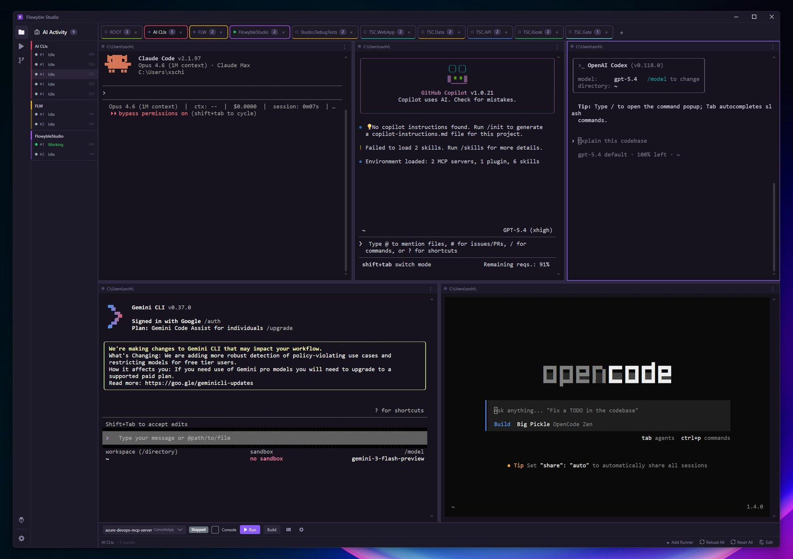
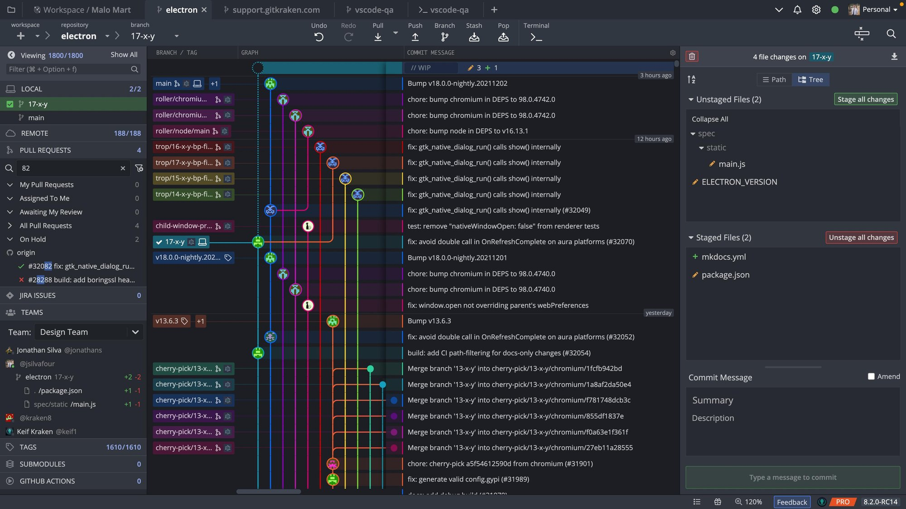
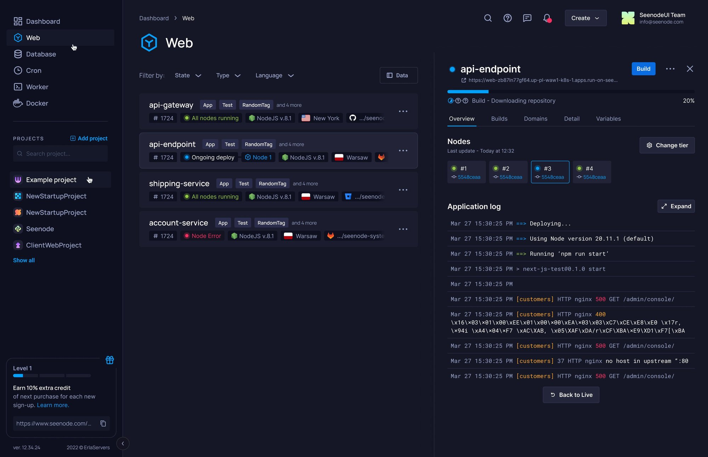
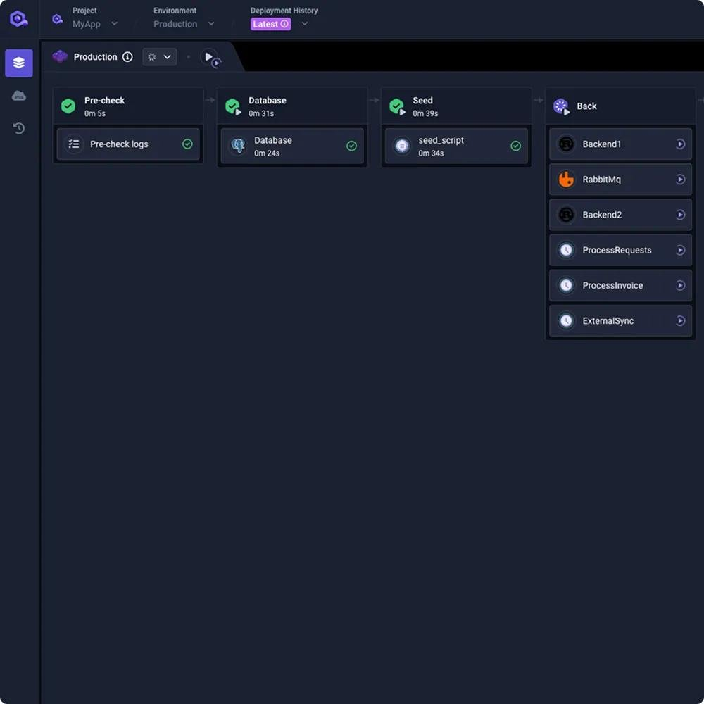

# One project, one execution model (WORKSPACE_PLAN)

Two inputs, one plan:

- **What the assistant did on mr-finance PR #74** (2026-11-01): the turn checks of
  [TURN_HONESTY_PLAN](TURN_HONESTY_PLAN.md) caught two things, and two more went through (T1–T3).
- **The owner's brief**, kept word for word in [WORKSPACE_BRIEF.md](WORKSPACE_BRIEF.md): the board,
  plan, checklist and assistant show one state, and the studio gains a terminal, git, environments and
  deploys (W0–W4).

T1–T3 are small and come first. W0 is an audit, and only after it does W1 get its concrete steps:
the brief says not to assume what exists.

## T — what the PR #74 turn showed

The turn "continue FF5 toward < 20 flows" (10:04–10:48, 44 min, $6.65). Good: pulled first, one
commit per fold with the contract test after each, FF5 kept in progress, and both times the stop hook
sent it back it did what was asked (steps closed; `failing_on_base`: both failures fail on main too).

What went through:

| | seen | why it matters |
|---|---|---|
| T1 | "< 20" was met by folding `zone_flow` into `news_flow` (0c497bf) and `evaluation_flow` into `market_flow` (50f3380), while the plan's table — "One flow per feature" — gives zone (row 14) and evaluation (row 13) their own flows. FF6 marked done on that count. | A number stands for a design. Meeting it another way is the owner's call, and it was reported as done work. |
| T2 | "`brd check` reports 4 summary-row errors. I haven't checked whether they exist on main." — in the reply and again after "hello ?". | The turn knew a check was missing and ended anyway. S2 covers only pytest. |
| T3 | The same question as S2 ("is it on main too?") for a check that is not a test. | `failing_on_base` already extracts the merge-base; running another command there is one call. |

**T1.** The S1 reason (stophook.py) also asks: "was it met the way the plan says (its table, its
decisions)? A different way is the owner's call: say what you did and ask." Knowledge: a target number
stands for the plan's design.

**T2.** A new stop check: the last assistant text says it has not checked or verified something
("haven't checked", "not verified", "didn't run") → sent back once: run it, or say why it cannot run.

**T3.** `on_base(command, cwd, base?)` in basecheck.py: the command in the merge-base copy, its output
and exit status beside the branch's. `failing_on_base` stays as the test-shaped case.

Gates: stophook tests for T1/T2 on the PR #74 transcript (its last turn sent back for both);
`test_basecheck.py` for `on_base` on a real repo; a Sonnet turn with the hook.

**Done (2026-11-01).** On the PR #74 transcript the turn that marked FF6 done is sent back for T1 and T2,
and its last turn ("hello ?") for T2 (`test_the_pr74_turns_are_sent_back`). T2 matches first person only
("I haven't checked …"): "R12 is not verified" is a BRD status, not a check left undone.
`on_base(cwd, command)` runs the command here and in the merge-base copy and shows both exit statuses
(`test_a_command_runs_here_and_on_base`). A Sonnet turn told to end on "I haven't checked whether
notes.txt exists" was sent back once, ran `ls -l notes.txt`, and answered ($0.10). Studio suite: 656
passed, 5 skipped.

## W — the workspace (the brief)

The phases follow the brief's §14; each ends with tests, docs and its cards on the board.

**W0 — Audit.** For each of: projects, plans, board cards, task states, checklist and requirement
verification, questions, assistant sessions, steps cards and progress events, git, evidence — where it
is stored, who writes it, who reads it, and where two of them can disagree. Known pieces to start from
(to be confirmed, not assumed): the board in `.operonx/project` (operonx-project engine), plans on the
board (engine `plan` op, studio board_plan/auto-sync), the steps card, runhook/progress (live calls),
the stop hook, the Files page, the worktrees card. Output: the root causes, and W1's steps with gates.

**W1 — Unified project execution model** (brief §1–4, the most important part):
- one hierarchy, adapted to what exists: project → plan → card → run → steps, logs, tests, git, evidence;
- a card the assistant creates is on the board at once; a run names its card; starting moves the card,
  the run's real result moves it again; a failed run never reads done; "built", "tests pass",
  "reviewed" and "criteria verified" stay separate;
- found work becomes a card (or a follow-up linked to one), not a line in chat; dependencies kept;
- a step inside a run is not a card;
- the page: overview (active plan and card, counts, open questions and requirements, recent runs), an
  execution graph from the same data, a card's detail (criteria, dependencies, runs, terminals, git,
  tests, evidence), and the assistant panel aware of the selected card, with the card it works on lit.

**W2 — Terminal and Git** (§5–6): real PTY sessions with tabs and splits, built on the execution layer
the assistant's calls already use (no second process manager); the assistant can open and use them and
tie them to a card. Git: status, branches, remotes, fetch/pull/push, staged and unstaged with line
diffs, history and graph, branch/commit/merge/rebase, conflicts, PRs — linked to cards and runs, with
the existing guards and commit identity, and nothing uncommitted ever dropped without a confirmation.

**W3 — Environments** (§7–8): one provider interface (local, SSH; containers later). SSH profiles with
host-key checks, a connection test, remote terminals, checkout, logs and processes. Secrets stored
apart, never shown to the model or in logs; per-environment permissions; production asks more.

**W4 — Run, test, deploy** (§9–10): services with start/stop/restart, ports, env, status, logs, health
and a preview URL; a light pipeline git → build → test → run → validate → deploy per environment,
observable stage by stage, its evidence on the card; production needs approval, keeps history and a
rollback where it can.

Constraints from the brief (§15) hold throughout: reuse before adding, no duplicate models, no fake
states, no polling or model calls that are not needed, long runs supported, user data kept.

## Materials

Screenshots the owner gave as references (2026-11-01):

| | what to take from it |
|---|---|
| [terminals-ai-clis.jpg](img/workspace/terminals-ai-clis.jpg) | Terminal (W2): project tabs with a session count, a split grid of live sessions, a side rail of sessions with *Working*/*Idle* and age, a run/build bar per service. |
| [git-graph.jpg](img/workspace/git-graph.jpg) | Git (W2): branch lanes beside commit rows, local/remote/PRs on the left, unstaged/staged and the commit box on the right. |
| [environments-services.jpg](img/workspace/environments-services.jpg) | Environments and runtime (W3–W4): services with a status chip (running, deploying, error), a side panel with build progress, nodes and a live log with *Back to Live*. |
| [deploy-pipeline.jpg](img/workspace/deploy-pipeline.jpg) | Deploy (W4) and the execution graph (W1): stages as columns left to right, each with its duration and a check, the running one open. |

