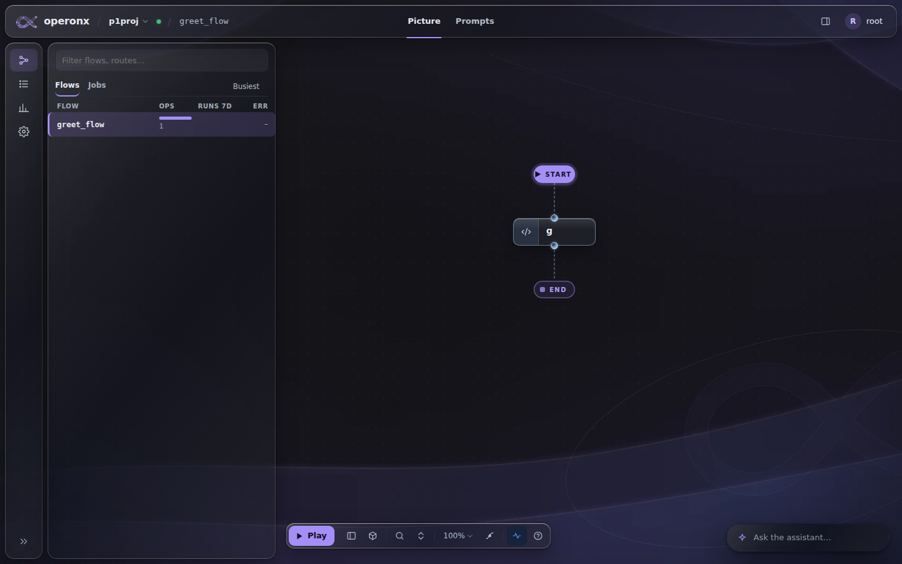
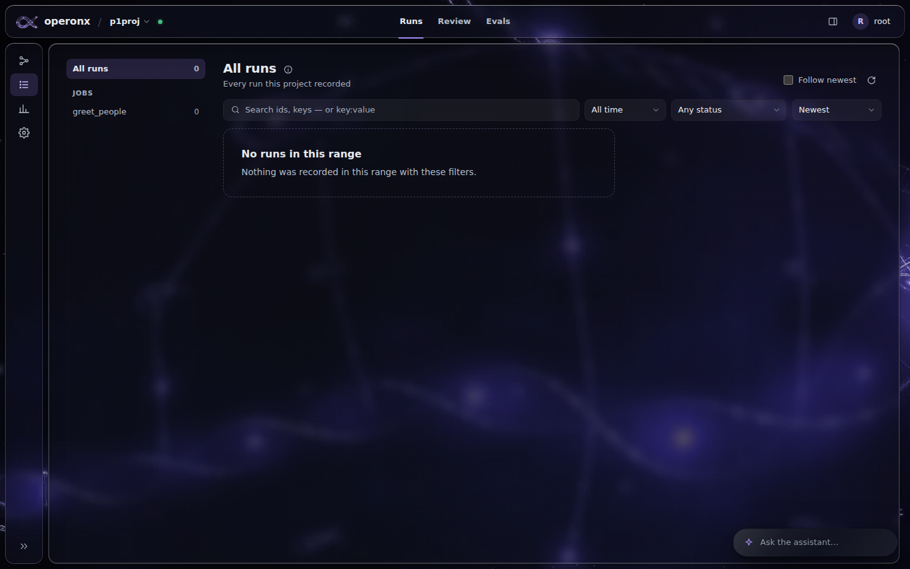
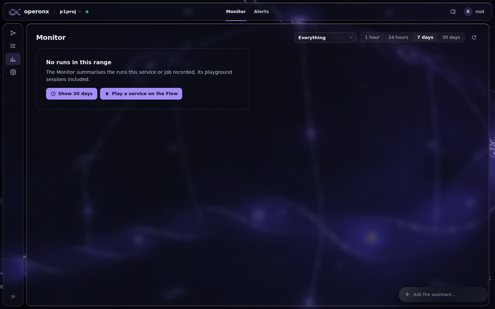
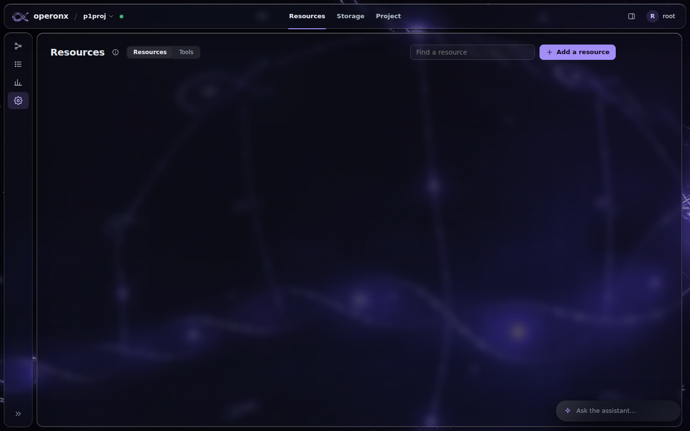
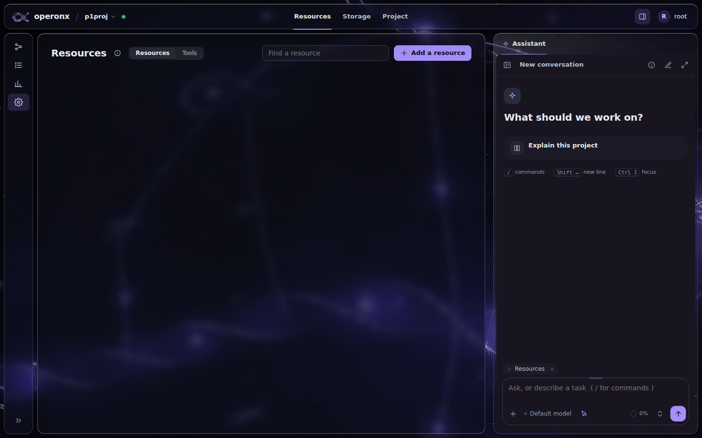
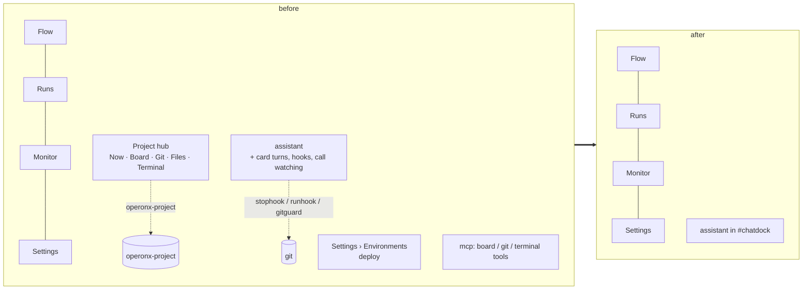

# P1 — the studio cut

Part 1 of [LEAN_PRODUCT_PLAN](https://github.com/batman1m2001-cyber/Operonx/blob/main/docs/LEAN_PRODUCT_PLAN.md) §5.
The studio stops being a place to *write code* (board, git, terminals, hooks, deploy) and keeps what
shows the *product* — Flow, Runs, Monitor, Settings — plus the assistant in its dock.
Rollback point: tag `pre-lean-product`.

**Net: 83 files, +173 / −10,912 lines (−10,739)**, not counting this write-up and its screenshots.

## Result

| Gate | Result |
|---|---|
| studio tests green | Python 710 passed, 0 failed, 5 skipped (was 870 + 1 failing `test_stophook`; the 12 removed test files held 160); JS 227/227 |
| `git grep operonx_project` empty | empty (code, tests, packaging; only docs/ history mentions it) |
| stable chrome | rail = Flow · Runs · Monitor · Settings on every hub; no Project / Board / Environments item |
| dark screenshots of the 4 hubs | below, 0 page errors |
| old addresses | `/p/<id>/board`, `/project` → Flow; `/environments` → Settings › Resources |
| live studio restart | waits for the owner's OK |

| Flow | Runs |
|---|---|
|  |  |
| **Monitor** | **Settings** |
|  |  |

The assistant stays in the `#chatdock` dock, opened from the top bar:


## Before → after



```
operonx_studio/                         operonx_studio/
├── app.py            (−187)            ├── app.py
├── access.py         (31 routes off)   ├── access.py
├── assistant.py      (−363)            ├── assistant.py
├── chat.py                             ├── chat.py
├── mcp.py            (19 tools off)    ├── mcp.py
├── basecheck.py      ✗                 │
├── deploy.py         ✗                 │
├── environments.py   ✗                 │
├── files.py          ✗                 │
├── gitguard/         ✗                 │
├── gitpolicy.py      ✗                 │
├── gitview.py        ✗                 │
├── progress.py       ✗                 │
├── projectboard.py   ✗                 │
├── runhook.py        ✗                 │
├── stophook.py       ✗                 │
├── terminals.py      ✗                 │
├── testreport.py     ✗                 │
├── guide/board.md    ✗                 ├── guide/
└── static/                             └── static/
    ├── board.js         ✗                  ├── assistant.js, shell.js, router.js,
    ├── environments.js  ✗                  │   choreo.js, hand.js, progress.js …
    ├── gitview.js       ✗                  ├── project.html (4 hubs)
    ├── projectmode.js   ✗                  └── studio.css (−474)
    ├── terminal.js      ✗
    ├── waiting.js       ✗
    └── vendor/xterm/    ✗
```

## Files changed

**Removed** — the modules above, their 12 tests (`test_basecheck, test_board, test_environments,
test_files, test_gitpolicy, test_gitview, test_progress, test_runhook, test_stophook,
test_terminals, test_testreport, test_turn_leftovers`), `static/vendor/xterm`.

| File | Change |
|---|---|
| `app.py` | board/git/files/terminal/environment/deploy/hook routes gone; `GET env-health` and `POST /api/new` stay; `ui_action` no longer knows `open_board` |
| `access.py` | 31 route entries gone (incl. `/brd`, `/project/*`) |
| `assistant.py` | no live call watching, no card turns, no hooks; `SAVE_PROMPT` rewritten without the board |
| `chat.py` | no card worktrees, no gitpolicy env |
| `mcp.py` | 19 tools gone (board, git, terminal, files, deploy) |
| `guide/building.md`, `page.md`, `steps.md`, `knowledge.md` | operonx-project instructions and Project-page text gone |
| `static/project.html` | Now/Board/Git/Files/Terminal hubtabs, Environments tab, Project rail button and their panes/scripts gone |
| `static/home.html` | `waiting.js` gone |
| `static/shell.js`, `router.js`, `studio.js` | old `board`/`project` addresses → Flow, `environments` → Resources; no page routing |
| `static/assistant.js` | no worktrees, per-call Stop, board link, Project-mode placement; file links copy `path:line` |
| `static/choreo.js` | `steps`/`changed`/board columns gone; api = `{where, opSteps, inputOf, focus, changedParams}` |
| `static/hand.js`, `progress.js` | page / board-card targets gone |
| `static/studio.css` | −474: rules whose every selector was Project mode or a removed screen |
| `pyproject.toml` | `builder` extra and the `operonx-project` path source gone |
| `operonx_studio_toolkit/templates.py` | `OPERONX_PIN` 1.17.1 → 1.31.0 |
| `install.sh`, `README.md` | no operonx-project install step / Project hub text |
| `tests/js/*.test.mjs`, `tests/studio/test_access.py`, `test_assistant.py` | follow the cuts (admin routes 8 → 7) |

## Deviations from the plan

- **Kept** `assistant._plan` and `static/progress.js`: they draw the assistant's steps card, not the board.
- **mcp** lost 19 tools, not 18 (the plan's count missed one).
- **Also cut**, not named in the plan: `guide/board.md`, the board text in `knowledge.md`, `steps.md`, `page.md`;
  `test_turn_leftovers`, `test_terminals`; the install step in `install.sh` and README.
- **File links** in the assistant copy `path:line` and toast, since there is no Files page.
- **Point targets** are the screens that remain (`setting op run job eval field page tab`); `card:` is refused. The per-call stop route went with call watching (self routes 12 → 11).
- **Old addresses redirect** (`/board`, `/project`, `/environments`) so bookmarks land somewhere.
- **CSS** was cut mechanically (a filter over selectors), then the Flow rules that used `:not(.pmode)` were kept with it stripped.
- **Left for P4**: `center` placement in `assistant.js` and the per-call progress UI are now unused but harmless.
- **Kept** the `x-operonx-via` header; the older ruff F errors (`app.py` ProjectRef / probe_port, `layout.py`, `render.py`, `safewrite.py`) are untouched.
