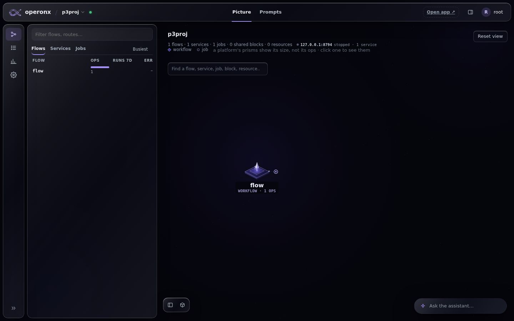
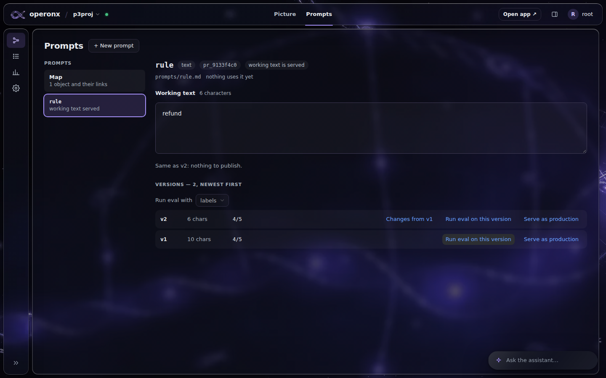
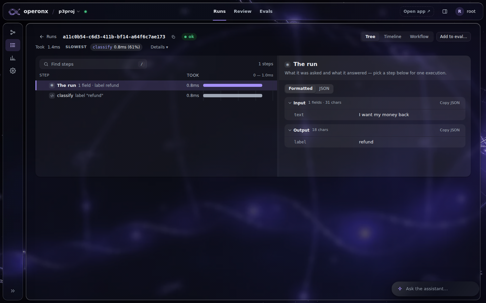
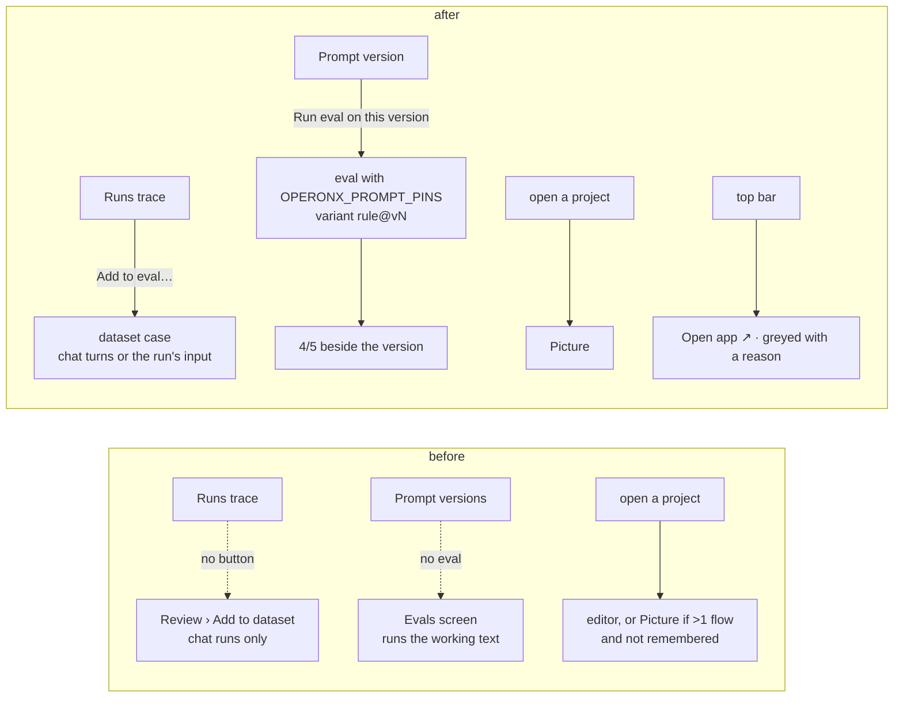

# P3 — the loop as plain buttons

Part 3 of [LEAN_PRODUCT_PLAN](https://github.com/batman1m2001-cyber/Operonx/blob/main/docs/LEAN_PRODUCT_PLAN.md) §5.
The improve loop, with no model in it: see a bad run → **Add to eval** → change a prompt → publish →
**Run eval on this version** → read the pass rate beside the version → serve it. Plus **Open app ↗**
and the Picture as the first screen.

**Net: 13 files, +272 / −24 lines (+248)**, not counting this write-up and its screenshots.
Budget for P3 + P4: ~3,580 lines, so ~3,330 are left for P4.

## Result

| Plan item | Result |
|---|---|
| a project opens on the Picture | yes, for one flow or many, unless the address names an op (`?op=`) |
| **Open app ↗** in the top bar | always there; greyed with the reason (no `web/`, no port, not running); live = a link to the running service's `/` in a new tab; no iframe |
| **Add to eval** on a Runs trace | button on every run page; same dialog and route as Review's Add to dataset |
| **Run eval on this version** | one button per prompt version; `{"prompts": {"rule": 2}}` → `OPERONX_PROMPT_PINS=rule=2`; names and versions checked first |
| pass rate beside each version | `4/5` (passed trials / trials) from that version's newest experiment |
| no paid calls except the eval's own | none added |
| gate: the owner does one real loop | **the owner's** |

Checked in a real browser (headless Chromium, dark, demo project with `web/`, an Eval and a prompt with
v1 "money back" / v2 "refund"; 0 page errors). Each version scored 4/5, and those are different cases:
v1 misses "please refund me", v2 misses "I want my money back". Those are the numbers worked out by hand.

| Opens on the Picture | Versions with Run eval and the pass rate |
|---|---|
|  |  |
| **A run, with Add to eval…** | **Open app ↗ while the app runs** |
|  |  |

Tests: `test_run_eval_on_one_prompt_version_pins_it_and_names_it` (pins, variant, 400s; skips on
operonx < 1.47), `test_a_runs_trace_that_is_not_a_conversation_is_added_to_an_eval_with_its_own_input`,
`test_services` (the `app` answer), JS `a prompt version's newest experiment…`.

## Where it differs from the plan

- **Run eval's route is `POST evals/{name}/run`**, the route the Evals screen already uses, not a new `jobs/` one.
- **Versions are read back by the experiment's `variant`.** A pinned run is labelled `rule@v2`, so the
  pass rate finds its version without a new field. A run with several pins is labelled with each, space-separated.
- **Run eval refuses (409) on a project whose operonx is older than 1.47.0.** Older versions ignore
  `OPERONX_PROMPT_PINS` and would score the working text under a version's name.
- **Add to eval works on any run, not only conversations.** Review's route took the user's chat turns
  only, and most flows have none. It now falls back to the run's own input (exact, read off the edges
  from the graph), the way an Eval hands a case back to the graph.
- **The Picture always comes first.** The remembered "last screen was the editor" and the "only with more than one flow"
  rules are gone, and Esc in a flow goes back to the Picture in every project.
- **Open app** needs a `web/` folder, so a project with an API only gets the reason. A service bound to
  `0.0.0.0` / `localhost` opens on the studio's own host name. Through the public tunnel, the app's
  port may not be reachable.

## Before → after

## Code changes

| File | Change |
|---|---|
| `evals.py` | `prompt_pins()` checks `{"name": version}` against the prompt files; `eval_start` sets the variant, checks the project's operonx reads pins, passes `OPERONX_PROMPT_PINS` |
| `app.py` | `services` answers `app: {web, key, host, port, running}`; Add to dataset falls back to `_run_inputs()` |
| `static/prompts.js` | "Run eval with [eval]" line; per version: pass-rate cell, Run eval button, polls until its experiment lands |
| `static/experiments.js` | `byPromptVersion()`, `passOf()` |
| `static/review.js`, `static/runview.js` | `ReviewView.addToDataset(run)`, shared by Review and the run header's **Add to eval…** |
| `static/project.html`, `static/services.js`, `static/studio.css` | `#btn-app` and its state |
| `static/factory.js` | the Picture is the landing screen |
