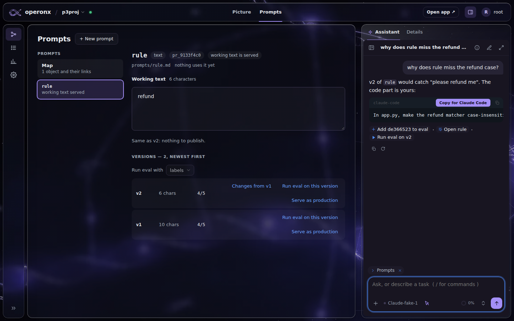
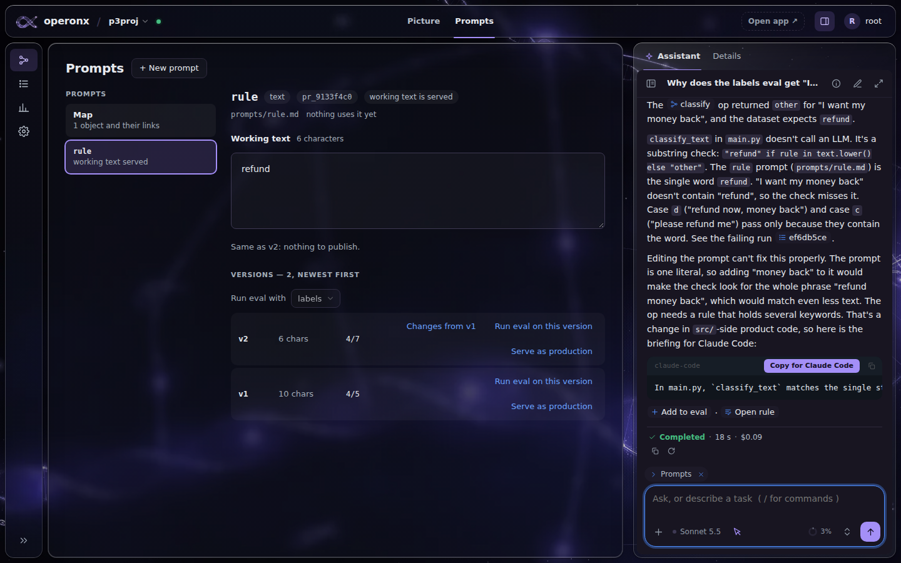
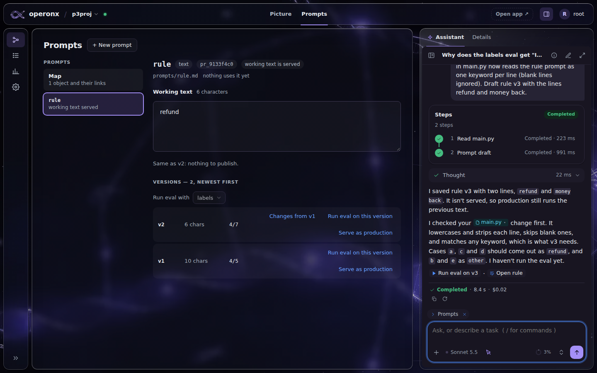
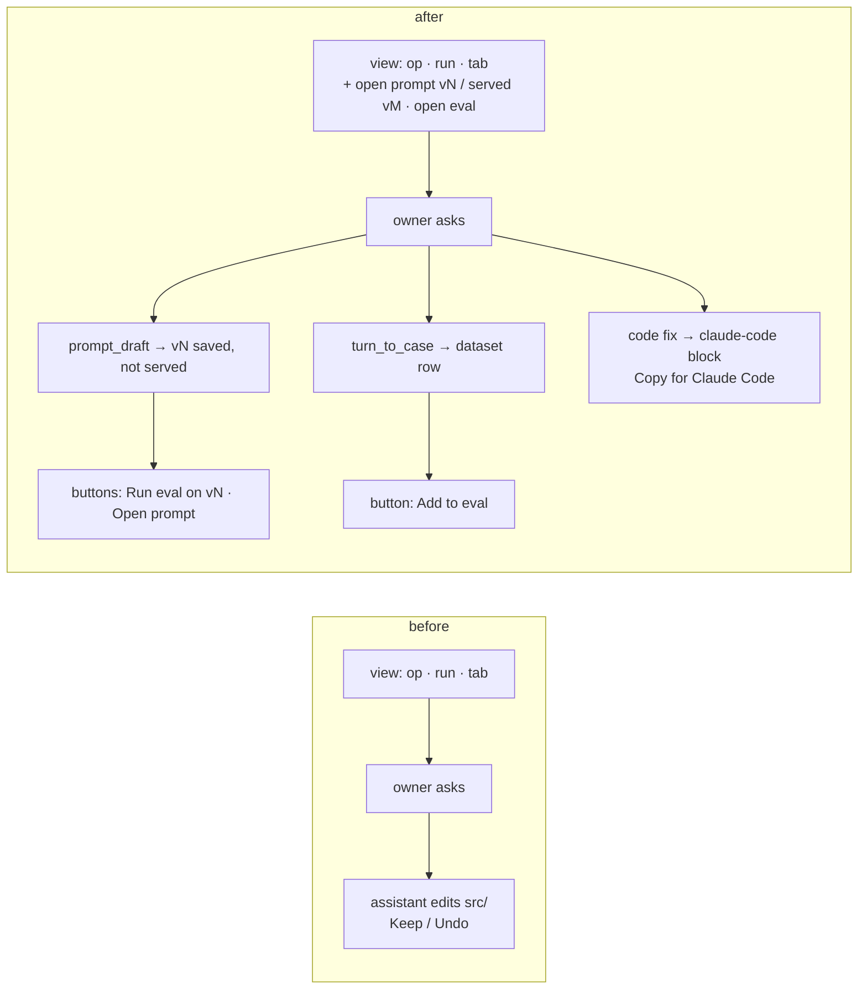

# P4 — the assistant on the loop

Part 4 of [LEAN_PRODUCT_PLAN](https://github.com/batman1m2001-cyber/Operonx/blob/main/docs/LEAN_PRODUCT_PLAN.md) §5.
The assistant does two jobs on P3's loop and ends its answers with P3's buttons. The product's code
is the owner's and Claude Code's: a fix that needs code ends as one block with **Copy for Claude Code**.

**Net: 17 files, +199 / −41 lines (+158)**, not counting this write-up and its screenshot.
P3 + P4 = +406 against a ~3,580 budget.

## Result

| Plan item | Result |
|---|---|
| the briefing names the open prompt and eval | `- open prompt: \`rule\`, newest version v3, served: v2, edited since its newest version` and `- open eval: \`smoke\``, sent with every message |
| `prompt_draft` tool | saves the text as the next version and **serves nothing new**; opens the prompt; tells the assistant which buttons to end with |
| `turn_to_case` tool | the row Add to eval writes (the user's words, or the run's input); twice adds nothing |
| answers end with P3's buttons | `studio:prompt/<name>`, `studio:runeval/<eval>/<N>/<name>`, `studio:addcase/<run>` are buttons in the answer |
| Copy for Claude Code | a ` ```claude-code ` block gets the button; it copies the block and says where to paste it |
| no Edit/Write on `src/` | every project turn passes `--disallowedTools Edit(./src/**) Write(./src/**) MultiEdit(./src/**) NotebookEdit(./src/**)` |
| gate: ~10 dock turns (~$3) | **passed 2026-11-24** with the owner's OK: 5 real Sonnet turns, **$0.14**, one question answered and acted on ([below](#the-gate-five-real-turns)) |

Checked in a real browser (headless Chromium, dark, P3's demo project). The model was a fake `claude`
that answers with fixed markdown, so no paid calls were made. 0 page errors. Each button was checked:

- The view sent was `{name: "rule", version: 2, served: null, edited: false}`.
- **Copy for Claude Code** put the block's text on the clipboard.
- **Open rule** opened the prompt.
- **Add … to eval** added a row to `labels` with `from.run` set to that run.
- **Run eval on v2** (after a confirm) started a `rule@v2` experiment.



## The gate: five real turns

Run on 2026-11-24 with the owner's OK, on a scratch studio (P3's demo project, real `claude`, Sonnet).
The question was why the `labels` eval gets "I want my money back" wrong. The answer was then acted on
from the dock, button by button. 0 page errors.

| # | Asked | What the assistant did | Cost |
|---|---|---|---|
| 1 | Why does `labels` get "I want my money back" wrong? | Read the code, the runs and the dataset. Found it: `classify_text` substring-matches the whole prompt, so one keyword is all it can hold. Ended with a `claude-code` block and the buttons for the op, the run, Add to eval and Open rule | $0.09 |
| 2 | Make sure that miss is a case | Case `a` already covers it, so it added nothing. It pointed out the duplicate row from an earlier Add to eval, which has no `expected` | $0.01 |
| 3 | Can a new rule version alone fix it? | **No.** It refused to draft one, because the eval would get worse until the code changes. It repeated the Claude Code block | $0.01 |
| — | (acted on) | **Copy for Claude Code** put the block on the clipboard. **Open rule** opened the prompt. The block was applied to `main.py` as written (one keyword per line, blank lines ignored) | — |
| 4 | Code is changed; draft rule v3 with `refund` and `money back` | Read `main.py` to check the change, then `prompt_draft` saved v3 without serving it. It pinned the working text as v2 first. Ended with **Run eval on v3** | $0.02 |
| — | **Run eval on v3** (confirm) | experiment `rule@v3`: cases **a–e all pass**, and `a` flips other → refund | — |
| 5 | Delete the duplicate case | Deleted it. It named the second no-`expected` row and left it, since it had not been asked | $0.01 |





Found on the way, for later:

- **A row without `expected` counts as a failed trial.** The v3 run said "2 of 7 trials failed". The
  two failures were Add to eval rows with the right output and nothing to check against. Add to eval
  writes rows like that, so the eval's verdict is wrong until someone fills in `expected`.
- Right after Run eval on v3, the v2 row's **production** badge overlapped "Changes from v1" for a
  moment, while the list redrew.

Tests:

- `test_the_assistant_drafts_a_prompt_version_that_is_not_served`: pins first, v2 is not served, the same text twice adds nothing, unknown name.
- `test_the_assistant_turns_a_run_into_a_case`
- `test_a_turn_becomes_items_that_persist_and_restore`: the briefing lines.
- the editor-turn deny list in the viewer test.

A `studio_tool` fixture in `tests/studio/conftest.py` calls any assistant tool against the TestClient.

## Where it differs from the plan

- **`prompt_draft` pins first.** If a prompt is served from its working text, its text as it is now
  becomes v1, labelled production, before the draft is written. Without that, the draft would go live
  on the next restart. The tool says when it did this.
- **`run_eval` is unchanged.** It still runs a job's working text. Running a version is the
  **Run eval on vN** button, so the eval's own model calls start from a click, behind a `confirm()`.
- **Bash can still write `src/`.** The deny covers the file tools. The briefing, `knowledge.md` and
  `guide/building.md` cover the rest: "src/ is closed to your file tools … one fenced block of language claude-code".
- **`guide/building.md` is rewritten** as "Working with the owner": the two jobs, their buttons, the
  `claude-code` block, `point`. The plan-doc and commit routine it described is gone, along with the
  Keep / Undo code-edit text in the briefing.

## Before → after



## Code changes

| File | Change |
|---|---|
| `mcp.py` | `prompt_draft`, `turn_to_case` and their schemas |
| `chat.py`, `assistant.py` | `CODE_DENY`, always passed with `--disallowedTools` |
| `app.py` | briefing: the two tools, the end-with-buttons links, the `claude-code` rule; `_view_lines` adds the open prompt and eval |
| `knowledge.md`, `guide/building.md` | the code is the owner's and Claude Code's; the two jobs and their buttons |
| `static/assistant.js`, `static/studio.css` | link icons; the `claude-code` block and its **Copy for Claude Code** button |
| `static/shell.js` | `studio:prompt/…`, `studio:addcase/…`, `studio:runeval/…`; the `open_prompt` screen action |
| `static/studio.js`, `static/prompts.js`, `static/evals.js` | the view carries the open prompt (version, served, edited) and eval |
