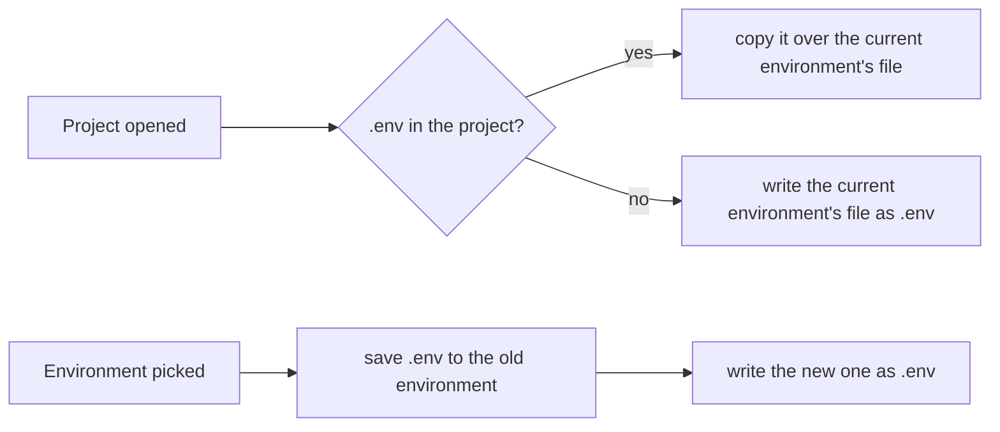
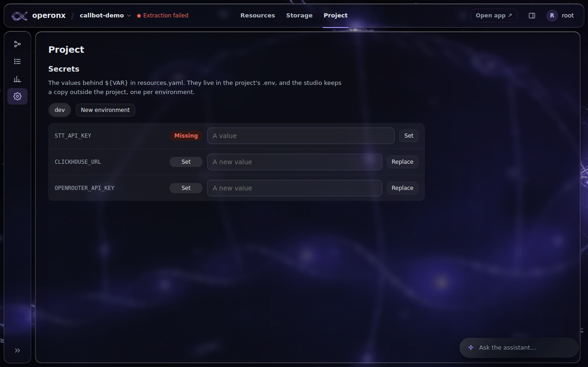

# PROJECT_SOURCE_PLAN S1: secrets outside the project

Plan: Operon `docs/PROJECT_SOURCE_PLAN.md`. Gate: a secret set in studio survives the project
losing its `.env`; a value never appears in a response.

## What changed

The project's `.env` is still what everything reads. The studio now keeps a copy of it in its own
state, one file per environment, and puts it back when the project has none.

```text
before                                after
proj/.env      the only copy          proj/.env                               what runs (unchanged)
                                      ~/.operonx/secrets/<project id>/
                                      ├── dev.env        0600                 a copy per environment
                                      ├── staging.env
                                      └── current        "dev"                which one .env holds now
```



A hand edit of `.env` wins: it is what runs, so it is saved, never overwritten by an older copy.

## Code

| File | What |
|---|---|
| `operonx_studio/secrets.py` (new) | `sync`, `use`, `add`, `describe`; names only leave the module |
| `operonx_studio/app.py` | `GET secrets`, `POST secrets/use`, `POST secrets/environment`; `POST env` and opening a project call `sync` |
| `operonx_studio/access.py` | the three routes: read, edit, edit |
| `static/secrets.js` (new) | Settings › Project: the environment picker and one row per name (the tab was empty before) |
| `tests/studio/test_secrets.py` (new), `test_app.py`, `test_access.py` | the gate, the routes, 50 edit routes |



## Not done here

The "used by" column of the mock: the IR gives the names a project asks for, not which resource
asks for each. Names that only `.env.example` lists are shown as well.
