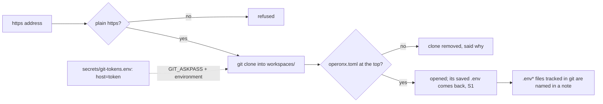
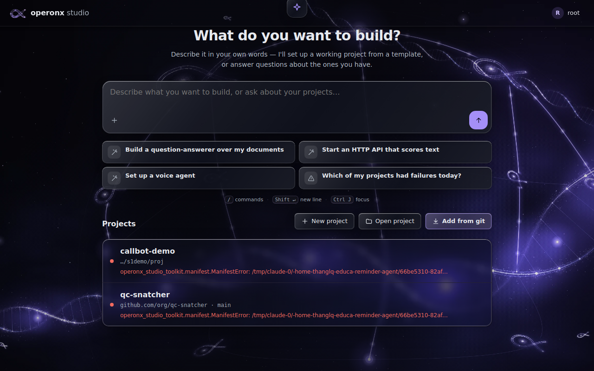
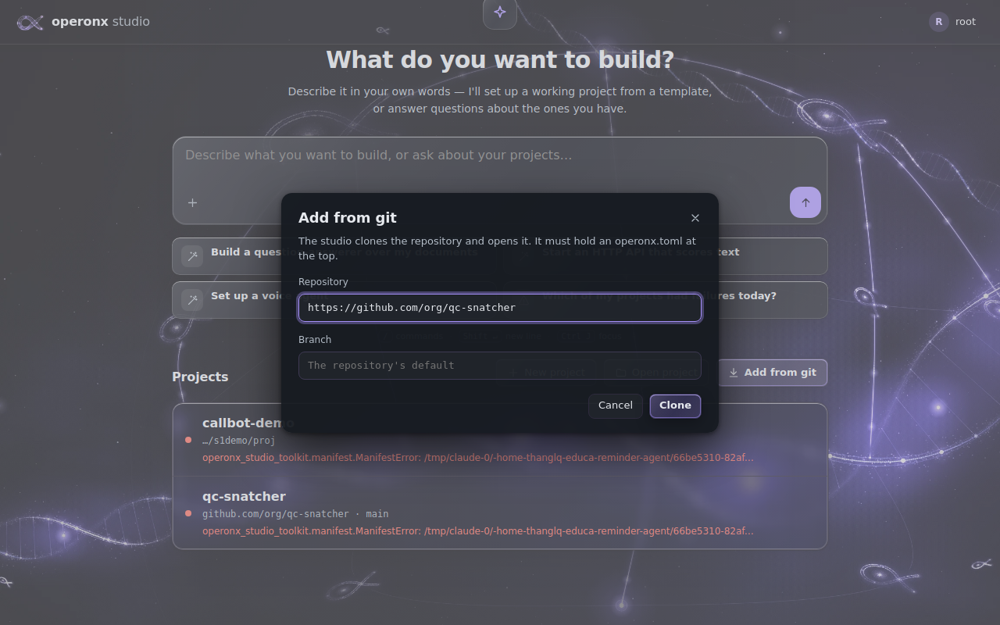

# PROJECT_SOURCE_PLAN S2: add a project from git

Plan: Operon `docs/PROJECT_SOURCE_PLAN.md`. Gate: a repository added from its address on an empty
state opens as a project.

## What changed

```text
before                                   after
a project = a folder someone put         Add from git: an https address (+ branch)
on the server, opened by its path        → cloned into ~/.operonx/workspaces/<name>-<hash>/
                                         → opened like any folder
```



- **Token**: one line per host in `<state>/secrets/git-tokens.env` (0600). It reaches git through
  `GIT_ASKPASS` and the environment only, never a command line, a URL or `.git/config`. A refused
  sign-in says which line to add.
- **Where a project comes from** is read from the folder's own `.git` files, so a folder someone
  cloned by hand shows its remote and branch on the home page too.
- **The project id** stays the digest of the folder's path (not of the address, as the plan first
  said): nothing else in the studio had to change, and a state folder copied to the same path on
  another server keeps every id.

## Code

| File | What |
|---|---|
| `operonx_studio/gitsource.py` (new) | `clone`, `source`, `tokens`, `tracked_env_files`, `git` |
| `operonx_studio/app.py` | `POST /api/clone`; every project row carries `source` |
| `static/home.js`, `home.html` | the Add from git button and dialog; a row shows `remote · branch` |
| `static/studio.css`, `studio-dark.css` | `button.tinted`: the leading action is glass with a lavender tint, not a solid accent block; dialogs are nearly solid where there is no GPU (they were see-through) |
| `tests/studio/test_gitsource.py` (new) | 11 tests against a local repository standing in for the remote |



