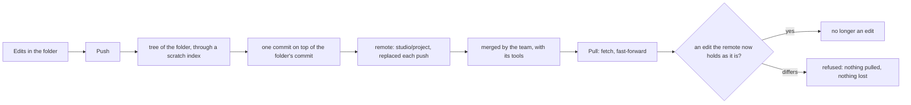
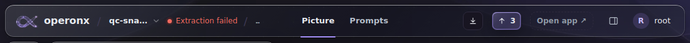

# PROJECT_SOURCE_PLAN S3: Pull and Push

Plan: Operon `docs/PROJECT_SOURCE_PLAN.md`. Gate: an edit made in the studio arrives on the remote
as a branch, only after Push. All the git the studio does; no branch picker, no commit screen
(LEAN_PRODUCT_PLAN).

## What changed

```text
before                                 after
an edit made in the studio stayed      the bar has Pull and Push
in the server's folder                 Push → studio/<project> on the remote, one commit
                                       Pull → the folder's branch, fast-forward only
```



- **Push never commits on the folder's branch and never touches the default one.** The edits stay
  edits in the folder; they stop being edits when they come back by a pull.
- **Never sent, whatever `.gitignore` says:** `.env` (secrets) and `.operonx/` (runs and caches).
  A real push in a scratch studio caught the second: the run index was going along.
- **Pull is fast-forward only.** Edits to files the remote did not change stay. A clash refuses
  the pull and names the files.
- The buttons are always in the bar, greyed with the reason when there is no remote or nothing to
  push. Push is tinted glass, with the number of edited files, only while edits wait. Under 1100 px
  the bar has no room (the tabs share the row with the crumbs) and they are not shown.
- After a push a toast offers **Open merge request** (GitHub compare page, GitLab new merge request).

## Code

| File | What |
|---|---|
| `operonx_studio/gitsource.py` | `status`, `pull`, `push`, the merge page of each host |
| `operonx_studio/app.py`, `access.py` | `GET git` (read), `POST git/pull`, `POST git/push` (edit) |
| `static/gitbar.js` (new), `project.html`, `studio.css` | the two buttons |
| `tests/studio/test_gitsource.py` | +4: the studio branch, the folder left alone, pull keeps/drops/refuses |


