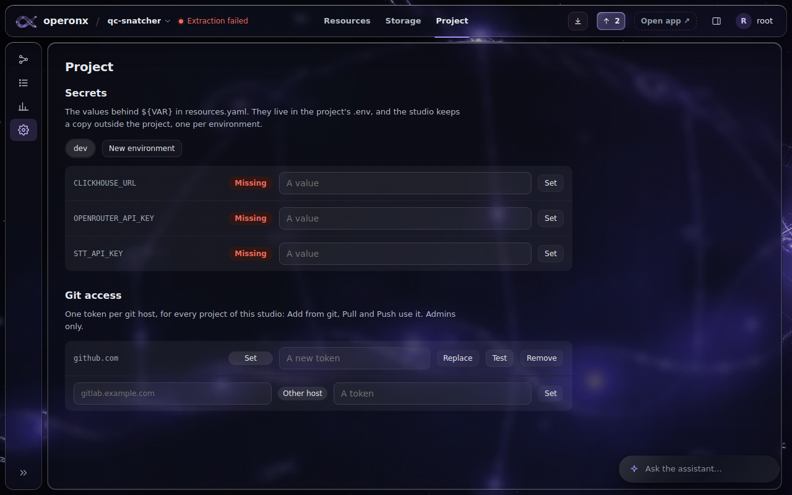
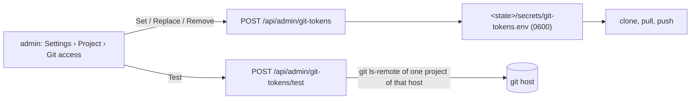

# Git access: a host's token is set in the studio

After S3. A token used to be a line an admin wrote into `<state>/secrets/git-tokens.env` over SSH;
a wrong or expired one stopped Add from git, Pull and Push until someone did. It is now a section
of Settings › Project, for admins.





- One row per host: every host that has a token, and every host a project comes from. A last row
  takes a host no project comes from yet.
- A token is typed and never sent back: the routes answer host names and set/missing only, and the
  activity log keeps the host, not the token.
- **Test** asks the host for the branches of one project that comes from it, with the token it has.
  The answer says which case it is: it answers, it refused the token (wrong or expired), or it asks
  for a sign-in (no token).
- Editors and viewers do not see the section; the three routes are `admin` in `access.py`.
- The messages of a refused clone, pull or push now point here, not at the file.

```text
operonx_studio/gitsource.py     set_token(), test_token(); the refusal messages
operonx_studio/app.py           GET/POST /api/admin/git-tokens, POST /api/admin/git-tokens/test
operonx_studio/access.py        the three routes, admin
operonx_studio/users.py         the activity log keeps "host"
operonx_studio/static/secrets.js  the section
```

Checked in a scratch studio against github.com: a wrong token answers "refused its token", none
answers "asks for a sign-in"; at 1280, 800 and 400 px nothing overflows; a viewer has no section.
