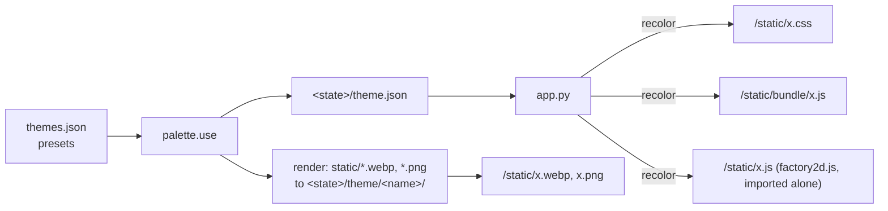
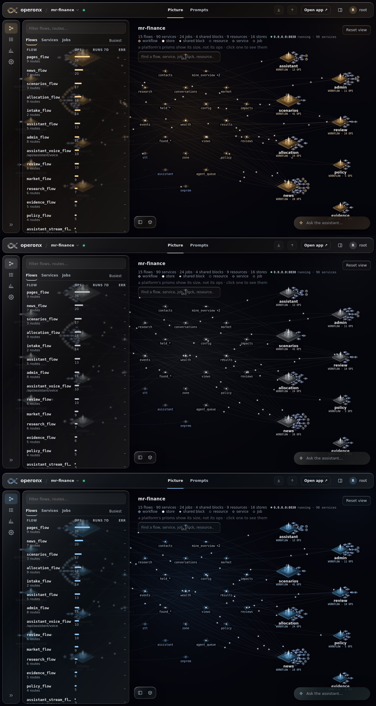
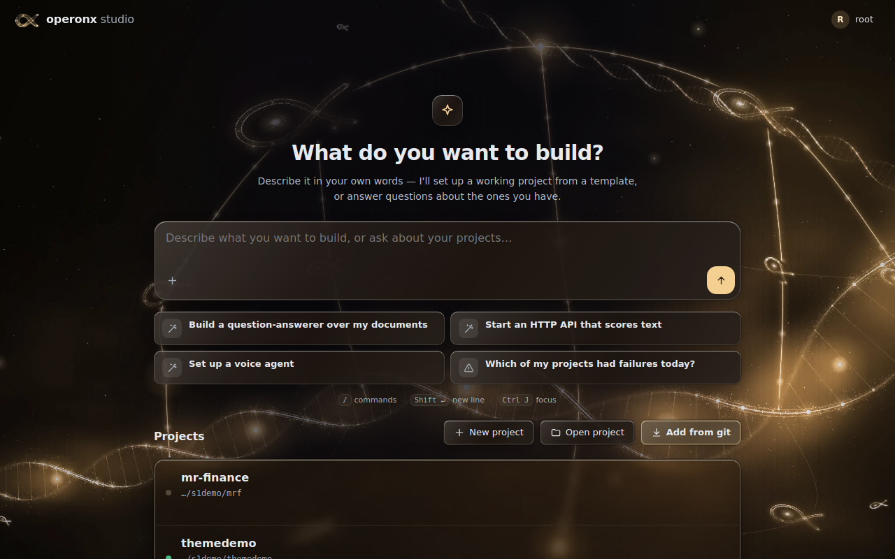

# Colour theme presets

The studio's lavender is now one setting. Presets: `lavender` (as drawn), `golden`, `platinum`,
`blue`; or any hue. How to use it: `.claude/skills/studio-theme/SKILL.md`.

```bash
uv run --with pillow --with numpy python -m operonx_studio.palette golden
```

## Flow



Nothing in `static/` changes. A colour is turned when its hue is 226–295° (lavender): the new hue
is the preset's, and the small differences between the lavenders are kept at half size. Type
colours (blue calls, red errors, green status) stay.

## Files

```text
operonx_studio/
├── themes.json     new   the presets
├── palette.py      new   recolor(), render(), use(), the command
├── app.py                the theme is part of the asset version; .css, the bundles, single .js
│                         and the pictures are served in the theme
└── access.py             three open routes: /static/{name}.js, .webp, .png
.claude/skills/studio-theme/   SKILL.md, scripts/shots.py
tests/studio/test_palette.py   new; test_app.py: one test
```

## Checked

The Picture of mr-finance (15 flows, 90 services), golden / platinum / blue:





Found on the way: the Picture's code (`factory2d.js`) is imported by itself, outside the page's
bundle, so it stayed lavender until single scripts got a themed route.

Not done: a light ("white") theme. The studio is dark only; that is a separate piece of work.
